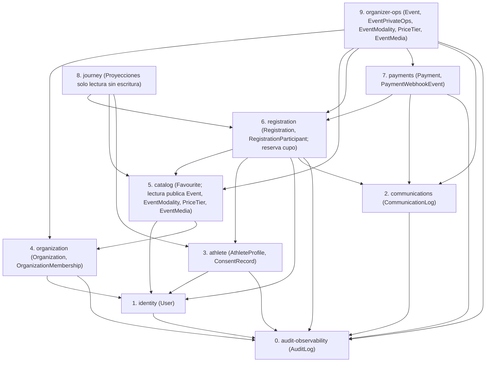
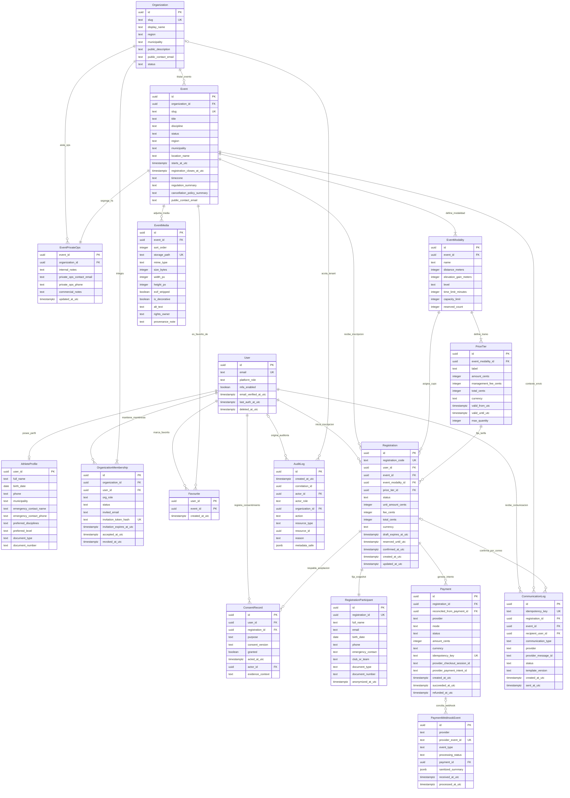
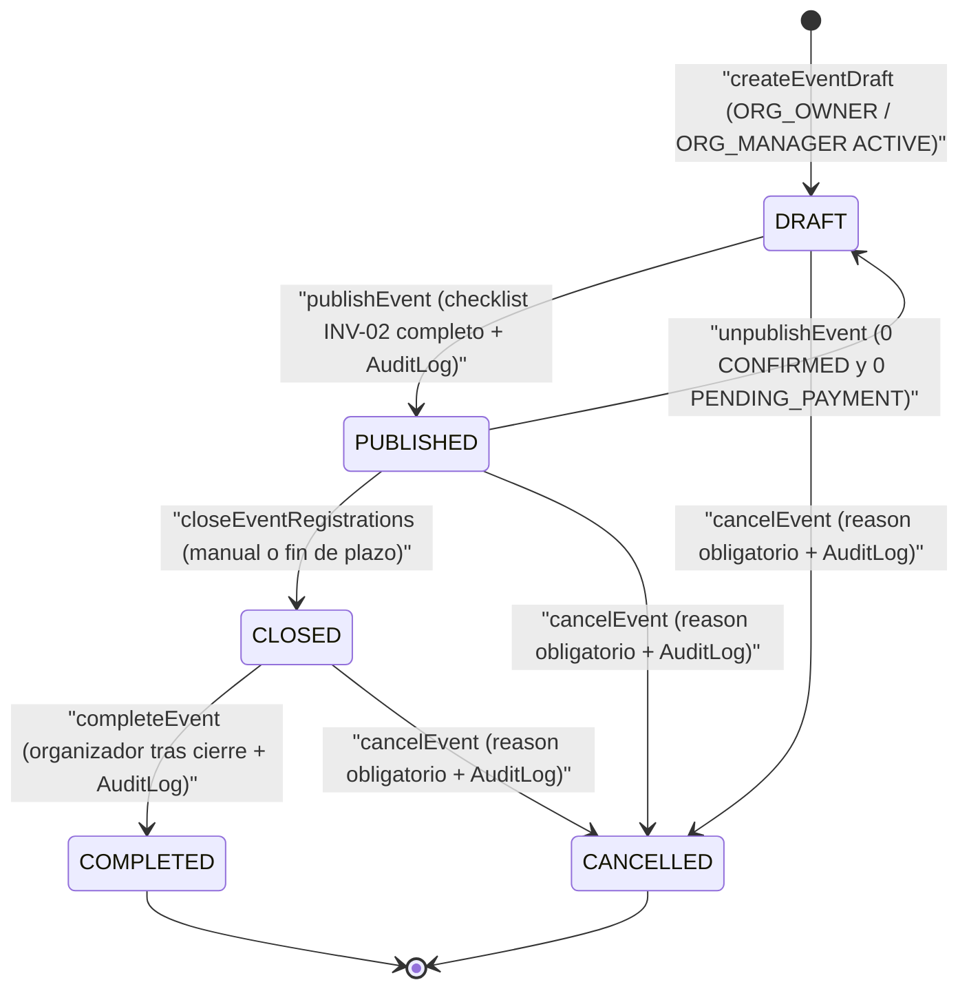
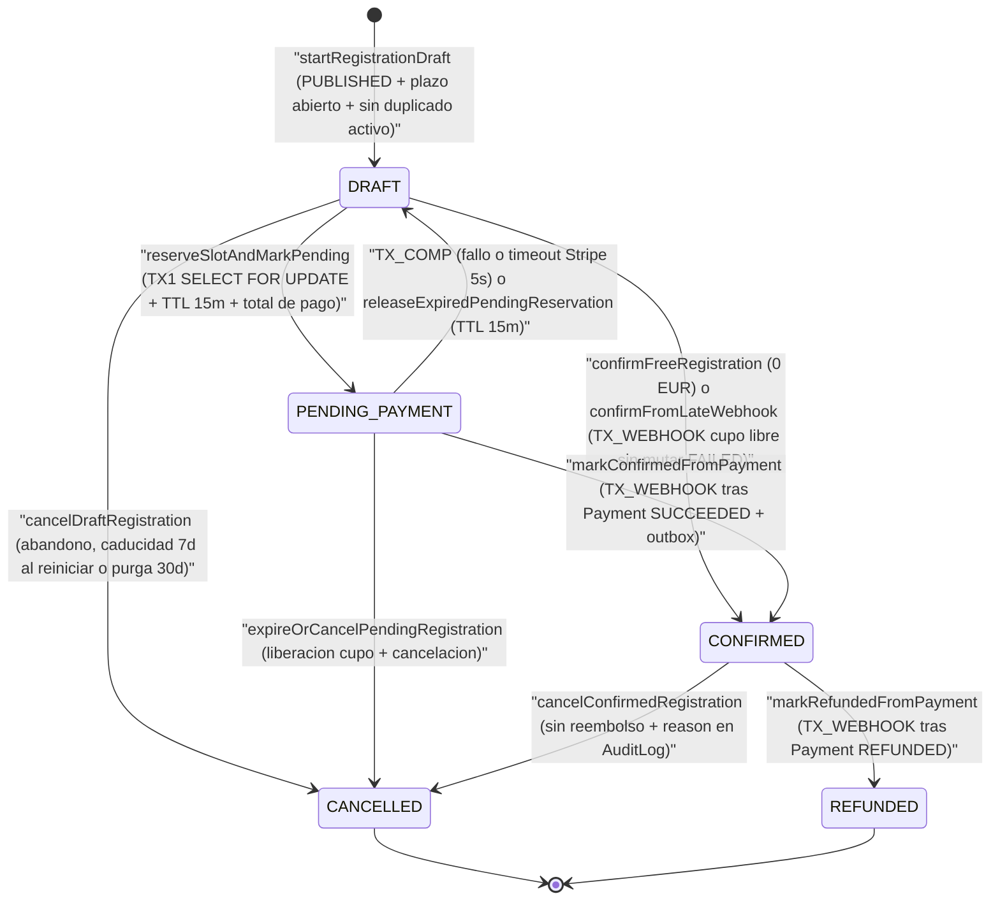
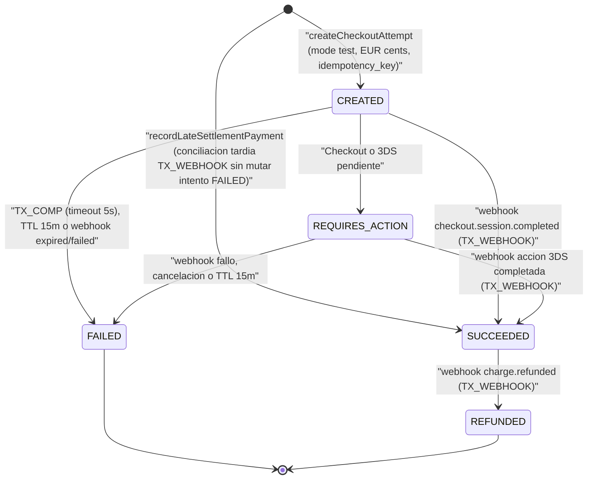
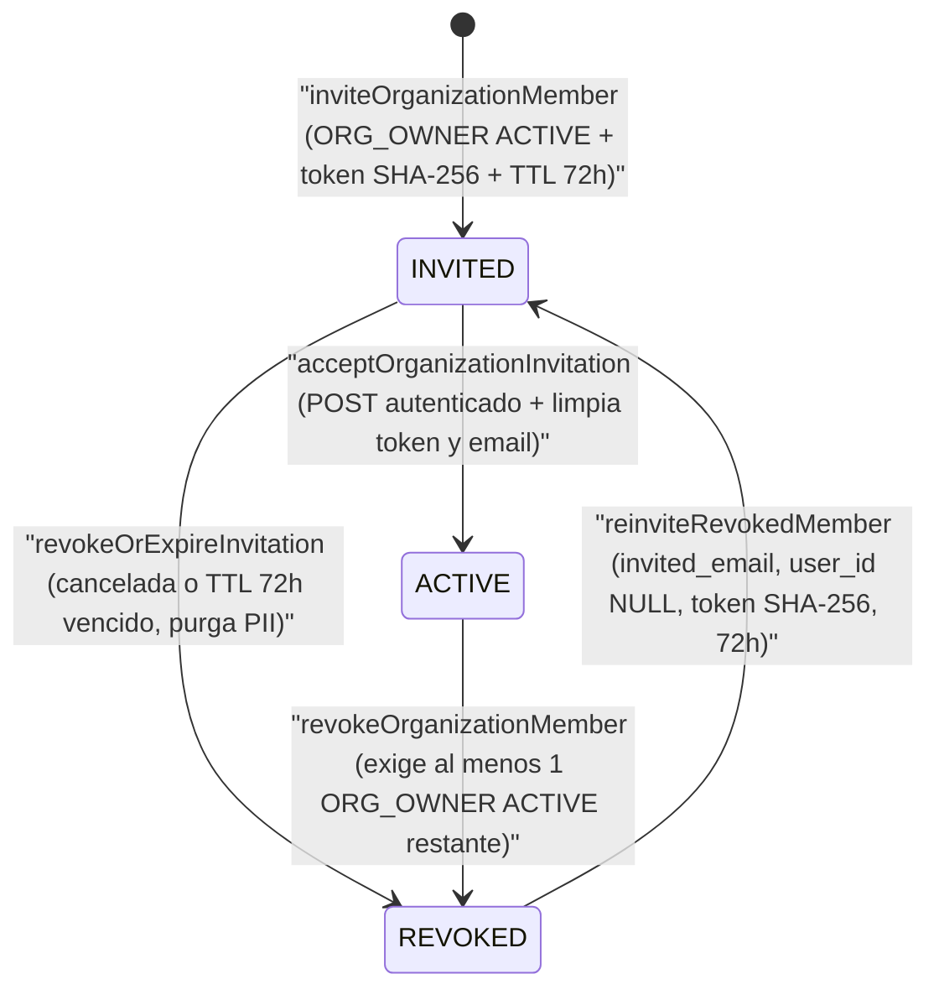

# Modelo de Dominio, Relaciones, Máquinas de Estado e Invariantes V1 — OAK

- **Paquete origen:** `P1-008` (Fase 1 — Contrato de producto, marca y arquitectura)
- **Versión:** `1.1` (revisión post-`PEER_REVIEW` ronda 1: `P1-008-REV-01`, `P1-008-REV-02` y ajustes `P3`)
- **Estado:** Entregado para revisión independiente (`PEER_REVIEW` por `auditor-no-funcional`, previo a certificación de `release-guardian`)
- **Owner:** `arquitecto-seguridad` (`ARCH` / `SEC`)
- **Decisión de alcance `D0`:** `APPROVED` (`2026-11-20`, `docs/agentic/DECISION_LOG.md`)
- **Estado de Gate `D1`:** `PENDING USER VALIDATION` (se resuelve en `P1-012`; prohibida su auto-aprobación aquí)
- **Línea base previa:** `G0 = PASS` (`P0-010`) y `P1-001`..`P1-006` = `ACEPTADA` (`origin/master @ b94307ea0f251fd8696f66941dd87aa16272dd7a`)
- **Consumidores directos:** `P1-009` (contratos de casos de uso, API y eventos), `P1-011` (revisión de seguridad del diseño), `P1-012` (validación `D1`), `P1-013` (congelación de contrato) y `P2-002` / `P2-006` (migración SQL inicial y RLS)
- **Fuentes normativas vinculantes:** `AGENTS.md`, `docs/agentic/DECISION_LOG.md`, `docs/agentic/MASTER_EXECUTION_PLAN.md` (§4, §7.1–§7.6), `docs/agentic/QUALITY_GATES.md`, `docs/architecture/SYSTEM_ARCHITECTURE.md`, `docs/adr/ADR-001-stack-and-modular-monolith.md`, `docs/adr/ADR-002-canonical-commands-and-environments.md`, `docs/adr/ADR-003-auth-tenancy-and-integrations.md`, `docs/adr/ADR-004-migrations-recovery-and-budgets.md`, `docs/product/V1_SCOPE_AND_EXCLUSIONS.md`, `docs/product/PERSONAS_AND_DATA_CATALOG.md`, `docs/product/FUNCTIONAL_ACCEPTANCE_CRITERIA.md`, `docs/brand/INFORMATION_ARCHITECTURE_AND_ROUTES.md` (§3.4–§3.5), `docs/security/DATA_CLASSIFICATION_RETENTION.md`, `docs/security/THREAT_MODEL.md` (`NT-01..NT-17`), `data/fixtures/schema.ts`

---

## 1. Propósito, Precedencia Normativa y Regla de Contención V1

Este documento consolida el **modelo formal de dominio V1 de OAK**: contextos acotados y propiedad de escritura dentro del grafo acíclico (DAG) de los `10` módulos, modelo relacional lógico (`erDiagram`) para las **`16` entidades mínimas + `EventPrivateOps`** (`ADR-003` §2.2), catálogo de **Value Objects inmutables**, las **`4` máquinas de estado formales** con matrices exhaustivas de transiciones válidas e inválidas, y el **catálogo formal de invariantes `INV-01..INV-12`** reforzado en tres capas (Dominio/Aplicación, PostgreSQL/Constraints/Locks/`FORCE RLS` y Auditoría/Observabilidad sin PII).

### Reglas vinculantes de alcance

1. **Jerarquía de conflicto (`AGENTS.md`):** En caso de conflicto documental prevalece: (1) `DECISION_LOG.md`, (2) `MASTER_EXECUTION_PLAN.md`, (3) `QUALITY_GATES.md`, (4) `BRAND_UX_CONTRACT.md`, (5) `sites/` solo como evidencia visual histórica. Ningún conflicto se resuelve silenciosamente.
2. **Sin DDL ni contratos de transporte en `P1-008`:** Este documento define la semántica lógica y de integridad de dominio; no contiene migraciones SQL ejecutables (`P2-002`) ni esquemas OpenAPI/Zod de endpoints (`P1-009`).
3. **Frontera `D0` vs `D1`:** Se aplica todo lo cerrado en `D0 = APPROVED` (`trail` y `running` en Comunidad de Madrid, `es-ES`, web responsive `320 px..1440+ px`, Stripe Checkout solo modo `test` en céntimos `EUR` + `0 EUR`, Favoritos `AC-J02-04` incluido, `15` exclusiones `Out-of-Scope V1` fuera del modelo). Los ítems **`D1-07..D1-10`** (incluyendo rutas provisionales `/mis-retos/favoritos` y `/soporte`, políticas finas de cancelación/reembolso y **`blocked_by_D1_09`**) permanecen explícitamente en **`PENDING USER VALIDATION`** hasta `P1-012`.

---

## 2. Contextos Acotados, DAG de los `10` Módulos y Modelo Relacional (`AC-01`)

### 2.1 Grafo Acíclico de Dependencias (DAG) entre los `10` Módulos

Conforme a `SYSTEM_ARCHITECTURE.md` §1–§2 y `ADR-001` §2.3, OAK V1 es un monolito modular único con **cero ciclos** entre módulos y **prohibición absoluta de acceso `Presentación -> Infraestructura/BD` (`NT-16`)**. Toda colaboración entre módulos atraviesa su fachada pública `src/modules/<módulo>/index.ts`; cuando dos agregados deben mutar dentro de la misma transacción PostgreSQL (`TX1`, `TX_COMP`, `TX_WEBHOOK`), el módulo orquestador invoca al servicio público del módulo propietario pasando un manejador de transacción opaco `DbTransaction` (`tx`), sin ejecutar `INSERT`/`UPDATE`/`DELETE` directos sobre tablas ajenas.

### 2.2 Contextos Acotados, Propietario Único de Escritura y Límites de Agregado

|   # | Módulo (`src/modules/*`) | Raíz(ces) de agregado y entidades propias                                                                    | Propietario único de escritura (transaccional)                                                                                                             | Consumidores de lectura pública permitidos (vía `index.ts`)                                                              | Dependencias DAG permitidas                                                                    |
| --: | ------------------------ | ------------------------------------------------------------------------------------------------------------ | ---------------------------------------------------------------------------------------------------------------------------------------------------------- | ------------------------------------------------------------------------------------------------------------------------ | ---------------------------------------------------------------------------------------------- |
|   1 | `audit-observability`    | `AuditLog`                                                                                                   | `audit-observability` (`INSERT`-only; cero `UPDATE`/`DELETE`)                                                                                              | `organizer-ops`, soporte `ADMIN` auditado                                                                                | _(Nivel 0: cero dependencias de negocio)_                                                      |
|   2 | `identity`               | `User`                                                                                                       | `identity` (sincronizado con Supabase Auth `@supabase/ssr`; anonimización coordinada con `athlete`)                                                        | `athlete`, `organization`, `catalog`, `registration`, soporte `ADMIN`                                                    | `audit-observability`                                                                          |
|   3 | `communications`         | `CommunicationLog`                                                                                           | `communications` (inserción outbox en `tx` invocada por `registration`, `payments` u `organizer-ops` + despacho Resend sandbox)                            | `organizer-ops` (historial agregado por lote), `registration` / `ADMIN` (estado puntual)                                 | `audit-observability`                                                                          |
|   4 | `athlete`                | `AthleteProfile`, `ConsentRecord`                                                                            | `athlete` (`ConsentRecord` append-only; `AthleteProfile` borrado/limpiado en supresión RGPD)                                                               | `registration` (precarga revisable en etapa 2), `journey`                                                                | `identity`, `audit-observability`                                                              |
|   5 | `organization`           | `Organization`, `OrganizationMembership`                                                                     | `organization` (invitaciones `SHA-256`, activación, revocación y guarda de último `ORG_OWNER`)                                                             | `catalog` (solo `display_name`, `slug`, `municipality`, `public_contact_email` si publicados), `organizer-ops`           | `identity`, `audit-observability`                                                              |
|   6 | `catalog`                | `Favourite` _(escritura)_; vistas públicas de `Event`, `EventModality`, `PriceTier`, `EventMedia`            | `catalog` es **único escritor de `Favourite`** y proveedor de consultas públicas `PUBLISHED` (sin `EventPrivateOps`, sin PII)                              | `registration`, `journey`, `organizer-ops` (preview equivalente `AC-J06-04`)                                             | `identity`, `organization` (datos públicos org)                                                |
|   7 | `registration`           | `Registration`, `RegistrationParticipant`; puerto transaccional de cupo sobre `EventModality.reserved_count` | `registration` es único escritor de `Registration`/`RegistrationParticipant` y único mutador de `EventModality.reserved_count` (`SELECT ... FOR UPDATE`)   | `payments`, `journey`, `organizer-ops`, soporte `ADMIN` por ID exacto                                                    | `catalog`, `athlete`, `identity`, `communications`, `audit-observability`                      |
|   8 | `payments`               | `Payment`, `PaymentWebhookEvent`                                                                             | `payments` (orquesta `TX1` -> Stripe test -> `TX_COMP` / `TX_WEBHOOK`; invoca `registration.markConfirmedFromPayment(tx)` / `markRefundedFromPayment(tx)`) | `organizer-ops` (conciliación KPI al céntimo), `registration` (`/resultado`), soporte `ADMIN`                            | `registration`, `communications`, `audit-observability`                                        |
|   9 | `journey`                | _(Sin agregado mutable propio; proyecciones derivadas de solo lectura)_                                      | **Ninguno** (cero endpoints/comandos de escritura, `INV-08`)                                                                                               | Presentación (`/mis-retos`, `/trayectoria`)                                                                              | `registration`, `catalog`, `athlete`                                                           |
|  10 | `organizer-ops`          | `Event`, `EventPrivateOps`, `EventModality`, `PriceTier`, `EventMedia`                                       | `organizer-ops` es único escritor de definición/ciclo de vida de eventos, notas privadas aisladas, cupos (`capacity_limit`), tarifas y medios              | `catalog` (solo lectura pública `PUBLISHED`), `registration` / `journey` (lectura de datos de evento propios del atleta) | `organization`, `catalog`, `registration`, `payments`, `communications`, `audit-observability` |

> **Aclaración de frontera `organizer-ops` / `catalog` / `registration` sobre `EventModality`:** `organizer-ops` gobierna la creación, checklist, publicación, cierre y configuración de `capacity_limit` (bloqueada si `capacity_limit < reserved_count`, `INV-10`), mientras que `registration` gobierna atómicamente los incrementos/decrementos de `reserved_count` (`SELECT ... FOR UPDATE`, `INV-03`). `catalog` expone únicamente lectura pública de eventos `PUBLISHED` (`remaining_spots = capacity_limit - reserved_count`) y jamás lee `EventPrivateOps`. Esta separación mantiene el DAG estrictamente acíclico.

### 2.3 Modelo Relacional Lógico (`erDiagram` — `16/16` Entidades Mínimas + `EventPrivateOps`)

> **Nota sobre `RegistrationParticipant.emergency_contact` y `PaymentWebhookEvent.payment_id`:** En `AthleteProfile` se estructuran `emergency_contact_name` y `emergency_contact_phone` como plantilla reutilizable, mientras que `RegistrationParticipant` persiste el snapshot operativo (`emergency_contact` o par estructurado equivalente según `P1-002` §4.2 #12, preservando `N4 PII`, `blocked_by_D1_09` y anonimización `BR-01`). Asimismo, `PaymentWebhookEvent.payment_id` es una FK nulable para permitir registrar eventos desconocidos o _out-of-order_ antes/sin romper la deduplicación por `provider_event_id UNIQUE`.

### 2.4 Catálogo Completo de Entidades (`16 + 1`), Claves, Restricciones e Índices Críticos (`p95 <= 500 ms`)

|   # | Entidad (Módulo)                                    | Cardinalidad / FK (`ON DELETE`)                                                                                                                                                        | `PK` y Restricciones `UNIQUE`                                                                                                                                                                                                                                                                                                                                                                                           | Invariantes Estructurales (`CHECK` lógico) y Bloqueos                                                                                                                                                                                                                                                                                                                                                                                                                                                                                                                                                                                                                                                                         | Índices Críticos (`ADR-004` `p95 <= 500 ms` / Concurrencia / TTL)                                                                                                                                                                                                                                                                                                                                                      | Clase Máx. (`N1..N6`) y Política RGPD                                                                                                                                                                                                                                                                                                                                                                    |
| --: | --------------------------------------------------- | -------------------------------------------------------------------------------------------------------------------------------------------------------------------------------------- | ----------------------------------------------------------------------------------------------------------------------------------------------------------------------------------------------------------------------------------------------------------------------------------------------------------------------------------------------------------------------------------------------------------------------- | ----------------------------------------------------------------------------------------------------------------------------------------------------------------------------------------------------------------------------------------------------------------------------------------------------------------------------------------------------------------------------------------------------------------------------------------------------------------------------------------------------------------------------------------------------------------------------------------------------------------------------------------------------------------------------------------------------------------------------- | ---------------------------------------------------------------------------------------------------------------------------------------------------------------------------------------------------------------------------------------------------------------------------------------------------------------------------------------------------------------------------------------------------------------------- | -------------------------------------------------------------------------------------------------------------------------------------------------------------------------------------------------------------------------------------------------------------------------------------------------------------------------------------------------------------------------------------------------------- |
|   1 | `User` (`identity`)                                 | `1:0..1` `AthleteProfile`; `1:N` `ConsentRecord`, `OrganizationMembership`, `Favourite`, `Registration`, `CommunicationLog`                                                            | `PK (id)`; **`UNIQUE (lower(email))`**                                                                                                                                                                                                                                                                                                                                                                                  | `platform_role IN ('ATHLETE','ADMIN')`; `platform_role <> 'ADMIN' OR mfa_enabled = true`; `password_hash` solo en Supabase Auth                                                                                                                                                                                                                                                                                                                                                                                                                                                                                                                                                                                               | Índice único funcional sobre `lower(email)`; índice `(platform_role, deleted_at_utc)`                                                                                                                                                                                                                                                                                                                                  | `N4 PII` / `N6 Secreto` (Auth); borrado RGPD: revoca Auth + `deleted-<uuid>@anon.oak.invalid` + `deleted_at_utc = NOW()`                                                                                                                                                                                                                                                                                 |
|   2 | `AthleteProfile` (`athlete`)                        | `1:1` con `User` (`FK user_id -> User.id ON DELETE CASCADE`)                                                                                                                           | `PK (user_id)`                                                                                                                                                                                                                                                                                                                                                                                                          | `full_name` `1..120` sin HTML; `municipality` en `55` Madrid; `preferred_disciplines` en `('trail','running')`; **`document_type IS NULL AND document_number IS NULL`** (`blocked_by_D1_09`); `0` campos clínicos                                                                                                                                                                                                                                                                                                                                                                                                                                                                                                             | Acceso O(1) por `PK (user_id)`                                                                                                                                                                                                                                                                                                                                                                                         | `N4 PII` + `blocked_by_D1_09`; borrado/limpieza física inmediata en supresión RGPD                                                                                                                                                                                                                                                                                                                       |
|   3 | `ConsentRecord` (`athlete`)                         | `N:1` `User` (`ON DELETE RESTRICT`); `N:0..1` `Registration` (`ON DELETE RESTRICT`); `actor_id -> User.id` (`RESTRICT`)                                                                | `PK (id)`                                                                                                                                                                                                                                                                                                                                                                                                               | **Append-only** (`UPDATE` y `DELETE` revocados en BD); `purpose IN ('ACCOUNT_PRIVACY_POLICY','EVENT_REGULATION_ACCEPTANCE','EVENT_COMMUNICATIONS')`; sin IP ni UA identificativo en `evidence_context`                                                                                                                                                                                                                                                                                                                                                                                                                                                                                                                        | `(user_id, purpose, acted_at_utc DESC)` para estado actual; `(registration_id, purpose)` para guardia etapa 3->4                                                                                                                                                                                                                                                                                                       | `N2 Interna` (vínculo `user_id` opaco); retenido `5 años` tras anonimizar cuenta (`BR-01`)                                                                                                                                                                                                                                                                                                               |
|   4 | `Organization` (`organization`)                     | `1:N` `OrganizationMembership`, `Event`, `EventPrivateOps`                                                                                                                             | `PK (id)`; **`UNIQUE (slug)`**                                                                                                                                                                                                                                                                                                                                                                                          | `slug` kebab-case `3..100`; `region = 'Comunidad de Madrid'`; `municipality` en `55` Madrid; `status IN ('ACTIVE','SUSPENDED')`; `public_contact_email` institucional                                                                                                                                                                                                                                                                                                                                                                                                                                                                                                                                                         | `UNIQUE (slug)`; `(status, municipality)`                                                                                                                                                                                                                                                                                                                                                                              | `N3 Confidencial` (`N1` proyección pública si tiene eventos `PUBLISHED`); retenida mientras opere o tenga contabilidad                                                                                                                                                                                                                                                                                   |
|   5 | `OrganizationMembership` (`organization`)           | `N:1` `Organization` (`RESTRICT`); `N:0..1` `User` (`RESTRICT`)                                                                                                                        | `PK (id)`; **`UNIQUE (invitation_token_hash) WHERE invitation_token_hash IS NOT NULL`**; **`UNIQUE (organization_id, user_id) WHERE status = 'ACTIVE'`** _(permite historial `REVOKED` sin bloquear nuevas altas ni `reinviteRevokedMember`)_; **`UNIQUE (organization_id, lower(invited_email)) WHERE status = 'INVITED'`**                                                                                            | `org_role IN ('ORG_OWNER','ORG_MANAGER','ORG_VIEWER')`; `status IN ('INVITED','ACTIVE','REVOKED')`; si `status = 'INVITED'`: `user_id IS NULL`, `invited_email IS NOT NULL`, `invitation_token_hash` hex `64` chars, `invitation_expires_at_utc IS NOT NULL`; si `status = 'ACTIVE'`: **`user_id IS NOT NULL AND invited_email IS NULL AND invitation_token_hash IS NULL`**; si `status = 'REVOKED'`: **`invitation_token_hash IS NULL AND invited_email IS NULL AND revoked_at_utc IS NOT NULL`** y admite **`user_id IS NULL` (origen `INVITED -> REVOKED`) o `user_id IS NOT NULL` (origen `ACTIVE -> REVOKED`)** _(purga inmediata de `invited_email` e `invitation_token_hash` a `NULL` en toda transición a `REVOKED`)_ | `(user_id, status, organization_id)` para resolución `ActorContext` y conmutador `/pro`; `(status, invitation_expires_at_utc)` para expiración `72 h` (`INVITED -> REVOKED`)                                                                                                                                                                                                                                           | `N3 Confidencial` / `N6 Secreto` (hash) / `N4 PII` temporal (`invited_email` purgado inmediatamente a `NULL` al pasar a `ACTIVE` o `REVOKED`)                                                                                                                                                                                                                                                            |
|   6 | `Event` (`organizer-ops` / `catalog`)               | `N:1` `Organization` (`RESTRICT`); `1:1` `EventPrivateOps`; `1:N` `EventModality`, `EventMedia`, `Favourite`, `Registration`, `CommunicationLog`                                       | `PK (id)`; **`UNIQUE (slug)`**; **`UNIQUE (id, organization_id)`** _(soporte de FK compuesta anti cross-tenant desde `EventPrivateOps`)_                                                                                                                                                                                                                                                                                | `discipline IN ('trail','running')`; `status IN ('DRAFT','PUBLISHED','CLOSED','CANCELLED','COMPLETED')`; `region = 'Comunidad de Madrid'`; `municipality` en `55` Madrid; `timezone = 'Europe/Madrid'`; **`registration_closes_at_utc <= starts_at_utc`**; cero columnas privadas internas (aisladas en `EventPrivateOps`)                                                                                                                                                                                                                                                                                                                                                                                                    | **Índice parcial catálogo `/explorar`:** `(starts_at_utc, discipline, municipality) WHERE status = 'PUBLISHED'`; `(organization_id, status, starts_at_utc DESC)` para `/pro/eventos`                                                                                                                                                                                                                                   | `N3 Confidencial` (`DRAFT`) / `N1 Pública` (`PUBLISHED`, `CLOSED`, `CANCELLED`, `COMPLETED` sin PII ni `EventPrivateOps`)                                                                                                                                                                                                                                                                                |
|   7 | `EventPrivateOps` (`organizer-ops`, `ADR-003` §2.2) | `1:1` `Event` (**`FK (event_id, organization_id) REFERENCES Event(id, organization_id) ON DELETE CASCADE`** solo en borrado de draft sin registros); `N:1` `Organization` (`RESTRICT`) | `PK (event_id)`; `UNIQUE (event_id, organization_id)`                                                                                                                                                                                                                                                                                                                                                                   | Aísla `internal_notes`, `private_ops_contact_email`, `private_ops_phone`, `commercial_notes` fuera de `Event` debido a que PostgreSQL RLS filtra filas y no columnas; la FK compuesta blinda consistencia `EventPrivateOps.organization_id = Event.organization_id`                                                                                                                                                                                                                                                                                                                                                                                                                                                           | `(organization_id, event_id)` para lectura autorizada en `/pro/eventos/:eventId`                                                                                                                                                                                                                                                                                                                                       | `N3 Confidencial` estricta (`FORCE RLS` exclusivo miembros `ACTIVE` de `organization_id`)                                                                                                                                                                                                                                                                                                                |
|   8 | `EventModality` (`organizer-ops` / `registration`)  | `N:1` `Event` (`RESTRICT` si tiene inscripciones); `1:N` `PriceTier`, `Registration`                                                                                                   | `PK (id)`; `UNIQUE (event_id, name)`                                                                                                                                                                                                                                                                                                                                                                                    | `distance_meters > 0`; `elevation_gain_meters >= 0`; `level IN ('INICIACION','MEDIO','AVANZADO')`; `time_limit_minutes > 0`; `capacity_limit >= 1`; `reserved_count >= 0`; **`reserved_count <= capacity_limit`**; `remaining_spots` derivado (`capacity_limit - reserved_count`)                                                                                                                                                                                                                                                                                                                                                                                                                                             | `(event_id, level, distance_meters)` para filtros combinados de `/explorar`; lock de fila por `PK (id)` con `SELECT ... FOR UPDATE`                                                                                                                                                                                                                                                                                    | `N3 Confidencial` (`DRAFT`) / `N1 Pública` (agregado de disponibilidad en `PUBLISHED`)                                                                                                                                                                                                                                                                                                                   |
|   9 | `PriceTier` (`organizer-ops` / `catalog`)           | `N:1` `EventModality` (`RESTRICT` si referenciado por `Registration`)                                                                                                                  | `PK (id)`; `UNIQUE (event_modality_id, label)`                                                                                                                                                                                                                                                                                                                                                                          | `amount_cents >= 0`; `management_fee_cents >= 0`; `total_cents >= 0`; **`total_cents = amount_cents + management_fee_cents`**; `currency = 'EUR'`; `valid_from_utc <= valid_until_utc`; `max_quantity >= 1` (`<= EventModality.capacity_limit` en dominio)                                                                                                                                                                                                                                                                                                                                                                                                                                                                    | `(event_modality_id, valid_from_utc, valid_until_utc)` para lookup de tarifa vigente y precio mínimo "Desde XX,XX EUR"                                                                                                                                                                                                                                                                                                 | `N3 Confidencial` (`DRAFT`) / `N5 Financiera/Pago` (`PUBLISHED`)                                                                                                                                                                                                                                                                                                                                         |
|  10 | `EventMedia` (`organizer-ops` / `catalog`)          | `N:1` `Event` (`CASCADE` solo en borrado de borrador; purga Storage asociada)                                                                                                          | `PK (id)`; **`UNIQUE (storage_path)`**                                                                                                                                                                                                                                                                                                                                                                                  | `sort_order >= 0`; `mime_type IN ('image/webp','image/avif','image/jpeg','image/png')` (**SVG prohibido**); `size_bytes BETWEEN 1 AND 5242880`; `width_px > 0`; `height_px > 0`; `exif_stripped = true`; `is_decorative OR length(btrim(alt_text)) > 0`                                                                                                                                                                                                                                                                                                                                                                                                                                                                       | `(event_id, sort_order)`                                                                                                                                                                                                                                                                                                                                                                                               | `N3 Confidencial` (`DRAFT`) / `N1 Pública` (`PUBLISHED`); sin EXIF ni PII                                                                                                                                                                                                                                                                                                                                |
|  11 | `Favourite` (`catalog`)                             | `N:1` `User` (`ON DELETE CASCADE` en supresión RGPD); `N:1` `Event` (`ON DELETE RESTRICT` o `CASCADE` en archivo físico)                                                               | **`PK (user_id, event_id)`** _(garantiza `UNIQUE (user_id, event_id)`)_                                                                                                                                                                                                                                                                                                                                                 | Solo creable cuando `Event.status = 'PUBLISHED'`; inserción idempotente (`ON CONFLICT DO NOTHING`)                                                                                                                                                                                                                                                                                                                                                                                                                                                                                                                                                                                                                            | `(user_id, created_at_utc DESC)` para listado `/mis-retos/favoritos`                                                                                                                                                                                                                                                                                                                                                   | `N2 Interna` (preferencia privada); **borrado físico inmediato** al suprimir cuenta                                                                                                                                                                                                                                                                                                                      |
|  12 | `Registration` (`registration`)                     | `N:1` `User`, `Event`, `EventModality`, `PriceTier` (todos `ON DELETE RESTRICT` para preservar contabilidad/aforo)                                                                     | `PK (id)`; **`UNIQUE (registration_code)`**; **`UNIQUE (user_id, event_modality_id) WHERE status IN ('PENDING_PAYMENT', 'CONFIRMED')`**; `UNIQUE (user_id, event_modality_id) WHERE status = 'DRAFT'` _(un borrador activo recuperable reutilizable por modalidad; si caducó `> 7 d` y `< 30 d`, pasa atómicamente a `CANCELLED` al reiniciar)_                                                                         | `status IN ('DRAFT','PENDING_PAYMENT','CONFIRMED','CANCELLED','REFUNDED')`; `unit_amount_cents >= 0`; `fee_cents >= 0`; `total_cents = unit_amount_cents + fee_cents`; `currency = 'EUR'`; `status <> 'CONFIRMED' OR confirmed_at_utc IS NOT NULL`; `status <> 'PENDING_PAYMENT' OR reserved_until_utc IS NOT NULL`                                                                                                                                                                                                                                                                                                                                                                                                           | **`(status, reserved_until_utc) WHERE status = 'PENDING_PAYMENT'`** (sweeper `TTL 15 min`); **`(status, draft_expires_at_utc) WHERE status = 'DRAFT'`** (expiración `7 d` / purga `30 d`); `(user_id, status, confirmed_at_utc DESC)` (`/mis-retos` y `/trayectoria`); `(event_id, event_modality_id, status, created_at_utc DESC)` (`/pro/participantes <= 50` filas/pág.); `UNIQUE (registration_code)` (`/soporte`) | `N2 Interna` + `N5 Financiera/Pago`; `DRAFT` purgado a `30 días` o al borrar cuenta; resto conservado sin PII (`BR-01`)                                                                                                                                                                                                                                                                                  |
|  13 | `RegistrationParticipant` (`registration`)          | `1:1` `Registration` (`ON DELETE RESTRICT`, salvo purga física de `DRAFT` que borra primero participante)                                                                              | `PK (id)`; **`UNIQUE (registration_id)`**                                                                                                                                                                                                                                                                                                                                                                               | Snapshot independiente de `AthleteProfile`; **`document_type IS NULL AND document_number IS NULL`** (`blocked_by_D1_09`); sin datos clínicos; neutralizado en export CSV (`SafeCsvCell`)                                                                                                                                                                                                                                                                                                                                                                                                                                                                                                                                      | `UNIQUE (registration_id)`; `(registration_id, anonymized_at_utc)`                                                                                                                                                                                                                                                                                                                                                     | `N4 PII` + `blocked_by_D1_09`; `DRAFT` borrado físico; confirmadas/pasadas anonimizadas a `180 días` post-evento o al borrar cuenta (`full_name = 'Participante Anonimizado'`, `email = 'deleted-<reg_id>@anon.oak.invalid'`, `birth_date = NULL`, `phone = NULL`, `emergency_contact = NULL`, **`club_or_team = NULL`**, `document_type = NULL`, `document_number = NULL`, `anonymized_at_utc = NOW()`) |
|  14 | `Payment` (`payments`)                              | `N:1` `Registration` (`ON DELETE RESTRICT`); `N:0..1` `Payment` (`reconciled_from_payment_id`, `ON DELETE RESTRICT` para conciliación tardía)                                          | `PK (id)`; **`UNIQUE (idempotency_key)`** (`reg:<reg_id>:attempt:<n>` o `reg:<reg_id>:late_settlement:<evt_id>`); **`UNIQUE (provider_checkout_session_id) WHERE provider_checkout_session_id IS NOT NULL AND status <> 'FAILED'`**; **`UNIQUE (provider_payment_intent_id) WHERE provider_payment_intent_id IS NOT NULL`**; **`UNIQUE (registration_id) WHERE status IN ('CREATED', 'REQUIRES_ACTION', 'SUCCEEDED')`** | `provider = 'stripe_test'`; `mode = 'test'`; `status IN ('CREATED','REQUIRES_ACTION','SUCCEEDED','FAILED','REFUNDED')`; `amount_cents >= 0`; `currency = 'EUR'`; cero PAN/CVV/caducidad/IBAN/titular; **`FAILED` es terminal inmutable**                                                                                                                                                                                                                                                                                                                                                                                                                                                                                      | `(registration_id, created_at_utc DESC)`; `(status, created_at_utc)` para conciliación `/pro/analitica`                                                                                                                                                                                                                                                                                                                | `N5 Financiera/Pago` (PCI-DSS SAQ A); conservado intacto sin PII tras borrado RGPD (`BR-01`)                                                                                                                                                                                                                                                                                                             |
|  15 | `PaymentWebhookEvent` (`payments`)                  | `N:0..1` `Payment` (`ON DELETE RESTRICT`)                                                                                                                                              | `PK (id)`; **`UNIQUE (provider_event_id)`** (`evt_*`)                                                                                                                                                                                                                                                                                                                                                                   | `provider = 'stripe'`; `processing_status IN ('RECEIVED','PROCESSED','IGNORED_OUT_OF_ORDER','LATE_SETTLEMENT_CONFLICT','LATE_SETTLEMENT_REFUND_INITIATED','FAILED')`; `sanitized_summary` sin `stripe-signature`, `customer_details`, `billing_details` ni email/nombre                                                                                                                                                                                                                                                                                                                                                                                                                                                       | `UNIQUE (provider_event_id)`; `(processing_status, received_at_utc)` para alertas `AL-01` (`> 5 min`) y `AL-04` (`LATE_SETTLEMENT_CONFLICT`)                                                                                                                                                                                                                                                                           | `N2 Interna` / `N5 Financiera/Pago` (sanitizada desde ingreso); purga a `180 días`                                                                                                                                                                                                                                                                                                                       |
|  16 | `CommunicationLog` (`communications`)               | `N:0..1` `Registration` (`RESTRICT`); `N:1` `Event` (`RESTRICT`); `N:1` `User` (`recipient_user_id`, `RESTRICT`)                                                                       | `PK (id)`; **`UNIQUE (idempotency_key)`** (`confirm:<reg_id>` o `briefing:<batch_id>:<recipient_id>`)                                                                                                                                                                                                                                                                                                                   | `communication_type IN ('REGISTRATION_CONFIRMATION','ORGANIZER_BRIEFING')`; `provider = 'resend_sandbox'`; `status IN ('PENDING','SENT','FAILED')`; no duplica email en texto ni cuerpo HTML con PII                                                                                                                                                                                                                                                                                                                                                                                                                                                                                                                          | `(status, created_at_utc)` para worker reintento outbox; `(event_id, communication_type, created_at_utc DESC)` para `/pro/comunicaciones`                                                                                                                                                                                                                                                                              | `N2 Interna` (vínculo opaco a `User` anonimizado tras baja); purga a `180 días`                                                                                                                                                                                                                                                                                                                          |
|  17 | `AuditLog` (`audit-observability`)                  | `N:0..1` `User` (`actor_id`, `RESTRICT`); `N:0..1` `Organization` (`RESTRICT`)                                                                                                         | `PK (id)`                                                                                                                                                                                                                                                                                                                                                                                                               | **Inmutable `INSERT`-only** (`UPDATE`/`DELETE` revocados); `actor_role IN ('ANONYMOUS','ATHLETE','ORG_OWNER','ORG_MANAGER','ORG_VIEWER','ADMIN','SYSTEM_WEBHOOK','SYSTEM_COMPENSATION')`; `action` en allowlist cerrada; `actor_role <> 'ADMIN' OR length(btrim(reason)) > 0`; `metadata_safe` sin PII ni secretos                                                                                                                                                                                                                                                                                                                                                                                                            | `(organization_id, created_at_utc DESC)`; `(resource_type, resource_id, created_at_utc DESC)`; `(correlation_id)`; `(actor_role, created_at_utc DESC)`                                                                                                                                                                                                                                                                 | `N2 Interna` / `N3 Confidencial` (**0 PII directa**, `BR-01`); retención mín. `180 días` (hasta `3 años` eventos críticos/admin)                                                                                                                                                                                                                                                                         |

---

## 3. Catálogo de Value Objects Inmutables y Reglas de Representación (`AC-01`)

Todo Value Object pertenece al dominio puro (`src/modules/*/domain` o `src/shared/contracts/` sin dependencias de frameworks ni I/O), se valida de forma inmutable en su constructor/fábrica y rechaza entradas anómalas antes de alcanzar persistencia o pasarelas externas.

| Value Object                                             | Estructura y dominio de valores válido                                                                                                                                                                | Normalización e invariantes obligatorias                                                                                                                                                                                                                                                                                                                                                                                                                                                                                                                                                                                                                                                                                                                                                                                                                                                                                                                   | Entradas inválidas rechazadas (fail-closed)                                                                                                                                                                                                                                                                                                                                       | Módulos propietarios / consumidores                                                        |
| -------------------------------------------------------- | ----------------------------------------------------------------------------------------------------------------------------------------------------------------------------------------------------- | ---------------------------------------------------------------------------------------------------------------------------------------------------------------------------------------------------------------------------------------------------------------------------------------------------------------------------------------------------------------------------------------------------------------------------------------------------------------------------------------------------------------------------------------------------------------------------------------------------------------------------------------------------------------------------------------------------------------------------------------------------------------------------------------------------------------------------------------------------------------------------------------------------------------------------------------------------------- | --------------------------------------------------------------------------------------------------------------------------------------------------------------------------------------------------------------------------------------------------------------------------------------------------------------------------------------------------------------------------------- | ------------------------------------------------------------------------------------------ |
| **`MoneyEurCents`**                                      | `{ unitAmountCents: int, feeCents: int, totalCents: int, currency: 'EUR' }`                                                                                                                           | Todos los campos son `INTEGER >= 0` (`Number.isSafeInteger`); `currency === 'EUR'`; `totalCents === unitAmountCents + feeCents`. Modalidad gratuita explícita: `0 + 0 = 0`. Formateo decimal `es-ES` (`"30,00 EUR"`) solo en borde UI/CSV.                                                                                                                                                                                                                                                                                                                                                                                                                                                                                                                                                                                                                                                                                                                 | Cualquier `float`/`double` (`24.99`), negativos (`-100`), desbordamientos no seguros, monedas != `'EUR'` (`'USD'`), discrepancias `unit + fee !== total`.                                                                                                                                                                                                                         | `organizer-ops`, `catalog`, `registration`, `payments` (`INV-04`)                          |
| **`UtcTimestamp` & `EventTimezone`**                     | `UtcTimestamp`: marca `TIMESTAMPTZ` en UTC (`YYYY-MM-DDTHH:mm:ssZ` o `.sssZ`). `EventTimezone`: literal `'Europe/Madrid'` (IANA).                                                                     | Validación de fecha de calendario real en UTC (rechaza `2027-02-30` o mes `13`); comparación temporal estricta en UTC; `Event.registration_closes_at_utc <= Event.starts_at_utc`; `PriceTier.valid_from_utc <= PriceTier.valid_until_utc`. Conversión a `Europe/Madrid` solo en UI/CSV.                                                                                                                                                                                                                                                                                                                                                                                                                                                                                                                                                                                                                                                                    | Marcas sin sufijo `Z`, offsets locales (`+02:00`), zonas horarias distintas de `'Europe/Madrid'`, cierre posterior al inicio o vigencia invertida.                                                                                                                                                                                                                                | Todos los módulos (`AC-J01-04`, `AC-J06-02`)                                               |
| **`MadridMunicipality` & `Discipline`**                  | `MadridMunicipality`: texto perteneciente a la allowlist exacta de **`55` municipios** de `data/fixtures/schema.ts` + literal `region = 'Comunidad de Madrid'`. `Discipline`: `'trail' \| 'running'`. | `MadridMunicipality` aplica `normalizeComparisonText` (descomposición Unicode NFD sin diacríticos, minúsculas, trim) para validar contra el conjunto cerrado de `55` municipios madrileños.                                                                                                                                                                                                                                                                                                                                                                                                                                                                                                                                                                                                                                                                                                                                                                | Municipios fuera de la Comunidad de Madrid (`Segovia`, `Ávila`), regiones distintas, disciplinas ajenas (`ciclismo`, `triatlon`, `natacion`).                                                                                                                                                                                                                                     | `organization`, `organizer-ops`, `catalog`, `athlete` (`D0`, `INV-12`)                     |
| **`SafeInternalReturnTo`**                               | Cadena relativa de mismo origen autorizada tras `/entrar` o `/registro` (por defecto fail-closed: `/mis-retos`).                                                                                      | Decodificación URL ejecutada **una única vez** (rechaza error de decodificación, doble codificación `%2f%2f`, `%5c`, `%0d`, `%0a` o caracteres de control). Acepta **exactamente `"/"`** **o** el patrón `^\/[a-z0-9]` únicamente sobre rutas internas permitidas: `/`, `/explorar` (conservando exclusivamente query params canónicos `P1-004` §3.4: `q`, `disciplina`, `municipio`, `fechaDesde`, `fechaHasta`, `distancia`, `distMinKm`, `distMaxKm`, `nivel`, `orden`, `pagina`, más `intent=fav&eventId=<uuid>` en `AC-J02-04`), `/retos/<slug>` (`^[a-z0-9]+(?:-[a-z0-9]+)*$` + opcional `intent=fav`), `/inscripciones/<uuid>/{modalidad,datos,revision,pago,resultado}`, `/mis-retos`, `/mis-retos/favoritos` _(prov. `D1-07`)_, `/trayectoria`, `/perfil`, `/pro`, `/pro/invitacion`, `/pro/eventos`, `/pro/eventos/nuevo`, `/pro/eventos/<uuid>`, `/pro/eventos/<uuid>/{participantes,comunicaciones,analitica}` y `/soporte` _(prov. `D1-07`)_. | Cualquier esquema (`http:`, `https:`, `javascript:`, `data:`, `vbscript:`, `mailto:`), rutas _protocol-relative_ (`//malicioso.invalid`), barras invertidas (`\`, `/\`), secuencias `..`, carácter `@` en segmento de autoridad, bucles de autenticación (`/entrar`, `/registro`, `/recuperar-acceso`, `/api/**`) o parámetros con PII/tokens (`email`, `dni`, `phone`, `token`). | `identity`, `catalog`, `registration` (`AC-J02-04`, `NT-12`, `INV-09`)                     |
| **`RegistrationCode`**                                   | Código legible durable sin PII (`^OAK-[A-Z0-9]{4}-[A-Z0-9]{4}$` en runtime; `^OAK-DEMO-\d{4}-\d{4}$` en `oak-seed.v1`).                                                                               | Generado en servidor mediante CSPRNG con alta entropía; inmutable tras creación; nunca codifica nombre, email, fecha de nacimiento ni contador secuencial predecible.                                                                                                                                                                                                                                                                                                                                                                                                                                                                                                                                                                                                                                                                                                                                                                                      | Códigos enviados por el cliente, códigos secuenciales enumerables (`OAK-0001`), o cadenas con PII incrustada.                                                                                                                                                                                                                                                                     | `registration`, soporte `ADMIN` (`AC-J04-07`, `AC-J08-01`)                                 |
| **`SafeCsvCell`**                                        | Cadena UTF-8 saneada para exportación RFC 4180 en `/pro/eventos/:eventId/participantes`.                                                                                                              | Inspecciona la cadena original **y tras eliminar espacios iniciales** (`trimStart`): si comienza por **`=`**, **`+`**, **`-`**, **`@`**, **`\t`** (`0x09`) o **`\r`** (`0x0D`), antepone obligatoriamente comilla simple **`'`** (ej. `"=CMD(...)"` -> `"'=CMD(...)"`, `" =1+1"` -> `"' =1+1"`, `"\t=1"` -> `"'\t=1"`, `"\r=1"` -> `"'\r=1"`). Escapa comillas dobles RFC 4180 (`"` -> `""`) y encapsula cuando proceda.                                                                                                                                                                                                                                                                                                                                                                                                                                                                                                                                   | Exportación cruda sin prefijo `'` ante fórmulas o caracteres de control iniciales.                                                                                                                                                                                                                                                                                                | `organizer-ops` (`AC-J07-03`, `NT-08`, `INV-11`)                                           |
| **`EventMediaRule`**                                     | `{ mimeType: 'image/webp' \| 'image/avif' \| 'image/jpeg' \| 'image/png', sizeBytes: 1..5242880, widthPx > 0, heightPx > 0, exifStripped: true, altText, rightsOwner, provenanceNote }`               | MIME verificado en servidor por **magic bytes reales** (jamás por extensión o cabecera cliente); tamaño `<= 5 MB` (`5.242.880` bytes); eliminación obligatoria de metadatos EXIF (GPS/dispositivo/autor); **SVG (`image/svg+xml` o payload SVG) terminantemente prohibido**; `altText` obligatorio para imágenes informativas (`""` solo si `isDecorative = true`); presupuesto objetivo `AVIF`/`WebP` (`<= 350 KB` hero, `<= 40 KB` thumbnail, trazabilidad `D1-12`).                                                                                                                                                                                                                                                                                                                                                                                                                                                                                     | Ficheros `.svg` o SVGs renombrados como `.png`/`.webp`, payloads `> 5 MB`, magic bytes incongruentes, imágenes con EXIF residual, activos PNG pesados de los decks (`BRAND_UX_CONTRACT.md` §7).                                                                                                                                                                                   | `organizer-ops`, `catalog` (`AC-J02-05`, `AC-J06-02`, `NT-11`, `INV-11`)                   |
| **`IdentityDocumentAndHealthLock` (`blocked_by_D1_09`)** | `{ documentType: null, documentNumber: null, clinicalFieldsCount: 0 }`                                                                                                                                | Invariante activa mientras `D1-09` permanezca `PENDING USER VALIDATION`: prohíbe exigir, recoger o almacenar `DNI`/`NIE`/pasaporte (`document_type = null`, `document_number = null`), reglas de menores no aprobadas o cualquier dato clínico/biométrico (alergias, grupo sanguíneo, lesiones, pulsaciones, `VO2max`).                                                                                                                                                                                                                                                                                                                                                                                                                                                                                                                                                                                                                                    | Cualquier payload que envíe `documentNumber`, `documentType`, `allergies`, `bloodGroup`, `medicalConditions` o `heartRate` (`400`/`422`).                                                                                                                                                                                                                                         | `athlete`, `registration`, `journey`, `organizer-ops` (`AC-J03-02`, `AC-J05-05`, `INV-12`) |
| **`InvitationTokenDigest` & `ReservedInvalidEmail`**     | `InvitationTokenDigest`: hex minúsculas `SHA-256` (`^[0-9a-f]{64}$`), caducidad `72 h`. `ReservedInvalidEmail`: email `RFC 5322` normalizado (`lowercase`, suffix `.invalid` en no-producción/seeds). | El token plano CSPRNG (`>= 256 bits`) jamás se persiste ni loguea; se verifica en tiempo constante contra `invitation_token_hash`; `invited_email` y `invitation_token_hash` se purgan inmediatamente a `NULL` al activar (`INVITED -> ACTIVE`) o al revocar/expirar (`INVITED -> REVOKED` y `ACTIVE -> REVOKED`).                                                                                                                                                                                                                                                                                                                                                                                                                                                                                                                                                                                                                                         | Almacenamiento de tokens en claro, reutilización tras canje, conservación de `invited_email` en `ACTIVE`/`REVOKED`, o emails reales fuera de `.invalid` en fixtures/tests/evidencias.                                                                                                                                                                                             | `organization`, `identity`, `athlete`, `registration` (`AC-J06-01`, `NT-03`, `NT-14`)      |

---

## 4. Las `4` Máquinas de Estado Formales y Matrices de Transición (`AC-02`)

Conforme a `MASTER_EXECUTION_PLAN.md` §7.4 y `SYSTEM_ARCHITECTURE.md` §3, **ningún estado crítico se modifica mediante escrituras genéricas `UPDATE ... SET status = $1`**. Cada transición existe exclusivamente como método explícito de dominio cubierto al `100 %` de ramas en `G2` (`QUALITY_GATES.md` §6), con validación de actor, precondiciones, bloqueos transaccionales y registro inmutable en `AuditLog`.

### 4.1 Máquina de Estados `Event` (Módulo `organizer-ops`)

#### Transiciones Válidas de `Event`

| Origen -> Destino                           | Comando de dominio        | Actor(es) autorizado(s)                                   | Precondiciones y guardias obligatorias                                                                                                                                                                                                                                                                                                                                                                                                                 | Lock, efectos transaccionales y `AuditLog`                                                                                                                                                   | `AC` / `CL`                                |
| ------------------------------------------- | ------------------------- | --------------------------------------------------------- | ------------------------------------------------------------------------------------------------------------------------------------------------------------------------------------------------------------------------------------------------------------------------------------------------------------------------------------------------------------------------------------------------------------------------------------------------------ | -------------------------------------------------------------------------------------------------------------------------------------------------------------------------------------------- | ------------------------------------------ |
| `[*] -> DRAFT`                              | `createEventDraft`        | `ORG_OWNER` o `ORG_MANAGER` `ACTIVE` de `organization_id` | `discipline` en `('trail','running')`, `municipality` en `55` Madrid, `region = 'Comunidad de Madrid'`, `timezone = 'Europe/Madrid'`, `registration_closes_at_utc <= starts_at_utc`, `slug` único, medios validados por `EventMediaRule`.                                                                                                                                                                                                              | Crea `Event(DRAFT)` + `EventPrivateOps` en misma TX. `AuditLog`: `EVENT_DRAFT_CREATED` (0 PII).                                                                                              | `AC-J06-01`, `AC-J06-02`, `CL-22`          |
| `DRAFT -> PUBLISHED`                        | `publishEvent`            | `ORG_OWNER` o `ORG_MANAGER` `ACTIVE` de la org dueña      | Ejecuta validador completo **`INV-02`**: `title`, `slug`, `discipline`, `municipality`, `location_name`, `starts_at_utc > NOW()`, `registration_closes_at_utc > NOW()`, `registration_closes_at_utc <= starts_at_utc`, `>= 1` `EventModality` (`capacity_limit >= 1`), `>= 1` `PriceTier` vigente en `EUR` (`total = amount + fee`), `regulation_summary`, `cancellation_policy_summary`, `public_contact_email` institucional y `alt_text` en medios. | Transacción sobre `Event`; si falla checklist -> **`422`** con `missingChecklistItems[]`. Habilita visibilidad en `/explorar`. `AuditLog`: `EVENT_PUBLISHED` (`from=DRAFT`, `to=PUBLISHED`). | `AC-J06-03`, `AC-J01-04`, `CL-22`          |
| **`PUBLISHED -> DRAFT`**                    | `unpublishEvent`          | `ORG_OWNER` o `ORG_MANAGER` `ACTIVE` de la org dueña      | **Guardia estricta `AC-J06-05`:** bloquea `Event` y modalidades, verifica **`0` inscripciones `CONFIRMED` Y `0` reservas activas `PENDING_PAYMENT`** (`reserved_count === 0` y conteo `0` en tabla `Registration`) para no dejar huérfanas sesiones Stripe Checkout dentro del TTL de `15 min`.                                                                                                                                                        | Lock transaccional sobre `Event` y sus `EventModality`; retira el evento de `/explorar` y `/retos/:slug` (`404` público). `AuditLog`: `EVENT_UNPUBLISHED_TO_DRAFT`.                          | `AC-J06-05` `L637`, `CL-23`                |
| `PUBLISHED -> CLOSED`                       | `closeEventRegistrations` | `ORG_OWNER` / `ORG_MANAGER` `ACTIVE`                      | Evento actualmente `PUBLISHED`. Cierra admisión de nuevas inscripciones (nota: si `registration_closes_at_utc <= NOW()`, catálogo ya oculta el evento y bloquea altas antes de la transición manual).                                                                                                                                                                                                                                                  | Transacción sobre `Event`; los inscritos `CONFIRMED` mantienen acceso de lectura en `/mis-retos`. `AuditLog`: `EVENT_CLOSED`.                                                                | `AC-J06-06`, `AC-J02-03`, `CL-02`, `CL-03` |
| `CLOSED -> COMPLETED`                       | `completeEvent`           | `ORG_OWNER` / `ORG_MANAGER` `ACTIVE`                      | Evento actualmente en `CLOSED` y concluido (`starts_at_utc <= clock.nowUtc()` en servidor). Desbloquea inclusión en métricas de `/trayectoria` para inscripciones `CONFIRMED` (`INV-08`).                                                                                                                                                                                                                                                              | Transacción sobre `Event`; estado terminal irreversible. `AuditLog`: `EVENT_COMPLETED`.                                                                                                      | `AC-J06-06`, `AC-J05-03`, `CL-19`          |
| `DRAFT \| PUBLISHED \| CLOSED -> CANCELLED` | `cancelEvent`             | `ORG_OWNER` / `ORG_MANAGER` `ACTIVE`                      | Exige **`reason` no vacío** (`422` si falta o solo espacios). Si existen inscritos `CONFIRMED`, las políticas finas de reembolso masivo siguen la resolución `D1-08` (en `oak-seed.v1` / webhook `charge.refunded` pasan a `REFUNDED`).                                                                                                                                                                                                                | Transacción con `reason` obligatorio en `AuditLog`: `EVENT_CANCELLED` (`from_status`, `to_status`, `reason`). Estado terminal irreversible.                                                  | `AC-J06-06`, `CL-22`, `D1-08`              |

#### Transiciones Inválidas y Ediciones Prohibidas de `Event`

| Intento inválido / patrón bloqueado                                                                                                            | Respuesta HTTP y código estructurado                                     | Regla violada y trazabilidad                    |
| ---------------------------------------------------------------------------------------------------------------------------------------------- | ------------------------------------------------------------------------ | ----------------------------------------------- |
| `DRAFT -> PUBLISHED` con campos/modalidad/tarifa/reglamento faltantes                                                                          | `422 EVENT_PUBLISH_CHECKLIST_INCOMPLETE` (con `missingChecklistItems[]`) | `INV-02`, `AC-J06-03`, `CL-22`                  |
| **`PUBLISHED -> DRAFT` con `>= 1` `CONFIRMED` o `>= 1` `PENDING_PAYMENT`**                                                                     | **`409 EVENT_UNPUBLISH_HAS_ACTIVE_OR_CONFIRMED_REGISTRATIONS`**          | `INV-02`, `INV-10`, `AC-J06-05` `L637`, `CL-23` |
| `COMPLETED -> *` o `CANCELLED -> *` (cualquier salida de estado terminal)                                                                      | `409 EVENT_TERMINAL_STATE_IMMUTABLE`                                     | `INV-02`, `AC-J06-06`, `NT-16`                  |
| `DRAFT -> CLOSED`, `DRAFT -> COMPLETED` o `PUBLISHED -> COMPLETED` (salto de etapas)                                                           | `409 EVENT_INVALID_STATE_TRANSITION`                                     | `INV-02`, `AC-J06-06`, `NT-16`                  |
| `* -> CANCELLED` sin `reason` no vacío                                                                                                         | `422 EVENT_CANCEL_REASON_REQUIRED`                                       | `INV-02`, `AC-J06-06`                           |
| Reducir `capacity_limit < reserved_count`, borrar `EventModality` o mutar `amount_cents` de `PriceTier` usado en `CONFIRMED`/`PENDING_PAYMENT` | `409 EVENT_EDIT_INCOMPATIBLE_WITH_REGISTRATIONS`                         | `INV-10`, `AC-J06-05`, `CL-23`, `NT-16`         |
| Mutación genérica `PATCH { status }` o acción de `ORG_VIEWER`, `INVITED`, `REVOKED` o miembro de otra organización                             | `400`/`422` (payload) o `403` / `404` (`DRAFT` ajeno)                    | `INV-01`, `INV-02`, `NT-01`, `NT-03`, `NT-16`   |

---

### 4.2 Máquina de Estados `Registration` (Módulo `registration`)

#### Transiciones Válidas de `Registration`

| Origen -> Destino              | Comando de dominio                                                                        | Actor(es)                                                                         | Precondiciones y guardias                                                                                                                                                                                                                                                                                                                                                                                                                                                                                                                | Lock `FOR UPDATE`, TTL, compensación, outbox y `AuditLog`                                                                                                                                                                                                                                                                                                                                                                                                                                                                                                                                                                        | `AC` / `CL`                                                      |
| ------------------------------ | ----------------------------------------------------------------------------------------- | --------------------------------------------------------------------------------- | ---------------------------------------------------------------------------------------------------------------------------------------------------------------------------------------------------------------------------------------------------------------------------------------------------------------------------------------------------------------------------------------------------------------------------------------------------------------------------------------------------------------------------------------- | -------------------------------------------------------------------------------------------------------------------------------------------------------------------------------------------------------------------------------------------------------------------------------------------------------------------------------------------------------------------------------------------------------------------------------------------------------------------------------------------------------------------------------------------------------------------------------------------------------------------------------- | ---------------------------------------------------------------- |
| `[*] -> DRAFT`                 | `startOrResumeRegistrationDraft`                                                          | `ATHLETE` autenticado (`user_id = actor.userId`)                                  | `Event.status = 'PUBLISHED'`, `registration_closes_at_utc > NOW()`, `EventModality` válida del evento; **0** `Registration` en `('PENDING_PAYMENT', 'CONFIRMED')` para `(user_id, event_modality_id)`. Si existe `DRAFT` vigente (`draft_expires_at_utc > NOW()`), lo reanuda sin duplicar; si existe `DRAFT` caducado (`draft_expires_at_utc <= NOW()`, `> 7 d` y `< 30 d`), primero ejecuta atómicamente `cancelExpiredDraftOnRestart` (`DRAFT -> CANCELLED`) antes de crear el borrador limpio (`UNIQUE ... WHERE status = 'DRAFT'`). | Fija `draft_expires_at_utc = NOW() + 7 días` (sin reservar cupo todavía; purga física programada a `30 días` por `SYSTEM_COMPENSATION`). Guarda etapa completada (`1..3`). `AuditLog`: `REGISTRATION_DRAFT_CREATED` (y `REGISTRATION_EXPIRED_DRAFT_CANCELLED` si cerró borrador caducado).                                                                                                                                                                                                                                                                                                                                       | `AC-J04-01`, `AC-J04-03`, `CL-02`, `CL-03`, `CL-08`              |
| `DRAFT -> PENDING_PAYMENT`     | `reserveSlotAndMarkPending` (`TX1`)                                                       | `ATHLETE` propietario (`user_id = actor.userId`)                                  | Etapas 1–3 completas (modalidad válida, `RegistrationParticipant` válido sin DNI/salud, `ConsentRecord` obligatorio persistido); `PriceTier` vigente en `NOW()` (`total_cents > 0`); precio cliente ignorado; sin otra inscripción activa `(user_id, event_modality_id)`.                                                                                                                                                                                                                                                                | **En `TX1`:** `SELECT ... FOR UPDATE` sobre `EventModality`; verifica `reserved_count < capacity_limit` (`409` si agotado); `reserved_count + 1`; recalcula `unit_amount_cents + fee_cents = total_cents` (`EUR`) en servidor; fija `reserved_until_utc = NOW() + 15 min`; `COMMIT`. `AuditLog`: `REGISTRATION_SLOT_RESERVED`.                                                                                                                                                                                                                                                                                                   | `AC-J04-01`, `AC-J04-04`, `AC-J04-06`, `CL-01`, `CL-07`, `CL-13` |
| `DRAFT -> CONFIRMED`           | `confirmFreeRegistration` (TX única `0 EUR`)                                              | `ATHLETE` propietario (`user_id = actor.userId`)                                  | Idénticas guardias de etapas 1–3, `Event` abierto y **`PriceTier.total_cents === 0`** (`amount_cents === 0 && management_fee_cents === 0`).                                                                                                                                                                                                                                                                                                                                                                                              | **En una única TX:** `SELECT ... FOR UPDATE` sobre `EventModality`; verifica `reserved_count < capacity_limit` (`409`); `reserved_count + 1`; `confirmed_at_utc = NOW()`; **inserta outbox `CommunicationLog(PENDING, idempotency_key='confirm:' + reg_id)` `ON CONFLICT DO NOTHING`**; `AuditLog`: `REGISTRATION_CONFIRMED_FREE`; `COMMIT`. Post-commit: Resend sandbox (`<= 5 s`).                                                                                                                                                                                                                                             | `AC-J04-04`, `AC-J04-08`, `CL-12`, `INV-03`, `INV-06`            |
| `DRAFT -> CONFIRMED`           | `confirmFromLateWebhook` (`TX_WEBHOOK` tardío `> 15 min` sin mutar `Payment FAILED`)      | `SYSTEM_WEBHOOK` (firma Stripe verificada)                                        | Webhook `checkout.session.completed` válido llegado cuando `TTL 15 min` ya liberó `Registration -> DRAFT` y cerró el intento previo `Payment -> FAILED`; requiere `Event.status = 'PUBLISHED'`, `registration_closes_at_utc > NOW()`, `0` inscripciones activas duplicadas, `Payment` nuevo reconciliado `SUCCEEDED` (`reconciled_from_payment_id`) con `amount_total === Registration.total_cents` y **`EventModality.reserved_count < capacity_limit` bajo `SELECT ... FOR UPDATE`**.                                                  | En `TX_WEBHOOK`: **no muta jamás el `Payment(FAILED)` previo**; inserta nuevo `Payment(SUCCEEDED, idempotency_key='reg:' + reg_id + ':late_settlement:' + evt_id)` (`recordLateSettlementPayment`), incrementa `reserved_count + 1`, fija `confirmed_at_utc = NOW()`, outbox `CommunicationLog` y `AuditLog`: `PAYMENT_LATE_SETTLEMENT_RECONCILED`. _(Si cupo agotado, plazo cerrado o ya activa otra inscripción: **Rama B `LATE_SETTLEMENT_CONFLICT`** — no confirma `DRAFT` ni sobrevende, encola reembolso automático `REFUND_PENDING` + alerta `AL-04` + `AuditLog`: `PAYMENT_LATE_SETTLEMENT_CONFLICT_REFUND_INITIATED`)._ | `AC-J04-05`, `CL-09`, `CL-14`, `INV-03`, `INV-05`, `INV-06`      |
| `PENDING_PAYMENT -> DRAFT`     | `releasePendingReservationOnInitFailure` (`TX_COMP`) / `releaseExpiredPendingReservation` | `SYSTEM_COMPENSATION` / `ATHLETE` al cancelar Checkout                            | (a) Fallo o timeout `> 5 s` de `stripe.checkout.sessions.create` antes de devolver `sessionUrl`; o (b) `reserved_until_utc < NOW()` sin `Payment SUCCEEDED`; o (c) usuario pulsa volver/cancelar Checkout antes de pagar.                                                                                                                                                                                                                                                                                                                | **En `TX_COMP` / TX liberación:** `SELECT ... FOR UPDATE` sobre `EventModality`; `reserved_count - 1`; `Payment(CREATED\|REQUIRES_ACTION) -> FAILED` (terminal); limpia `reserved_until_utc = null`, restaura `draft_expires_at_utc = NOW() + 7 días` para permitir reintento (`attempt:<n+1>`). Post-`COMMIT`: intenta `stripe.checkout.sessions.expire(sessionId)` best-effort para minimizar pagos tardíos entre `15 min` y `30 min`. `AuditLog`: `REGISTRATION_RESERVATION_RELEASED` (`SYSTEM_COMPENSATION`).                                                                                                                | `AC-J04-05`, `AC-J04-07`, `CL-09`, `CL-10`, `CL-11`              |
| `PENDING_PAYMENT -> CONFIRMED` | `markConfirmedFromPayment` (dentro de `TX_WEBHOOK`)                                       | `SYSTEM_WEBHOOK` (firma Stripe verificada)                                        | `PaymentWebhookEvent` insertado nuevo (no duplicado); `Payment` estaba en `CREATED \| REQUIRES_ACTION` y pasa en la misma TX a **`SUCCEEDED`** con `Payment.amount_cents === Registration.total_cents`. _(Si el intento previo ya estaba en `FAILED` por `TTL 15 min`, aplica el contrato exclusivo de `confirmFromLateWebhook` / `LATE_SETTLEMENT_CONFLICT` sin mutar el `Payment` terminal `FAILED`)._                                                                                                                                 | Dentro de `TX_WEBHOOK`: fija `confirmed_at_utc = NOW()`, `reserved_until_utc = null`; **inserta outbox `CommunicationLog(PENDING, idempotency_key='confirm:' + reg_id)` `ON CONFLICT DO NOTHING`**; `AuditLog`: `REGISTRATION_CONFIRMED`; `COMMIT`. Post-commit: Resend sandbox (`<= 5 s`).                                                                                                                                                                                                                                                                                                                                      | `AC-J04-05`, `AC-J04-08`, `CL-14`, `CL-15`, `INV-05`, `INV-06`   |
| `DRAFT -> CANCELLED`           | `cancelDraftRegistration` / `cancelExpiredDraftOnRestart`                                 | `ATHLETE` propietario o `SYSTEM_COMPENSATION`                                     | `Registration.status = 'DRAFT'` (abandono explícito o borrador vencido `> 7 d` antes de reiniciar/purgar).                                                                                                                                                                                                                                                                                                                                                                                                                               | No toca `EventModality.reserved_count`. `AuditLog`: `REGISTRATION_CANCELLED` o `REGISTRATION_EXPIRED_DRAFT_CANCELLED`.                                                                                                                                                                                                                                                                                                                                                                                                                                                                                                           | `AC-J04-03`, `AC-J04-07`, `CL-08`                                |
| `PENDING_PAYMENT -> CANCELLED` | `expireOrCancelPendingRegistration`                                                       | `ATHLETE` propietario o `SYSTEM_COMPENSATION` / cierre organizativo               | `Registration.status = 'PENDING_PAYMENT'` sin `Payment SUCCEEDED`.                                                                                                                                                                                                                                                                                                                                                                                                                                                                       | `SELECT ... FOR UPDATE` sobre `EventModality`; `reserved_count - 1`; cierra `Payment` abierto como `FAILED`; limpia `reserved_until_utc`. `AuditLog`: `REGISTRATION_CANCELLED`.                                                                                                                                                                                                                                                                                                                                                                                                                                                  | `AC-J04-07`, `CL-09`                                             |
| `CONFIRMED -> CANCELLED`       | `cancelConfirmedRegistration`                                                             | `ATHLETE` propietario o `ORG_OWNER`/`ORG_MANAGER` `ACTIVE` según política `D1-08` | `Registration.status = 'CONFIRMED'`; `Event.status <> 'COMPLETED'` (`409` si ya completado); exige `reason` no vacío en cancelación organizativa; política de liberación de cupo sujeta a `D1-08`.                                                                                                                                                                                                                                                                                                                                       | `SELECT ... FOR UPDATE` sobre `EventModality` si libera plaza pre-evento; preserva registro contable sin PII tras anonimización. `AuditLog`: `REGISTRATION_CANCELLED` con `reason`.                                                                                                                                                                                                                                                                                                                                                                                                                                              | `AC-J06-06`, `CL-18`, `D1-08`                                    |
| `CONFIRMED -> REFUNDED`        | `markRefundedFromPayment` (dentro de `TX_WEBHOOK`)                                        | `SYSTEM_WEBHOOK` (webhook `charge.refunded`)                                      | `Payment` transiciona `SUCCEEDED -> REFUNDED` en la misma `TX_WEBHOOK`; `Registration.status = 'CONFIRMED'`.                                                                                                                                                                                                                                                                                                                                                                                                                             | Preserva `Registration` y `Payment` para conciliación (`BR-01`) y las excluye de KPIs activos y de `/trayectoria` (`INV-08`). Libera cupo si el evento sigue abierto (no `CANCELLED`/`COMPLETED`). `AuditLog`: `REGISTRATION_REFUNDED`.                                                                                                                                                                                                                                                                                                                                                                                          | `AC-J04-05`, `AC-J05-03`, `AC-J07-02`, `CL-14`, `D1-08`          |

#### Transiciones Inválidas de `Registration`

| Intento inválido / patrón bloqueado                                                                          | Respuesta HTTP y código estructurado                                              | Regla violada y trazabilidad                         |
| ------------------------------------------------------------------------------------------------------------ | --------------------------------------------------------------------------------- | ---------------------------------------------------- |
| `DRAFT -> CONFIRMED` cuando `total_cents > 0`                                                                | `409 REGISTRATION_PAYMENT_REQUIRED`                                               | `INV-06`, `NT-16`                                    |
| `PENDING_PAYMENT -> CONFIRMED` sin `Payment SUCCEEDED` (incl. `ADMIN` o retorno `/resultado?status=success`) | `409 PAYMENT_NOT_SUCCEEDED` (o lectura pasiva real en `/resultado`)               | `INV-06`, `AC-J04-07`, `AC-J08-04`, `NT-15`, `NT-16` |
| `DRAFT -> PENDING_PAYMENT` sin etapa 1/2/3 completa (salto directo de URL)                                   | `422 REGISTRATION_STAGE_INCOMPLETE` (UI redirige `302` a primera etapa pendiente) | `INV-03`, `AC-J04-01`, `CL-07`                       |
| `DRAFT -> PENDING_PAYMENT` o `DRAFT -> CONFIRMED` con `remaining_spots === 0` (`25` paralelas)               | `409 CAPACITY_EXHAUSTED`                                                          | `INV-03`, `AC-J04-06`, `CL-01`, `NT-04`              |
| Abrir segunda `PENDING_PAYMENT` o `CONFIRMED` en la misma `(user_id, event_modality_id)`                     | `409 DUPLICATE_ACTIVE_REGISTRATION`                                               | `INV-03`, `AC-J04-01`, `data/fixtures/schema.ts`     |
| Reanudar `DRAFT` vencido (`draft_expires_at_utc <= NOW()`) o sobre evento `CLOSED`/`CANCELLED`               | `410 REGISTRATION_DRAFT_EXPIRED` / `409 EVENT_NOT_OPEN_FOR_REGISTRATION`          | `INV-03`, `AC-J04-03`, `CL-02`, `CL-08`              |
| `CANCELLED -> *`, `REFUNDED -> *` o `CONFIRMED -> DRAFT \| PENDING_PAYMENT`                                  | `409 REGISTRATION_TERMINAL_OR_INVALID_TRANSITION`                                 | `INV-05`, `INV-06`, `NT-06`                          |
| Acceso o mutación por `ATHLETE` distinto de `user_id`                                                        | `403 FORBIDDEN` / `404 NOT_FOUND` (`FORCE RLS`)                                   | `INV-01`, `NT-02`                                    |

---

### 4.3 Máquina de Estados `Payment` (Módulo `payments`)

#### Transiciones Válidas de `Payment`

| Origen -> Destino                         | Disparador / Comando                             | Actor(es)                                                                | Precondiciones y guardias                                                                                                                                                                                                                                                                                                                                     | Efectos transaccionales, monotonicidad y `AuditLog`                                                                                                                                                                                                                                                                                                                                        | `AC` / `NT`                                         |
| ----------------------------------------- | ------------------------------------------------ | ------------------------------------------------------------------------ | ------------------------------------------------------------------------------------------------------------------------------------------------------------------------------------------------------------------------------------------------------------------------------------------------------------------------------------------------------------- | ------------------------------------------------------------------------------------------------------------------------------------------------------------------------------------------------------------------------------------------------------------------------------------------------------------------------------------------------------------------------------------------ | --------------------------------------------------- |
| `[*] -> CREATED`                          | `createCheckoutAttempt`                          | `payments` (tras `TX1`)                                                  | `Payment.amount_cents === Registration.total_cents > 0`, `currency = 'EUR'`, `mode = 'test'`, `provider = 'stripe_test'`, `idempotency_key = reg:<id>:attempt:<n>` único; **0** filas previas de la misma inscripción en `('CREATED','REQUIRES_ACTION','SUCCEEDED')`.                                                                                         | Inserta `Payment(CREATED)`; llama a `stripe.checkout.sessions.create` (`timeout <= 5 s`, `Idempotency-Key`, `expires_at` mínimo Stripe `>= 30 min`); al recibir respuesta guarda `provider_checkout_session_id`. `AuditLog`: `PAYMENT_ATTEMPT_CREATED`.                                                                                                                                    | `AC-J04-04`, `AC-J04-05`, `NT-07`, `NT-10`          |
| `CREATED -> REQUIRES_ACTION`              | `markPaymentRequiresAction`                      | `SYSTEM_WEBHOOK` o respuesta Checkout                                    | Sesión en espera de autenticación 3DS/SCA.                                                                                                                                                                                                                                                                                                                    | Monótono: solo desde `CREATED`. `AuditLog`: `PAYMENT_REQUIRES_ACTION`.                                                                                                                                                                                                                                                                                                                     | `AC-J04-07`, `CL-11`                                |
| `CREATED \| REQUIRES_ACTION -> SUCCEEDED` | `markPaymentSucceededFromWebhook` (`TX_WEBHOOK`) | `SYSTEM_WEBHOOK` (firma verificada)                                      | Firma `stripe-signature` válida sobre `rawBody`; `PaymentWebhookEvent(provider_event_id)` nuevo; `event.amount_total === Payment.amount_cents` y `currency === 'eur'`.                                                                                                                                                                                        | Fija `succeeded_at_utc = NOW()`, `provider_payment_intent_id`; invoca `registration.markConfirmedFromPayment(tx_webhook)`. `AuditLog`: `PAYMENT_SUCCEEDED`.                                                                                                                                                                                                                                | `AC-J04-05`, `CL-14`, `NT-05`, `NT-06`              |
| `CREATED \| REQUIRES_ACTION -> FAILED`    | `markPaymentFailed`                              | `SYSTEM_WEBHOOK` / `SYSTEM_COMPENSATION` (`TX_COMP` o sweeper `TTL 15m`) | Fallo de creación Checkout (`> 5 s`), tarjeta `test` rechazada, sesión expirada o expiración `reserved_until_utc < NOW()`.                                                                                                                                                                                                                                    | Coordina liberación de cupo en `Registration` (`PENDING_PAYMENT -> DRAFT` o `CANCELLED`); intenta `stripe.checkout.sessions.expire` best-effort post-`COMMIT`. Nuevo intento crea nueva fila `Payment` con `attempt:<n+1>`. `AuditLog`: `PAYMENT_FAILED` (`SYSTEM_COMPENSATION` o `SYSTEM_WEBHOOK`).                                                                                       | `AC-J04-05`, `AC-J04-07`, `CL-09`, `CL-10`, `CL-11` |
| `[*] -> SUCCEEDED`                        | `recordLateSettlementPayment` (`TX_WEBHOOK`)     | `SYSTEM_WEBHOOK` (firma verificada)                                      | Webhook `checkout.session.completed` llegado tras cierre del intento previo en **`FAILED`** por sweeper `TTL 15 min`; solo procede en **Rama A** cuando `Registration = DRAFT`, `0` filas `Payment` activas/exitosas previas, `amount_total === Registration.total_cents` y **`EventModality.reserved_count < capacity_limit` bajo `SELECT ... FOR UPDATE`**. | **El intento previo `FAILED` permanece intacto e inmutable**; inserta nueva fila `Payment(SUCCEEDED, reconciled_from_payment_id = failedPayment.id, idempotency_key = 'reg:' + reg_id + ':late_settlement:' + evt_id)` (`provider_payment_intent_id UNIQUE`), vincula `PaymentWebhookEvent.payment_id`, invoca `confirmFromLateWebhook`. `AuditLog`: `PAYMENT_LATE_SETTLEMENT_RECONCILED`. | `AC-J04-05`, `CL-09`, `CL-14`, `INV-03`, `INV-05`   |
| `SUCCEEDED -> REFUNDED`                   | `markPaymentRefundedFromWebhook` (`TX_WEBHOOK`)  | `SYSTEM_WEBHOOK` (`charge.refunded`)                                     | Firma `stripe-signature` válida; `Payment.status = 'SUCCEEDED'`; `PaymentWebhookEvent(provider_event_id)` nuevo.                                                                                                                                                                                                                                              | Fija `refunded_at_utc = NOW()`; invoca `registration.markRefundedFromPayment(tx_webhook)`. `AuditLog`: `PAYMENT_REFUNDED`.                                                                                                                                                                                                                                                                 | `AC-J04-05`, `AC-J07-02`, `CL-14`                   |

#### Reglas de Idempotencia, Eventos _Out-of-Order_ y Transiciones Inválidas de `Payment`

| Caso o intento inválido                                                                             | Comportamiento obligatorio y respuesta                                                                                                                                                                                                                                                                                                                                                                                                                                                                                                                                                                                                                                                                                                                                                      | Regla violada / trazabilidad             |
| --------------------------------------------------------------------------------------------------- | ------------------------------------------------------------------------------------------------------------------------------------------------------------------------------------------------------------------------------------------------------------------------------------------------------------------------------------------------------------------------------------------------------------------------------------------------------------------------------------------------------------------------------------------------------------------------------------------------------------------------------------------------------------------------------------------------------------------------------------------------------------------------------------------- | ---------------------------------------- |
| Entrega repetida `20x` de un `provider_event_id` ya existente en `PaymentWebhookEvent`              | `INSERT ... ON CONFLICT (provider_event_id) DO NOTHING` inserta `0` filas -> devuelve **`200 OK`** idempotente sin mutar `Payment`, `Registration` ni `CommunicationLog`.                                                                                                                                                                                                                                                                                                                                                                                                                                                                                                                                                                                                                   | `INV-05`, `AC-J04-05`, `CL-14`, `NT-06`  |
| Webhook `checkout.session.completed` tardío (`> 15 min`) tras cierre `TTL` del intento en `FAILED`  | **Jamás muta el `Payment(FAILED)` previo.** `TX_WEBHOOK` bloquea `EventModality` (`SELECT ... FOR UPDATE`): si hay cupo libre y `Registration = DRAFT` sin pago activo (**Rama A**), ejecuta `recordLateSettlementPayment` + `confirmFromLateWebhook`; si no hay cupo, el plazo cerró o ya existe otro intento activo/confirmado (**Rama B `LATE_SETTLEMENT_CONFLICT`**), marca `PaymentWebhookEvent.processing_status = 'LATE_SETTLEMENT_CONFLICT'`, encola reembolso automático (`REFUND_PENDING` -> `stripe.refunds.create` post-`COMMIT` sobre `payment_intent` + alerta **`AL-04`** -> `'LATE_SETTLEMENT_REFUND_INITIATED'` -> `'PROCESSED'` con `charge.refunded`), `AuditLog`: `PAYMENT_LATE_SETTLEMENT_CONFLICT_REFUND_INITIATED` y devuelve `200 OK` sin confirmar ni sobrevender. | `INV-03`, `INV-05`, `INV-06`, `CL-09`    |
| Webhook `expired` o `requires_action` llegado tarde cuando `Payment` ya es `SUCCEEDED` o `REFUNDED` | Regla **monótona**: jamás degrada estado final; marca `PaymentWebhookEvent.processing_status = 'IGNORED_OUT_OF_ORDER'` y responde **`200 OK`**.                                                                                                                                                                                                                                                                                                                                                                                                                                                                                                                                                                                                                                             | `INV-05`, `CL-14`, `NT-06`               |
| Webhook sin firma o con `stripe-signature` inválida                                                 | Rechazo fail-closed **`400`/`401 WEBHOOK_SIGNATURE_INVALID`** + emisión de alerta **`AL-01`** sin guardar payload ni cabecera secreta.                                                                                                                                                                                                                                                                                                                                                                                                                                                                                                                                                                                                                                                      | `INV-05`, `NT-05`, `NT-14`               |
| `FAILED -> SUCCEEDED`, `FAILED -> REFUNDED` o `REFUNDED -> *`                                       | Rechazado (`409 PAYMENT_TERMINAL_STATE`); un reintento válido o conciliación tardía autorizada siempre genera un nuevo registro `Payment` independiente (`attempt:<n+1>` o `late_settlement:<evt_id>`).                                                                                                                                                                                                                                                                                                                                                                                                                                                                                                                                                                                     | `INV-05`, `INV-06`                       |
| Edición directa de `Payment.amount_cents` o `Payment.status` por `ADMIN`, `ORG_*` o `ATHLETE`       | Rechazado (`403`/`409`, inexistente en API/UI); solo Stripe test webhook o `SYSTEM_COMPENSATION` (`TX_COMP`/sweeper) mutan `Payment`.                                                                                                                                                                                                                                                                                                                                                                                                                                                                                                                                                                                                                                                       | `INV-04`, `INV-11`, `AC-J08-04`, `NT-15` |
| Clave `sk_live_`/`pk_live_` con `OAK_ENABLE_LIVE_PAYMENTS !== 'true'`                               | Aborto fail-closed al arranque (`src/shared/env.ts`) + alerta `AL-06`.                                                                                                                                                                                                                                                                                                                                                                                                                                                                                                                                                                                                                                                                                                                      | `INV-04`, `NT-10`                        |

---

### 4.4 Máquina de Estados `OrganizationMembership` (Módulo `organization`)

#### Transiciones Válidas de `OrganizationMembership`

| Origen -> Destino    | Comando de dominio             | Actor(es)                                                                      | Precondiciones y guardias                                                                                                                                                                                                                             | Efectos transaccionales y `AuditLog`                                                                                                                                                                                                                                                                                                                                                                                                            | `AC` / `CL`                                |
| -------------------- | ------------------------------ | ------------------------------------------------------------------------------ | ----------------------------------------------------------------------------------------------------------------------------------------------------------------------------------------------------------------------------------------------------- | ----------------------------------------------------------------------------------------------------------------------------------------------------------------------------------------------------------------------------------------------------------------------------------------------------------------------------------------------------------------------------------------------------------------------------------------------- | ------------------------------------------ |
| `[*] -> INVITED`     | `inviteOrganizationMember`     | `ORG_OWNER ACTIVE` de `organization_id`                                        | Sin autoalta abierta; `org_role IN ('ORG_OWNER','ORG_MANAGER','ORG_VIEWER')`; `invited_email` válido (`.invalid` en no-prod); sin otra invitación `INVITED` abierta para el mismo `(organization_id, lower(invited_email))`.                          | Genera token CSPRNG `>= 256 bits` enviado una vez sin persistir; guarda `invitation_token_hash = SHA-256(token)`, `user_id = null`, `invitation_expires_at_utc = NOW() + 72 h`. `AuditLog`: `MEMBERSHIP_INVITED` (sin email ni hash).                                                                                                                                                                                                           | `AC-J06-01`, `CL-20`, `NT-03`              |
| `INVITED -> ACTIVE`  | `acceptOrganizationInvitation` | Usuario `User` autenticado                                                     | Petición **`POST`** explícita (jamás `GET` automático, `P1-004` §3.3); comparación en tiempo constante `SHA-256(token) === invitation_token_hash`; `invitation_expires_at_utc > NOW()`; `user_id` sin membresía `ACTIVE` previa en `organization_id`. | Fija `user_id = actor.userId`, `status = 'ACTIVE'`, `accepted_at_utc = NOW()`, y **limpia inmediatamente `invited_email = null` e `invitation_token_hash = null`**. `AuditLog`: `MEMBERSHIP_ACCEPTED`.                                                                                                                                                                                                                                          | `AC-J06-01`, `CL-20`, `NT-03`, `schema.ts` |
| `INVITED -> REVOKED` | `revokeOrExpireInvitation`     | `ORG_OWNER ACTIVE` o `SYSTEM_COMPENSATION` (job expiración `72 h`)             | `status = 'INVITED'` y cancelación explícita o `invitation_expires_at_utc <= NOW()`.                                                                                                                                                                  | Fija `status = 'REVOKED'`, `revoked_at_utc = NOW()`, mantiene **`user_id = null`** (origen `INVITED`) y **purga inmediatamente `invited_email = null` e `invitation_token_hash = null`** (cumpliendo el `CHECK` de `REVOKED`). `AuditLog`: `MEMBERSHIP_REVOKED`.                                                                                                                                                                                | `AC-J06-01`, `CL-20`                       |
| `ACTIVE -> REVOKED`  | `revokeOrganizationMember`     | `ORG_OWNER ACTIVE` (o `SYSTEM_COMPENSATION` / baja RGPD si no es último owner) | **Guarda último propietario (`INV-10`):** bloquea las membresías de la org y, si el objetivo es `ORG_OWNER`, exige `COUNT(ACTIVE ORG_OWNER) >= 2` (`409` si quedaría `0`).                                                                            | Fija `status = 'REVOKED'`, `revoked_at_utc = NOW()`, conserva **`user_id`** (`NOT NULL`, origen `ACTIVE`), y purga `invited_email = null`, `invitation_token_hash = null`. Revoca de inmediato acceso a `/pro/**`. `AuditLog`: `MEMBERSHIP_REVOKED`.                                                                                                                                                                                            | `AC-J06-01`, `AC-J03-05`, `CL-18`, `CL-20` |
| `REVOKED -> INVITED` | `reinviteRevokedMember`        | `ORG_OWNER ACTIVE`                                                             | Membresía previa en `REVOKED` (origen `INVITED` o `ACTIVE`); `org_role IN ('ORG_OWNER','ORG_MANAGER','ORG_VIEWER')`; `invited_email` válido nuevo; sin otra invitación `INVITED` abierta para `(organization_id, lower(invited_email))`.              | Fija **`status = 'INVITED'`**, **`invited_email` válido**, **`user_id = null`** (libera vínculo previo si vino de `ACTIVE -> REVOKED`), **nuevo `invitation_token_hash` hex `64` (`SHA-256`)**, **`invitation_expires_at_utc = NOW() + 72 h`**, **`revoked_at_utc = null`** y `accepted_at_utc = null`, preservando siempre el `CHECK` de `INVITED` y la unicidad de invitación activa. `AuditLog`: `MEMBERSHIP_REINVITED` (sin email ni hash). | `AC-J06-01`, `SYSTEM_ARCHITECTURE.md` §3.4 |

#### Transiciones Inválidas de `OrganizationMembership`

| Intento inválido / patrón bloqueado                                                                               | Respuesta HTTP y código estructurado                                   | Regla violada / trazabilidad                         |
| ----------------------------------------------------------------------------------------------------------------- | ---------------------------------------------------------------------- | ---------------------------------------------------- |
| Canjear invitación con token expirado (`> 72 h`), alterado o ya usado (`2` veces)                                 | `410 INVITATION_EXPIRED_OR_CONSUMED` / `403 FORBIDDEN` (no enumerador) | `INV-10`, `AC-J06-01`, `CL-20`, `NT-03`              |
| Revocar o degradar rol del último `ORG_OWNER ACTIVE` de una `Organization` activa (incl. borrado de cuenta RGPD)  | **`409 LAST_ORG_OWNER_CANNOT_BE_REMOVED`**                             | `INV-10`, `AC-J03-05`, `AC-J06-01`, `CL-18`, `CL-20` |
| `REVOKED -> ACTIVE` directo sin nueva invitación cerrada `INVITED`                                                | `409 MEMBERSHIP_REINVITE_REQUIRED`                                     | `INV-10`, `SYSTEM_ARCHITECTURE.md` §3.4              |
| Usuario `INVITED` o `REVOKED` accediendo a `/pro/**`; o `ORG_MANAGER`/`ORG_VIEWER` invitando o revocando miembros | `403 FORBIDDEN`                                                        | `INV-01`, `INV-10`, `AC-J06-01`, `CL-20`, `NT-03`    |
| Autoalta pública de organización/membresía sin invitación                                                         | Inexistente / `403` (`Out-of-Scope V1` #5)                             | `INV-12`, `D0`                                       |

---

## 5. Catálogo Formal de Invariantes en 3 Capas (`INV-01..INV-12`) (`AC-02`, `AC-03`)

Cada invariante combina defensa en profundidad simultánea en **tres capas independientes** (**Aplicación/Dominio**, **PostgreSQL/Constraints/Locks/`FORCE RLS`** y **Auditoría `AuditLog` sin PII**), vinculada a códigos de error estructurados y verificada por los criterios **`44/44` `AC-*`** y las **`17/17` pruebas negativas `NT-01..NT-17`**.

| ID           | Enunciado de invariante                                                                                                                                                                                                                                  | Capa 1: Dominio / Aplicación                                                                                                                                                                                                                                                                                                                                                                                                                                                                                                                                                                                        | Capa 2: PostgreSQL (`CHECK`, `UNIQUE`, Locks, `FORCE RLS`)                                                                                                                                                                                                                                                                                                                               | Capa 3: `AuditLog` (sin PII) y Observabilidad                                                                                                                                                                                           | Códigos de error (`HTTP` + `code`)                                                                                                                                                                                    | Trazabilidad `AC-*`, `CL-*` y `NT-*`                                                                                                                                                        |
| ------------ | -------------------------------------------------------------------------------------------------------------------------------------------------------------------------------------------------------------------------------------------------------- | ------------------------------------------------------------------------------------------------------------------------------------------------------------------------------------------------------------------------------------------------------------------------------------------------------------------------------------------------------------------------------------------------------------------------------------------------------------------------------------------------------------------------------------------------------------------------------------------------------------------- | ---------------------------------------------------------------------------------------------------------------------------------------------------------------------------------------------------------------------------------------------------------------------------------------------------------------------------------------------------------------------------------------- | --------------------------------------------------------------------------------------------------------------------------------------------------------------------------------------------------------------------------------------- | --------------------------------------------------------------------------------------------------------------------------------------------------------------------------------------------------------------------- | ------------------------------------------------------------------------------------------------------------------------------------------------------------------------------------------- |
| **`INV-01`** | **Aislamiento multi-tenant, RBAC `deny-by-default` y propiedad de usuario:** Ningún actor accede ni muta recursos privados de otra `Organization` ni datos personales de otro `ATHLETE`; no existe `UI -> tablas`.                                       | `ActorContext` validado en servidor por sesión SSR `HttpOnly` (`@supabase/ssr`); casos de uso verifican `membership.status = 'ACTIVE'`, `org_role` y `resource.user_id === actor.userId`; eventos `DRAFT` ajenos devuelven `404`; reglas ESLint bloquean `supabase.from` en `src/app`/`src/components` y confinan `admin-client`.                                                                                                                                                                                                                                                                                   | `ENABLE ROW LEVEL SECURITY` y **`FORCE ROW LEVEL SECURITY`** en todas las tablas de negocio; **`FK (event_id, organization_id) REFERENCES Event(id, organization_id)`** en `EventPrivateOps`; pool `pg` sin `BYPASSRLS` con `withRlsContext` (`SET LOCAL ROLE` + `request.jwt.claims`); `ON DELETE RESTRICT` en vínculos contables.                                                      | Denegaciones críticas registradas en log JSON estructurado (`correlation_id`, `actor_role`, `0` PII); cambios de acceso en `AuditLog`; alerta `AL-02` ante picos `401`/`403`.                                                           | `401 UNAUTHORIZED`, `403 FORBIDDEN`, `404 NOT_FOUND`                                                                                                                                                                  | `AC-J01-04`, `AC-J03-01..03`, `AC-J05-02`, `AC-J06-01`, `AC-J06-04`, `AC-J07-01`, `AC-J07-04`; `CL-02`, `CL-20`, `CL-21`, `CL-28`; **`NT-01`, `NT-02`, `NT-03`, `NT-09`, `NT-12`, `NT-16`** |
| **`INV-02`** | **Ciclo de vida `Event`, checklist server-side y guardia `PUBLISHED -> DRAFT`:** Un evento solo pasa a `PUBLISHED` con checklist completo y nunca vuelve a `DRAFT` si tiene confirmados o reservas pendientes (`0` `CONFIRMED` y `0` `PENDING_PAYMENT`). | Comandos de dominio exclusivos (`publishEvent`, `unpublishEvent`, `closeEventRegistrations`, `completeEvent`, `cancelEvent`); catálogo `/explorar` filtra `status = 'PUBLISHED' AND registration_closes_at_utc > NOW()`; `unpublishEvent` exige **`confirmedCount === 0 && pendingPaymentCount === 0`** (`AC-J06-05` `L637`); `CANCELLED` exige `reason`.                                                                                                                                                                                                                                                           | `CHECK (registration_closes_at_utc <= starts_at_utc)`; enum cerrado `status`; índice parcial catálogo `PUBLISHED`; lock de fila sobre `Event` y `EventModality` durante `unpublishEvent`; RLS oculta `DRAFT` a terceros.                                                                                                                                                                 | `EVENT_DRAFT_CREATED`, `EVENT_PUBLISHED`, `EVENT_UNPUBLISHED_TO_DRAFT`, `EVENT_CLOSED`, `EVENT_COMPLETED`, `EVENT_CANCELLED` (`reason` obligatorio, `from_status`, `to_status`, `0` PII).                                               | `422 EVENT_PUBLISH_CHECKLIST_INCOMPLETE`, `422 EVENT_CANCEL_REASON_REQUIRED`, `409 EVENT_UNPUBLISH_HAS_ACTIVE_OR_CONFIRMED_REGISTRATIONS`, `409 EVENT_INVALID_STATE_TRANSITION`, `409 EVENT_TERMINAL_STATE_IMMUTABLE` | `AC-J01-01..06`, `AC-J02-01..03`, `AC-J06-02..06`; `CL-02`, `CL-03`, `CL-06`, `CL-22`, `CL-27`; **`NT-09`, `NT-16`**                                                                        |
| **`INV-03`** | **Cero sobreventa de cupo, unicidad activa, flujo en 4 etapas y TTL `15 min`:** Las reservas activas y confirmadas nunca exceden `capacity_limit` y cada atleta tiene a lo sumo una inscripción activa por modalidad.                                    | Flujo secuencial en 4 etapas con guardia server-side contra saltos; `TX1` / `confirmFreeRegistration` bloquea `EventModality`, verifica cupo y fija `reserved_until_utc = NOW() + 15m`; `DRAFT` recuperable `7 días` (al reiniciar tras `> 7d`/`< 30d`, transiciona atómicamente `DRAFT -> CANCELLED` antes de crear nuevo `DRAFT`; purga a `30d`); sweeper `SYSTEM_COMPENSATION` + liberación bajo demanda (`TX_COMP`) + reconciliación tardía `confirmFromLateWebhook` / `LATE_SETTLEMENT_CONFLICT` sin sobreventa.                                                                                               | **`SELECT ... FOR UPDATE`** sobre `EventModality`; **`CHECK (reserved_count >= 0 AND reserved_count <= capacity_limit)`**; índice único parcial **`(user_id, event_modality_id) WHERE status IN ('PENDING_PAYMENT','CONFIRMED')`** y índice único parcial **`WHERE status = 'DRAFT'`**; `Payment` terminal `FAILED` inmutable.                                                           | `REGISTRATION_SLOT_RESERVED`, `REGISTRATION_RESERVATION_RELEASED` (`SYSTEM_COMPENSATION`), `REGISTRATION_EXPIRED_DRAFT_CANCELLED`, `PAYMENT_LATE_SETTLEMENT_CONFLICT_REFUND_INITIATED` (`0` PII); alertas `AL-03` y `AL-04`.            | `409 CAPACITY_EXHAUSTED`, `409 DUPLICATE_ACTIVE_REGISTRATION`, `422 REGISTRATION_STAGE_INCOMPLETE`, `410 REGISTRATION_DRAFT_EXPIRED`, `429 TOO_MANY_REQUESTS`                                                         | `AC-J02-03`, `AC-J04-01`, `AC-J04-03`, `AC-J04-04`, `AC-J04-06`; `CL-01..03`, `CL-07..10`; **`NT-04`, `NT-13`**                                                                             |
| **`INV-04`** | **Integridad financiera `EUR` en céntimos enteros y solo modo `test`:** Ningún importe proviene del cliente ni usa coma flotante; los KPIs concilian al céntimo; Stripe `live` bloqueado en arranque.                                                    | `MoneyEurCents` (`INTEGER >= 0`, `'EUR'`); Zod rechaza importes/moneda en payloads cliente; recálculo server-side desde `PriceTier` vigente en TX (`409` si expiró o cambió tramo durante borrador); `src/shared/env.ts` aborta si aparece `sk_live_`/`pk_live_` sin `D3`; cero PAN/CVV/IBAN (PCI SAQ A).                                                                                                                                                                                                                                                                                                           | Columnas `INTEGER` con `CHECK (>= 0)`, `CHECK (total_cents = unit_amount_cents + fee_cents)`, `CHECK (currency = 'EUR')` y `CHECK (mode = 'test')` en `PriceTier`, `Registration` y `Payment`.                                                                                                                                                                                           | `PAYMENT_ATTEMPT_CREATED`, `PAYMENT_FAILED` (`0` PII, `0` datos tarjeta/Stripe brutos); alerta `AL-06` ante violación de guardia `env.ts`.                                                                                              | `400`/`422 INVALID_MONETARY_PAYLOAD`, `409 PRICE_TIER_CHANGED`, `422 PRICE_TIER_EXPIRED`, `500 FATAL_ENV_GUARD`                                                                                                       | `AC-J04-02`, `AC-J04-04`, `AC-J07-02`, `AC-J08-04`; `CL-12`, `CL-13`, `CL-24`; **`NT-07`, `NT-10`**                                                                                         |
| **`INV-05`** | **Idempotencia estricta de pagos, webhooks Stripe y outbox `Resend`:** Webhooks duplicados/desordenados o fallos de correo nunca duplican cobros, confirmaciones ni emails.                                                                              | Verificación criptográfica `stripe-signature` sobre `rawBody` fail-closed antes de parsear; `TX_WEBHOOK` monótono; si llega webhook tardío (`> 15 min`) sobre intento `FAILED`, jamás muta `Payment(FAILED)`: ejecuta `recordLateSettlementPayment` + `confirmFromLateWebhook` (Rama A con cupo) o `LATE_SETTLEMENT_CONFLICT` + reembolso automático `REFUND_PENDING` (Rama B sin cupo); outbox `CommunicationLog(PENDING)` en la misma TX de confirmación (`<= 5s`).                                                                                                                                               | **`Payment.idempotency_key UNIQUE`**; **`PaymentWebhookEvent.provider_event_id UNIQUE`** (`ON CONFLICT DO NOTHING`); **`CommunicationLog.idempotency_key UNIQUE`** (`confirm:<reg_id>`, `briefing:<batch>:<recipient>`); índice parcial `Payment` activo único por `registration_id`.                                                                                                    | `WEBHOOK_SIGNATURE_INVALID` (**`AL-01`**), `PAYMENT_SUCCEEDED`, `PAYMENT_LATE_SETTLEMENT_RECONCILED`, `PAYMENT_LATE_SETTLEMENT_CONFLICT_REFUND_INITIATED` (**`AL-04`**), `PAYMENT_REFUNDED`, `BRIEFING_BATCH_SENT`; alerta **`AL-05`**. | `400`/`401 WEBHOOK_SIGNATURE_INVALID`, `409 PAYMENT_TERMINAL_STATE`, `409 PAYMENT_ATTEMPT_CONFLICT`, `422 BRIEFING_PREVIEW_REQUIRED`                                                                                  | `AC-J04-05`, `AC-J04-08`, `AC-J07-04`, `AC-J07-05`; `CL-09`, `CL-10`, `CL-14`, `CL-15`, `CL-25`; **`NT-05`, `NT-06`, `NT-17`**                                                              |
| **`INV-06`** | **Coherencia `CONFIRMED` <-> `Payment SUCCEEDED` o `0 EUR`:** Ninguna inscripción pagada se confirma sin pago `SUCCEEDED` ni confiando en parámetros de URL en `/resultado`.                                                                             | `markConfirmedFromPayment` y `confirmFromLateWebhook` exigen `Payment.status = 'SUCCEEDED'` y `amount_cents === total_cents` dentro de `TX_WEBHOOK`; `confirmFreeRegistration` exige `total_cents === 0`; página `/inscripciones/:eventId/resultado` lee siempre PostgreSQL en servidor ignorando query params tipo `status=success`.                                                                                                                                                                                                                                                                               | `CHECK (status <> 'CONFIRMED' OR confirmed_at_utc IS NOT NULL)`; FKs `RESTRICT` entre `Payment` y `Registration`; lectura protegida por `FORCE RLS` (`user_id = auth.uid()`).                                                                                                                                                                                                            | `REGISTRATION_CONFIRMED`, `REGISTRATION_CONFIRMED_FREE`, `PAYMENT_LATE_SETTLEMENT_RECONCILED`, `REGISTRATION_REFUNDED` (`0` PII).                                                                                                       | `409 REGISTRATION_PAYMENT_REQUIRED`, `409 PAYMENT_NOT_SUCCEEDED`                                                                                                                                                      | `AC-J04-04`, `AC-J04-07`, `AC-J05-02`, `AC-J08-04`; `CL-11`, `CL-12`; **`NT-16`**                                                                                                           |
| **`INV-07`** | **Privacidad RGPD, consentimientos append-only, `AuditLog` inmutable y `BR-01`:** Borrar cuenta anonimiza PII preservando contabilidad, consentimientos, cupos y auditoría con `0` PII en telemetría.                                                    | `ConsentRecord` sin operaciones `UPDATE`/`DELETE` y sin IP/UA en claro; export JSON y borrado RGPD exigen **`last_auth_at_utc` (`auth_time <= 15 min`)**; borrado revoca Auth, borra `AthleteProfile`/`Favourite`/`DRAFT` y anonimiza `User` (`deleted-<uuid>@anon.oak.invalid`) y `RegistrationParticipant` (`full_name = 'Participante Anonimizado'`, `email = 'deleted-<reg_id>@anon.oak.invalid'`, `birth_date = NULL`, `phone = NULL`, `emergency_contact = NULL`, **`club_or_team = NULL`**, `document_type = NULL`, `document_number = NULL`); logger allowlist + Sentry `beforeSend` eliminan PII/secretos. | `REVOKE UPDATE, DELETE` sobre `ConsentRecord` y `AuditLog` para el rol aplicativo; `FORCE RLS` por `user_id`; transacción atómica de anonimización preservando `Registration`, `Payment`, `ConsentRecord`, `AuditLog` y `reserved_count` con `club_or_team = NULL` y `anonymized_at_utc = NOW()`.                                                                                        | `CONSENT_RECORDED`, `GDPR_DATA_EXPORTED`, `GDPR_ACCOUNT_ANONYMIZED` (inmutables, **`0` PII directa**).                                                                                                                                  | `401`/`403 RECENT_REAUTH_REQUIRED`, `409 LAST_ORG_OWNER_CANNOT_DELETE_ACCOUNT`                                                                                                                                        | `AC-J03-04`, `AC-J03-05`, `AC-J06-06`, `AC-J07-03`, `AC-J08-02`; `CL-16`, `CL-18`; **`NT-14`, `NT-17`**                                                                                     |
| **`INV-08`** | **Trayectoria derivada de solo lectura sin presión competitiva:** Métricas (`retos`, `km`, `localidades`) derivan solo de `Registration CONFIRMED` + `Event COMPLETED`, sin setters ni rankings.                                                         | Módulo `journey` expone exclusivamente queries de solo lectura (cero comandos `POST`/`PATCH`/`PUT`); cálculo determinista en servidor sobre `Registration(CONFIRMED)` + `Event(COMPLETED)`; `/mis-retos` usa lectura fresca (`no-store`); UI sin rankings, niveles, insignias ni datos clínicos.                                                                                                                                                                                                                                                                                                                    | Política RLS permite a `ATHLETE` leer `Event` / `EventModality` de sus propias inscripciones aunque el evento esté `CLOSED`, `CANCELLED` o `COMPLETED` (`ADR-003` §2.2); sin columnas ni tablas de rankings o biometría.                                                                                                                                                                 | Lecturas sin mutación (`403`/`405` si alguien intenta enviar métricas por endpoint no existente).                                                                                                                                       | `401 UNAUTHORIZED`, `403`/`405 JOURNEY_METRICS_READ_ONLY`                                                                                                                                                             | `AC-J05-01..05`; `CL-19`; **`NT-02`**                                                                                                                                                       |
| **`INV-09`** | **Favoritos idempotentes, bloqueo de `DRAFT` y `SafeInternalReturnTo` incl. `'/'`:** Guardar/retirar favoritos es idempotente por usuario y `returnTo` impide _open redirects_.                                                                          | `toggleFavourite` exige sesión autenticada, comprueba `Event.status = 'PUBLISHED'` (`404` si `DRAFT`) y ejecuta alta/baja idempotente; `SafeInternalReturnTo` acepta exacto `"/"` y `^\/[a-z0-9]` sobre rutas permitidas conservando filtros `P1-004` §3.4 + `intent=fav&eventId=<uuid>` y descartando esquemas/`//`/`\`/`..`/`@`/bucles `/entrar`.                                                                                                                                                                                                                                                                 | **`PRIMARY KEY (user_id, event_id)`** en `Favourite` con `INSERT ... ON CONFLICT (user_id, event_id) DO NOTHING`; `FORCE RLS` `auth.uid() = user_id` en `Favourite`.                                                                                                                                                                                                                     | Cero PII en URL de `returnTo`; log de seguridad sin PII ante rechazo de acceso cruzado o manipulación repetida.                                                                                                                         | `401 UNAUTHORIZED`, `403 FORBIDDEN`, `404 EVENT_NOT_PUBLIC_FOR_FAVOURITE`, `422 INVALID_RETURN_TO_FALLBACK`                                                                                                           | `AC-J01-03`, `AC-J02-04`; `CL-04`, `CL-05`; **`NT-02`, `NT-09`, `NT-12`**                                                                                                                   |
| **`INV-10`** | **Gobernanza organizadores: último `ORG_OWNER`, `EventPrivateOps` aislado y bloqueo de edición con inscritos:** Protege continuidad tenant, notas privadas e integridad de tarifas/cupo.                                                                 | Invitación cerrada (`SHA-256`, `72 h`, `POST` único uso, purga inmediata de `invited_email`/hash al activar o revocar; `reinviteRevokedMember` fija `invited_email`, `user_id = NULL`, nuevo hash y `72 h`); bloqueo de revocación/degradación/borrado del último `ORG_OWNER ACTIVE`; `EventPrivateOps` jamás cargado por `catalog` ni preview pública; bloqueo `409` al reducir `capacity_limit < reserved_count`, borrar modalidad o mutar tarifa con inscritos.                                                                                                                                                  | **`FORCE RLS`** dedicado en `EventPrivateOps` + **`FK (event_id, organization_id)`** hacia `Event(id, organization_id)`; bloqueo `SELECT ... FOR UPDATE` sobre membresías `ORG_OWNER` antes de revocar; `UNIQUE (organization_id, user_id) WHERE status = 'ACTIVE'`; `CHECK` diferenciado `INVITED` vs `ACTIVE` vs `REVOKED` (`user_id IS NULL` o `NOT NULL` + `invited_email IS NULL`). | `MEMBERSHIP_INVITED`, `MEMBERSHIP_ACCEPTED`, `MEMBERSHIP_REVOKED`, `MEMBERSHIP_REINVITED`, `EVENT_CAPACITY_UPDATED` (`0` PII, sin token ni `invited_email`).                                                                            | `403 FORBIDDEN`, `409 LAST_ORG_OWNER_CANNOT_BE_REMOVED`, `409 EVENT_EDIT_INCOMPATIBLE_WITH_REGISTRATIONS`, `410 INVITATION_EXPIRED_OR_CONSUMED`                                                                       | `AC-J02-01`, `AC-J06-01`, `AC-J06-04`, `AC-J06-05`; `CL-20`, `CL-21`, `CL-23`; **`NT-01`, `NT-03`, `NT-16`**                                                                                |
| **`INV-11`** | **Higiene `EventMedia` sin SVG/EXIF, CSV `'` y límites `ADMIN`:** Cero XSS por SVG/EXIF, cero _CSV formula injection_ y cero abuso de soporte administrativo.                                                                                            | `EventMediaRule` valida magic bytes (`webp`/`avif`/`jpeg`/`png`), `<= 5 MB`, elimina EXIF y **prohíbe SVG**; escape React + CSP; `SafeCsvCell` antepone `'` ante `=`, `+`, `-`, `@`, `\t`, `\r` (incluso tras espacios iniciales) + paginación `/pro <= 50` filas (`ORG_VIEWER` `403` en export `D1-10`); `ADMIN` exige MFA verificado, búsqueda exacta solo por `registration_id`/`registration_code` (cero wildcard PII), `reason` obligatorio, cero impersonación silenciosa y cero mutación directa de `Payment`/cupo.                                                                                          | `CHECK (mime_type IN (...))`, `CHECK (size_bytes BETWEEN 1 AND 5242880)`, `CHECK (exif_stripped = true)`; `CHECK (platform_role <> 'ADMIN' OR mfa_enabled = true)` en `User`; `CHECK (actor_role <> 'ADMIN' OR length(btrim(reason)) > 0)` y `INSERT`-only en `AuditLog`.                                                                                                                | **`PARTICIPANTS_EXPORTED_CSV`**, **`ADMIN_LOOKUP_BY_ID`** (con `reason` obligatorio), `EVENT_MEDIA_UPLOADED` (`0` PII en `AuditLog`).                                                                                                   | `400`/`422 ADMIN_REASON_REQUIRED`, `400`/`422 ADMIN_WILDCARD_SEARCH_FORBIDDEN`, `403 ADMIN_MFA_REQUIRED`, `403 IMPERSONATION_FORBIDDEN`, `413 MEDIA_TOO_LARGE`, `415 MEDIA_TYPE_FORBIDDEN_SVG_OR_INVALID`             | `AC-J02-05`, `AC-J06-02`, `AC-J07-01`, `AC-J07-03`, `AC-J08-01..04`; `CL-22`, `CL-24`, `CL-26`; **`NT-08`, `NT-11`, `NT-14`, `NT-15`**                                                      |
| **`INV-12`** | **Cumplimiento estricto `D0`, `blocked_by_D1_09` y cero exclusiones V1:** Solo `trail`/`running` en Madrid (`55` municipios), cero DNI/clínicos hasta `D1-09` y cero capacidades `Out-of-Scope V1`.                                                      | Esquemas Zod estrictos rechazan disciplinas != `'trail' \| 'running'`, municipios fuera de los `55` de Madrid, idioma != `es-ES` y cualquier campo `documentNumber`, `documentType` o clínico (`blocked_by_D1_09`); inexistencia de endpoints/entidades para las `15` exclusiones `D0` (mapa interactivo, dorsal digital, wearables, red social, IA/ML, autoalta org, cronometraje/GPX en vivo, cupones complejos, payouts/facturación, gamificación, waitlist/cesión); bloqueo de seed demo en producción (`env.ts`) y `assertNoBannedMockData()`.                                                                 | `CHECK (region = 'Comunidad de Madrid')`; `CHECK (discipline IN ('trail','running'))`; **`CHECK (document_type IS NULL AND document_number IS NULL)`** en `AthleteProfile` y `RegistrationParticipant` mientras `D1-09` siga abierto; ausencia física de columnas clínicas/biométricas o tablas de dorsal/waitlist/gamificación.                                                         | Cero PII real, cero emails fuera de `.invalid` en no-producción/evidencias, `0` `BANNED_DECK_TERMS`.                                                                                                                                    | `422 DOMAIN_SCOPE_VIOLATION_D0`, `422 BLOCKED_BY_D1_09`                                                                                                                                                               | `AC-J01-01..02`, `AC-J02-01`, `AC-J02-05`, `AC-J03-02`, `AC-J05-05`, `AC-J06-02`; `CL-06`, `CL-17`, `CL-22`, `CL-27`; **`NT-07`, `NT-10`, `NT-11`**                                         |

---

## 6. Trazabilidad Completa `44/44` AC + `17/17` NT + `28/28` CL (`AC-01`..`AC-03`)

| Bloque Journey                                  | Criterios funcionales (`44/44`)                                                                        | Máquina(s) de estado implicadas                                                                           | Invariantes (`INV-*`) y Value Objects clave                                                                                              | Casos límite (`CL-*`) y pruebas negativas (`NT-*`)                                                                                                                                                    |
| ----------------------------------------------- | ------------------------------------------------------------------------------------------------------ | --------------------------------------------------------------------------------------------------------- | ---------------------------------------------------------------------------------------------------------------------------------------- | ----------------------------------------------------------------------------------------------------------------------------------------------------------------------------------------------------- |
| **`J01` Descubrimiento** (`6/6`)                | `AC-J01-01`, `AC-J01-02`, `AC-J01-03`, `AC-J01-04`, `AC-J01-05`, `AC-J01-06`                           | `Event` (`PUBLISHED` + `registration_closes_at_utc > NOW()`)                                              | `INV-01`, `INV-02`, `INV-09`, `INV-12` · `Discipline`, `MadridMunicipality`, `UtcTimestamp`, `EventTimezone`, `SafeInternalReturnTo`     | `CL-02`, `CL-03`, `CL-04`, `CL-06`, `CL-27`, `CL-28` · `NT-09`, `NT-11`, `NT-12`, `NT-13`                                                                                                             |
| **`J02` Ficha y Favoritos** (`5/5`)             | `AC-J02-01`, `AC-J02-02`, `AC-J02-03`, `AC-J02-04`, `AC-J02-05`                                        | `Event` (`PUBLISHED`, `CLOSED`, `CANCELLED`, `COMPLETED`), `Registration`                                 | `INV-01`, `INV-02`, `INV-03`, `INV-09`, `INV-10`, `INV-11`, `INV-12` · `MoneyEurCents`, `SafeInternalReturnTo`, `EventMediaRule`         | `CL-02`, `CL-03`, `CL-04`, `CL-05`, `CL-22`, `CL-27` · `NT-01`, `NT-02`, `NT-09`, `NT-11`, `NT-12`, `NT-16`                                                                                           |
| **`J03` Cuenta, Perfil y RGPD** (`5/5`)         | `AC-J03-01`, `AC-J03-02`, `AC-J03-03`, `AC-J03-04`, `AC-J03-05`                                        | `OrganizationMembership` (guarda último owner en baja), `Registration` (snapshot + anonimización `BR-01`) | `INV-01`, `INV-07`, `INV-10`, `INV-12` · `IdentityDocumentAndHealthLock` (`blocked_by_D1_09`), `UtcTimestamp`, `MadridMunicipality`      | `CL-08`, `CL-16`, `CL-17`, `CL-18`, `CL-20`, `CL-27`, `CL-28` · `NT-02`, `NT-09`, `NT-11`, `NT-12`, `NT-13`, `NT-14`, `NT-17`                                                                         |
| **`J04` Inscripción y Pago Test** (`8/8`)       | `AC-J04-01`, `AC-J04-02`, `AC-J04-03`, `AC-J04-04`, `AC-J04-05`, `AC-J04-06`, `AC-J04-07`, `AC-J04-08` | `Registration`, `Payment`, `Event`                                                                        | `INV-03`, `INV-04`, `INV-05`, `INV-06`, `INV-07`, `INV-09` · `MoneyEurCents`, `RegistrationCode`, `UtcTimestamp`, `SafeInternalReturnTo` | `CL-01`, `CL-04`, `CL-07`, `CL-08`, `CL-09`, `CL-10`, `CL-11`, `CL-12`, `CL-13`, `CL-14`, `CL-15` · `NT-02`, `NT-04`, `NT-05`, `NT-06`, `NT-07`, `NT-10`, `NT-12`, `NT-13`, `NT-14`, `NT-16`, `NT-17` |
| **`J05` Trayectoria y Mis Retos** (`5/5`)       | `AC-J05-01`, `AC-J05-02`, `AC-J05-03`, `AC-J05-04`, `AC-J05-05`                                        | `Registration` (`CONFIRMED`), `Event` (`COMPLETED`, `PUBLISHED`, `CLOSED`, `CANCELLED`)                   | `INV-01`, `INV-06`, `INV-08`, `INV-09`, `INV-12` · `EventTimezone`, `IdentityDocumentAndHealthLock`                                      | `CL-02`, `CL-15`, `CL-17`, `CL-19`, `CL-27` · `NT-02`                                                                                                                                                 |
| **`J06` Crear / Publicar `/pro`** (`6/6`)       | `AC-J06-01`, `AC-J06-02`, `AC-J06-03`, `AC-J06-04`, `AC-J06-05`, `AC-J06-06`                           | `OrganizationMembership`, `Event`                                                                         | `INV-01`, `INV-02`, `INV-07`, `INV-10`, `INV-11`, `INV-12` · `InvitationTokenDigest`, `EventMediaRule`, `MoneyEurCents`, `UtcTimestamp`  | `CL-20`, `CL-21`, `CL-22`, `CL-23`, `CL-27` · `NT-01`, `NT-03`, `NT-09`, `NT-11`, `NT-14`, `NT-16`                                                                                                    |
| **`J07` Participantes, CSV y Briefing** (`5/5`) | `AC-J07-01`, `AC-J07-02`, `AC-J07-03`, `AC-J07-04`, `AC-J07-05`                                        | `OrganizationMembership`, `Registration`, `Payment`                                                       | `INV-01`, `INV-04`, `INV-05`, `INV-07`, `INV-10`, `INV-11` · `SafeCsvCell`, `MoneyEurCents`, `EventTimezone`                             | `CL-21`, `CL-24`, `CL-25`, `CL-27` · `NT-01`, `NT-03`, `NT-08`, `NT-13`, `NT-14`, `NT-17`                                                                                                             |
| **`J08` Admin / Soporte Auditado** (`4/4`)      | `AC-J08-01`, `AC-J08-02`, `AC-J08-03`, `AC-J08-04`                                                     | `Registration`, `Payment`, `EventModality` (solo lectura / transición auditada permitida)                 | `INV-01`, `INV-04`, `INV-06`, `INV-07`, `INV-11` · `RegistrationCode`, `MoneyEurCents`                                                   | `CL-26` · `NT-14`, `NT-15`, `NT-16`                                                                                                                                                                   |

---

## 7. Decisiones Técnicas Cerradas para `P1-009` / `P2-002` y Frontera `D0` vs `D1` (`AC-03`)

### 7.1 Decisiones Técnicas Reversibles Cerradas en `P1-008`

Estas decisiones técnicas implementan `D0 = APPROVED` sin alterar el alcance de producto ni auto-aprobar `D1`:

1. **Unicidad de inscripción activa, reciclado seguro de `DRAFT` vencido y reintento tras cancelación/reembolso:** Se fija un índice único parcial sobre `(user_id, event_modality_id) WHERE status IN ('PENDING_PAYMENT', 'CONFIRMED')`, permitiendo reintentar una nueva inscripción tras `CANCELLED` o `REFUNDED` sin perder historial contable. Además, se mantiene `UNIQUE (user_id, event_modality_id) WHERE status = 'DRAFT'` con reciclado atómico seguro: si un borrador venció (`> 7 d` y `< 30 d` antes de purga), `startOrResumeRegistrationDraft` lo cierra primero transicionando `DRAFT -> CANCELLED` (`cancelExpiredDraftOnRestart`) antes de insertar un `DRAFT` limpio, evitando colisión de clave única.
2. **Ventana de recuperación `DRAFT` (`7 días` / `30 días`):** `draft_expires_at_utc = updated_at_utc + 7 días` gobierna la reanudación cross-device (`AC-J04-03`). Pasados `7 días`, intentar reanudar ese ID directo devuelve `410 REGISTRATION_DRAFT_EXPIRED` (y reiniciar flujo aplica `cancelExpiredDraftOnRestart`); pasados `30 días`, un job periódico (`SYSTEM_COMPENSATION`) ejecuta purga física de `Registration(DRAFT)` y su `RegistrationParticipant` (`DATA_CLASSIFICATION_RETENTION.md` §6.2).
3. **Estrategia dual de expiración `PENDING_PAYMENT` (`TTL 15 min`) y reconciliación de webhook tardío (`> 15 min`):** Para eliminar acaparamiento de cupo (_capacity hoarding_, `NT-13`, `CL-09`) manteniendo invariante terminal `Payment.FAILED`:
   - _Sweeper periódico idempotente_ (`SYSTEM_COMPENSATION`, cada `1–2 min`): procesa reservas con `reserved_until_utc < NOW()`, ejecuta `releaseExpiredPendingReservation` (`SELECT ... FOR UPDATE`, decrementa `reserved_count`, revierte a `DRAFT`, marca `Payment = FAILED`), e intenta best-effort `stripe.checkout.sessions.expire(sessionId)` post-`COMMIT` para acortar la ventana frente al `expires_at` mínimo de Stripe (`>= 30 min`).
   - _Liberación bajo demanda:_ al intentar reservar cuando `reserved_count === capacity_limit` o al reentrar el usuario a `/pago`/`/resultado` con `reserved_until_utc < NOW()`, el servicio libera primero reservas caducadas de esa modalidad dentro de transacción antes de devolver `409`.
   - _Reconciliación atómica en `TX_WEBHOOK` si llega `checkout.session.completed` tras liberar el `hold` (`Payment = FAILED`):_ **nunca muta el intento previo `FAILED`** (`409 PAYMENT_TERMINAL_STATE`). Bajo `SELECT ... FOR UPDATE` sobre `EventModality`: **Rama A** (hay cupo, evento abierto y `Registration = DRAFT` sin otro pago activo) inserta nuevo `Payment(SUCCEEDED, reconciled_from_payment_id, idempotency_key = reg:<id>:late_settlement:<evt_id>)`, incrementa `reserved_count + 1` y confirma (`confirmFromLateWebhook` + outbox); **Rama B (`LATE_SETTLEMENT_CONFLICT`)** (sin cupo, plazo cerrado o ya activa otra inscripción) marca `PaymentWebhookEvent = 'LATE_SETTLEMENT_CONFLICT'`, dispara alerta **`AL-04`** y encola reembolso automático (`REFUND_PENDING` -> `stripe.refunds.create` post-`COMMIT` sobre el `payment_intent` cobrado hasta `charge.refunded`), sin sobrevender (`INV-03`) ni confirmar falsamente (`INV-06`). Contrato heredado por `P1-009` y `P4-006`.
4. **Armonización canónica de query params de `/explorar` bajo `P1-004` §3.4:** `P1-009` adoptará como contrato único los parámetros definidos en `INFORMATION_ARCHITECTURE_AND_ROUTES.md` §3.4 (`q`, `disciplina`, `municipio`, `fechaDesde`, `fechaHasta`, `distancia`, `distMinKm`, `distMaxKm`, `nivel`, `orden`, `pagina`, más `intent=fav&eventId=<uuid>` en `returnTo`), sustituyendo abreviaturas informales previas (`desde`, `hasta`, `distanciaMin`, `distanciaMax`) sin pérdida semántica.
5. **Segregación `EventPrivateOps` + FK compuesta + RLS `withRlsContext` (`ADR-003` §2.2):** Toda nota operativa interna o contacto privado del organizador reside exclusivamente en `EventPrivateOps` (`event_private_ops`), blindada con `FK (event_id, organization_id) REFERENCES Event(id, organization_id)` y protegida por `FORCE RLS` solo para miembros `ACTIVE` de su `organization_id`.
6. **Formato estable de errores de dominio traducibles a `es-ES` (Accesibilidad `NFR-04`):** Toda excepción de dominio emitida hacia `P1-009` expone un contrato determinista libre de trazas técnicas y PII (`{ code, httpStatus, messageKey, userMessageEs, fieldErrors?, missingChecklistItems?, correlationId }`), garantizando vinculación directa mediante `aria-describedby` y resúmenes de error accionables en `es-ES` (p. ej. lista exacta de campos faltantes en checklist `422` o explicación de `409` sin pérdida de borrador).
7. **Unicidad de pago activo e idempotencia outbox/webhook:** `Payment` admite `1..N` intentos históricos por `registration_id` (`idempotency_key = reg:<id>:attempt:<n>` o `reg:<id>:late_settlement:<evt_id>`), restringidos a `<= 1` fila activa/exitosa por `(registration_id) WHERE status IN ('CREATED','REQUIRES_ACTION','SUCCEEDED')` y `UNIQUE (provider_checkout_session_id) WHERE provider_checkout_session_id IS NOT NULL AND status <> 'FAILED'`; `PaymentWebhookEvent` deduplica por `provider_event_id UNIQUE` con payload sanitizado (`0` PII/`stripe-signature`); `CommunicationLog` se inserta en la misma TX de confirmación antes del envío sandbox post-`COMMIT`.
8. **Transiciones de cierre/despublicación/completado de `Event`:** `Event.PUBLISHED -> DRAFT` exige **`0` `CONFIRMED` y `0` `PENDING_PAYMENT`** (`AC-J06-05` `L637`); `Event.CLOSED -> COMPLETED` exige estado origen `CLOSED` y validación de fecha/conclusión mediante puerto `Clock` inyectable en servidor.

### 7.2 Ítems en `PENDING USER VALIDATION` (Gate `D1` — `P1-012`) sin Auto-Aprobación

Ninguna regla de este modelo auto-aprueba las decisiones abiertas de `Gate D1` (`DECISION_LOG.md`, `BRAND_UX_CONTRACT.md` §15.1):

| ID `D1`                                | Aspecto pendiente de aprobación del usuario en `P1-012`                                                                                                       | Comportamiento por defecto modelado en `P1-008`                                                                                                                                                                                    | Estado en `P1-008`            |
| -------------------------------------- | ------------------------------------------------------------------------------------------------------------------------------------------------------------- | ---------------------------------------------------------------------------------------------------------------------------------------------------------------------------------------------------------------------------------- | ----------------------------- |
| **`D1-07`**                            | Ratificación final del mapa de rutas (`/mis-retos/favoritos`, `/soporte`, `/pro/invitacion`, `/inscripciones/:eventId/*`, conmutador `/pro`)                  | Soportado en `SafeInternalReturnTo` como rutas provisionales alineadas con `P1-004`; el dominio es agnóstico de la URL final de UI                                                                                                 | **`PENDING USER VALIDATION`** |
| **`D1-08`**                            | Flujo visual en 4 etapas (Checkout hospedado externo vs embebido) y políticas finas de cancelación, reembolso, facturación y fallo                            | Modelados estados `CONFIRMED -> CANCELLED \| REFUNDED` con `reason` obligatorio y Stripe Hosted Checkout modo `test` + `0 EUR`; la política exacta de liberación de cupo o ventanas de reembolso queda parametrizable tras `D1-08` | **`PENDING USER VALIDATION`** |
| **`D1-09`**                            | Reglas detalladas de perfil, edad mínima/menores, redacción legal de consentimientos y **mantenimiento del bloqueo sobre DNI/NIE/pasaporte y datos de salud** | **`blocked_by_D1_09` activo:** `document_type = null`, `document_number = null` en `AthleteProfile` y `RegistrationParticipant`, `0` campos clínicos/biométricos y `birth_date` opcional no clínico                                | **`PENDING USER VALIDATION`** |
| **`D1-10`**                            | Campos detallados opcionales de ficha de evento, alcance operativo fino de `/pro` y permiso de `ORG_VIEWER` en export CSV                                     | Mínimos obligatorios `oak-seed.v1` + `EventPrivateOps`; `ORG_VIEWER` denegado (`403`) en exportación CSV por defecto conservador hasta confirmación en `D1-10`                                                                     | **`PENDING USER VALIDATION`** |
| **`D1-05`, `D1-06`, `D1-11`, `D1-12`** | Tokens semánticos/iconos SVG, promesa en inglés vs español y licencias/derechos definitivos de `EventMedia`                                                   | `EventMediaRule` prepara `rights_owner`, `provenance_note` y variantes `AVIF`/`WebP`; errores devuelven claves estables traducibles en `es-ES`                                                                                     | **`PENDING USER VALIDATION`** |

---

## 8. Rollback, Seguridad Documental y Disparadores de Invalidación

- **Rollback:** Entregable documental en rama aislada `feat/p1-008-domain-model-invariants` sin mutaciones sobre `src/**`, migraciones SQL ni `sites/**`. Reversión inmediata cerrando el PR sin fusionar y eliminando la rama (o mediante `git revert` en PR si hubiera sido integrado).
- **Higiene verificada:** `0` secretos, `0` PII real, `0` direcciones de correo fuera del sufijo reservado `.invalid` (`@oak-demo.invalid`, `@anon.oak.invalid`, `malicioso.invalid`), `0` ocurrencias de los `8` términos ilustrativos de `BANNED_DECK_TERMS` (`data/fixtures/schema.ts`), `0` etiquetas HTML en diagramas Mermaid y `100 %` integridad de `sites/**`.
- **Disparadores de invalidación (`QUALITY_GATES.md` §8):** Este documento queda **`INVALIDATED`** y exige nueva revisión y reapertura de `P1-009`..`P1-013` / `P2-002` si se modifica `D0`, si `D1-09` habilita captura de documentos de identidad o datos de menores, si cambia el catálogo de las `16` entidades mínimas + `EventPrivateOps` o si se introducen exclusiones `Out-of-Scope V1`.
