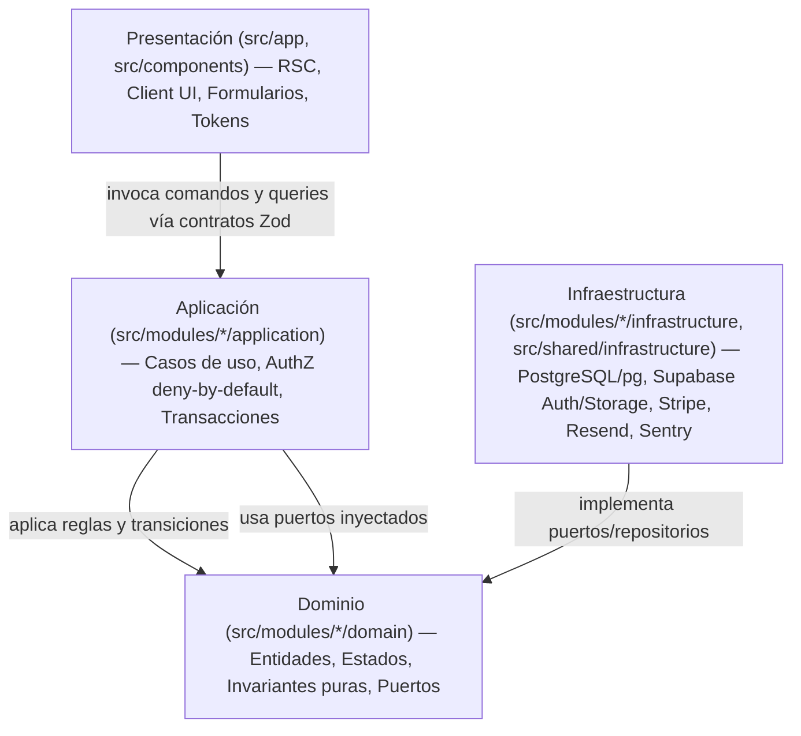
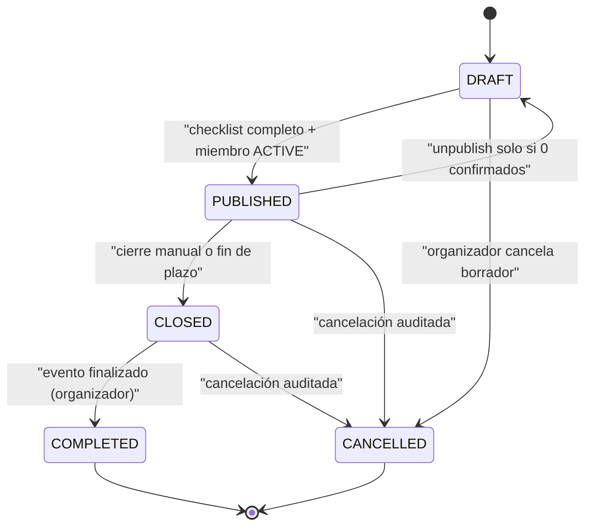
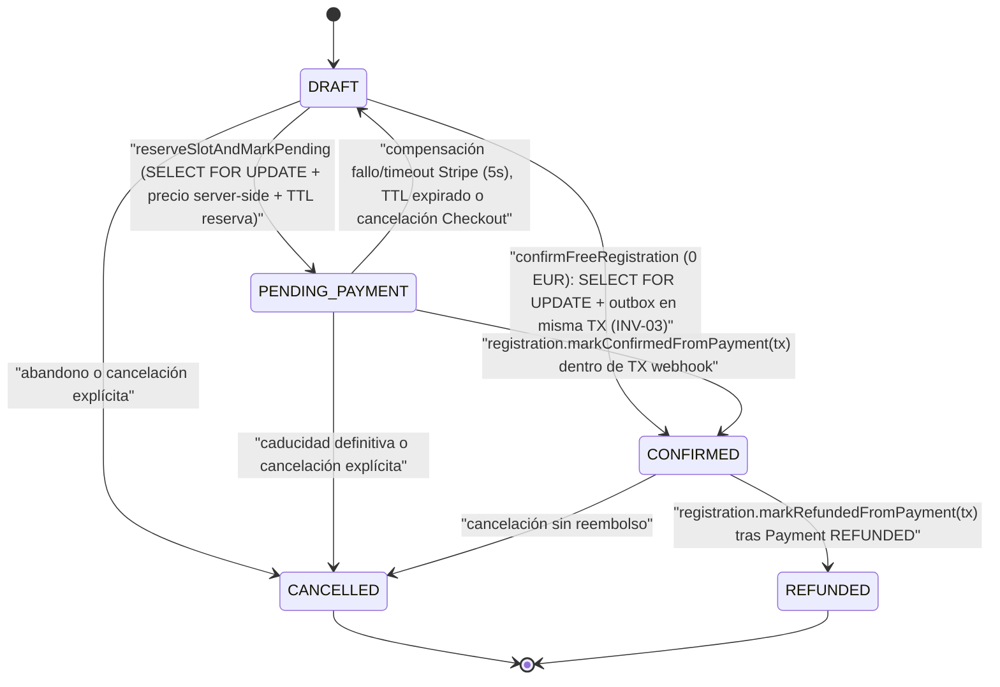
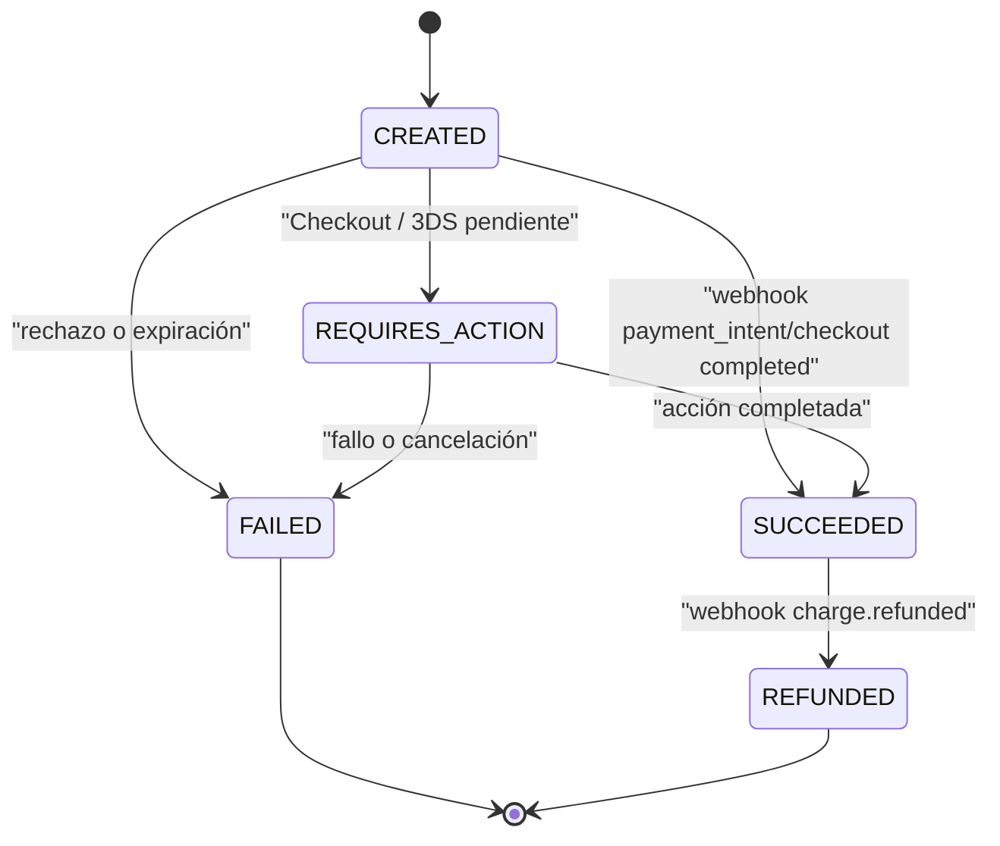
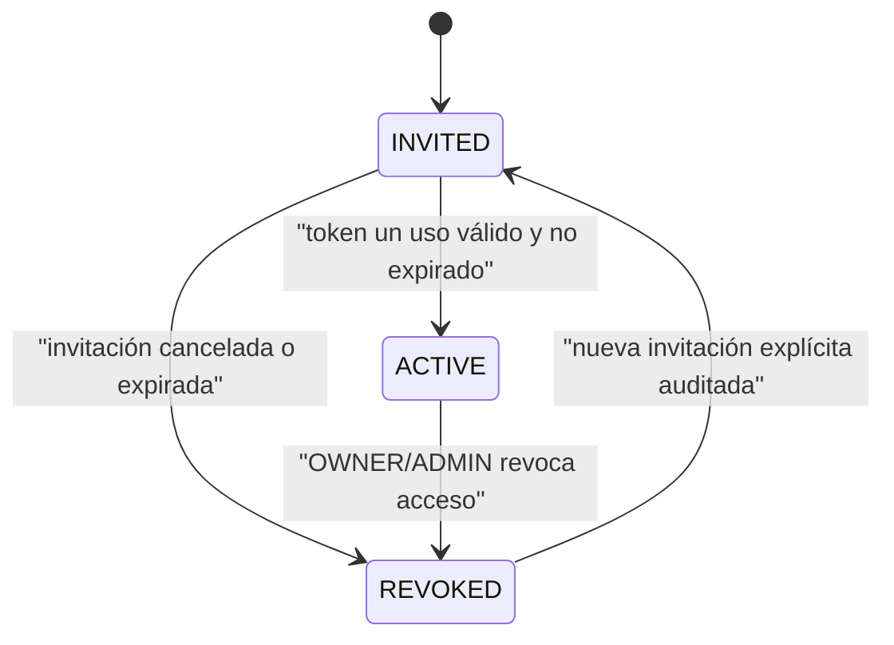

# Arquitectura de Referencia de OAK V1

- **Versión:** `1.0` (`P0-003`)
- **Estado:** Propuesta para revisión independiente (`devops-release`, `backend-datos`) y cierre `G0`
- **Referencias normativas:** `MASTER_EXECUTION_PLAN.md` (§6, §7), `ADR-001`, `ADR-002`, `ADR-003`, `ADR-004`, `BRAND_UX_CONTRACT.md` (§9)

## 1. Visión General y Capas del Monolito Modular

OAK V1 se implementa como un **monolito modular único desplegable** sobre Next.js App Router (`ADR-001`). La arquitectura separa estrictamente **cuatro capas** con una única dirección permitida de dependencias: **Presentación e Infraestructura dependen de Aplicación y Dominio; Dominio no depende de nadie externo**.



### Reglas estrictas entre capas y módulos

1. **Prohibición `Presentación -> Infraestructura / BD`:** Ni páginas ni componentes importan clientes de Supabase, `pg`, Stripe o Resend ni consultan tablas directamente (`ADR-003`).
2. **Aislamiento de Dominio:** `src/modules/<módulo>/domain/**` contiene TypeScript puro sin imports de `next/*`, `@supabase/*`, `stripe`, `resend` ni variables de entorno.
3. **Comunicación inter-módulo:** Ningún módulo importa rutas internas (`domain/` o `infrastructure/`) de otro módulo. Toda colaboración entre módulos atraviesa su fachada pública `src/modules/<módulo>/index.ts` o contratos compartidos en `src/shared/contracts/`.

## 2. Los 10 Módulos de Dominio y Entidades Mínimas (`§7.2`, `§7.3`)

El grafo de dependencias inter-módulo es **estrictamente acíclico (DAG)**; ningún módulo puede importar directa ni transitivamente a un módulo de nivel superior ni escribir sobre tablas pertenecientes a otro agregado (las escrituras coordinadas en una misma transacción SQL se ejecutan invocando el servicio público del módulo dueño pasando el manejador `DbTransaction`).

| # | Módulo (`src/modules/*`) | Responsabilidad principal | Entidades y agregados propios | Dependencias públicas permitidas (DAG acíclico) |
|---:|---|---|---|---|
| 1 | `audit-observability` | Registro inmutable de auditoría (`AuditLog`), logger JSON con `correlationId` y cero PII, métricas/trazas Sentry | `AuditLog` | *(Nivel 0: módulo transversal base; cero dependencias de negocio)* |
| 2 | `identity` | Cuenta, sesión SSR `HttpOnly`, verificación de correo, recuperación sin enumeración, re-autenticación reciente | `User` | `audit-observability` |
| 3 | `communications` | Outbox transaccional y despacho idempotente de confirmación de inscripción y briefing de organizador (sandbox en V1, usando DTOs sin consultar tablas ajenas) | `CommunicationLog` | `audit-observability` |
| 4 | `athlete` | Perfil reutilizable del deportista, consentimientos versionados, exportación RGPD y solicitud de borrado/anonimización | `AthleteProfile`, `ConsentRecord` | `identity`, `audit-observability` |
| 5 | `organization` | Organizaciones, invitaciones cerradas de un uso, membresías, roles RBAC y resolución de pertenencia multi-tenant | `Organization`, `OrganizationMembership` | `identity`, `audit-observability` |
| 6 | `catalog` | Consulta pública de eventos `PUBLISHED`, modalidades, tramos de precio visibles, búsqueda, filtros y favoritos idempotentes | `Event` (vista pública sin PII), `EventModality`, `PriceTier`, `EventMedia`, `Favourite` | `identity`, `organization` (solo datos públicos org) |
| 7 | `registration` | Borrador recuperable, datos de participante, recálculo server-side de precio en céntimos, reserva atómica de cupo (`SELECT ... FOR UPDATE`), confirmación gratuita `0 EUR` con outbox, liberación por compensación/timeout y cancelación | `Registration`, `RegistrationParticipant` | `catalog`, `athlete`, `identity`, `communications`, `audit-observability` |
| 8 | `payments` | Orquestación de Checkout (`payments -> registration`), sesión Stripe Checkout modo test con `Idempotency-Key`, compensación ante fallo/timeout, webhook firmado e idempotente (`PaymentWebhookEvent`), invocación transaccional `registration.markConfirmedFromPayment(tx)` y outbox `communications` | `Payment`, `PaymentWebhookEvent` | `registration`, `communications`, `audit-observability` |
| 9 | `journey` | Próximos retos, historial de inscripciones y métricas derivadas únicamente de inscripciones `CONFIRMED` / eventos `COMPLETED` | *(Proyecciones de solo lectura sin escritura)* | `registration`, `catalog`, `athlete` |
| 10 | `organizer-ops` | Alta/edición de eventos draft y tabla privada `event_private_ops`, modalidades/cupos/tiers, checklist de publicación, cierre/completado, participantes, export CSV seguro, KPIs reconciliados y solicitud de briefing | `Event`, `EventPrivateOps`, `EventModality`, `PriceTier`, `EventMedia` | `organization`, `catalog`, `registration`, `payments`, `communications`, `audit-observability` |

## 3. Máquinas de Estado Obligatorias (`§7.4`)

Todas las transiciones críticas se ejecutan exclusivamente mediante métodos de dominio cubiertos al `100%` de ramas (`G2`), nunca mediante actualizaciones genéricas `UPDATE ... SET status = $1` sin validar estado origen y precondiciones.

### 3.1 `Event`



### 3.2 `Registration`



### 3.3 `Payment`



### 3.4 `OrganizationMembership`



## 4. Catálogo de Invariantes Críticas (`§7.5`)

| ID | Invariante | Módulos | Mecanismo de refuerzo | Verificación requerida |
|---|---|---|---|---|
| INV-01 | Un usuario nunca accede a datos privados de otra organización | `organization`, `organizer-ops` | `ActorContext` `deny-by-default` en aplicación + RLS `FORCE` | Tests negativos cross-tenant `G3` (`Org1` vs `Org2`, `REVOKED`, `INVITED`) |
| INV-02 | Un evento no pasa a `PUBLISHED` sin fecha, ubicación, modalidad, cupo, precio, reglamento y contacto | `organizer-ops` | Validador de dominio + checklist server-side antes de transición | Unit tests `100%` ramas `G2` + API test `G3` |
| INV-03 | Las inscripciones activas/confirmadas nunca superan `capacity_limit` de la modalidad | `registration` | Transacción `SERIALIZABLE` / `SELECT ... FOR UPDATE` sobre modalidad + constraint `CHECK` en BD | Prueba de contención `25` paralelas sobre 1 plaza (`0` sobreventa) |
| INV-04 | El importe cobrado coincide exactamente con el cálculo server-side en céntimos enteros (`EUR`) | `registration`, `payments` | Precio calculado desde `PriceTier` en BD dentro de la transacción; campos cliente ignorados | Unit tests `100%` ramas + manipulación de payload en API test |
| INV-05 | Un webhook repetido o desordenado es idempotente y nunca duplica inscripción ni correo | `payments`, `communications` | `PaymentWebhookEvent(provider_event_id UNIQUE)` + `CommunicationLog(idempotency_key UNIQUE)` en transacción | Suite `G3` de duplicados y *out-of-order* |
| INV-06 | Una inscripción no pasa a `CONFIRMED` sin `Payment SUCCEEDED` (salvo modalidad gratuita explícita `0 EUR`) | `registration`, `payments` | Máquina de estados de dominio + regla transaccional | Unit tests de transición inválida `G2` + integración `G3` |
| INV-07 | El borrado de cuenta anonimiza PII preservando integridad contable y de `AuditLog` | `athlete`, `audit-observability` | Caso de uso transaccional con re-autenticación reciente y anonimización determinista | Integración `G3` verificando ausencia de PII y conservación de auditoría |
| INV-08 | Las métricas de trayectoria se derivan solo de inscripciones `CONFIRMED` y eventos `COMPLETED` | `journey` | Consultas de solo lectura sobre estado confirmado/completado; sin setters cliente | Unit/integration tests `G2`/`G3` |

## 5. Flujo Crítico End-to-End: Reserva de Cupo, Compensación Checkout y Outbox Transaccional

En los flujos de pago (`amount_cents > 0`), **Presentación invoca a `payments`**, que orquesta a `registration` y `communications` respetando el DAG acíclico y la propiedad de cada agregado (sin mutaciones directas sobre tablas ajenas ni dependencias circulares). En modalidades gratuitas (`amount_cents === 0`), Presentación invoca directamente `registration.confirmFreeRegistration(actor, registrationId)`, que ejecuta `SELECT ... FOR UPDATE`, transición `DRAFT -> CONFIRMED` e inserción outbox `CommunicationLog(PENDING)` en una única transacción antes de despachar Resend tras el `COMMIT`.

```mermaid
sequenceDiagram
    actor Atleta
    participant UI as Presentación (Next.js)
    participant Pay as Payments App
    participant Reg as Registration Service
    participant DB as PostgreSQL (pg / RLS)
    participant Stripe as Stripe Checkout (Test)
    participant Comm as Communications Outbox

    Atleta->>UI: Confirma revisión y pulsa "Continuar al pago"
    UI->>Pay: initiateCheckout(actor, registrationId)
    Pay->>Reg: reserveSlotAndMarkPending(actor, registrationId)
    Reg->>DB: BEGIN (TX1); SELECT modality FOR UPDATE; calcula EUR céntimos
    alt Cupo agotado
        DB-->>Reg: capacity_remaining == 0
        Reg-->>UI: 409 CONFLICT (sin sobreventa)
    else Cupo disponible
        DB-->>Reg: Reserva plaza + Registration = PENDING_PAYMENT (TTL 15m); COMMIT TX1
        Pay->>DB: Crea/reutiliza Payment = CREATED (idempotency_key = reg:id:attempt:n)
        Pay->>Stripe: checkout.sessions.create (modo test, Idempotency-Key, timeout 5s)
        alt Fallo o timeout Stripe (> 5s) antes de sessionUrl
            Pay->>DB: BEGIN (TX_COMP); Payment = FAILED
            Pay->>Reg: releasePendingReservationOnInitFailure(tx_comp, registrationId)
            Reg->>DB: SELECT FOR UPDATE; libera plaza + Registration = PENDING_PAYMENT -> DRAFT; COMMIT TX_COMP
            Pay-->>UI: Error recuperable con reintento (sin cupo ni borrador huérfanos)
        else Sesión Checkout creada
            Pay->>DB: Guarda checkout_session_id en Payment
            Pay-->>UI: Redirige a Stripe Checkout hospedado
        end
    end

    Stripe->>Pay: POST /api/webhooks/stripe (stripe-signature + rawBody)
    Pay->>Stripe: constructEvent() verifica firma
    Pay->>DB: BEGIN (TX_WEBHOOK); INSERT PaymentWebhookEvent(provider_event_id) ON CONFLICT DO NOTHING
    alt Evento duplicado
        DB-->>Pay: 0 filas insertadas; COMMIT
        Pay-->>Stripe: 200 OK (idempotente, 0 efectos repetidos)
    else Evento nuevo válido (checkout.session.completed)
        Pay->>DB: Payment = SUCCEEDED
        Pay->>Reg: markConfirmedFromPayment(tx_webhook, registrationId, paymentId)
        Reg->>DB: Valida PENDING_PAYMENT -> CONFIRMED (INV-06) + AuditLog
        Pay->>Comm: enqueueRegistrationConfirmation(tx_webhook, payload, idempotencyKey)
        Comm->>DB: INSERT CommunicationLog(status='PENDING', idempotency_key) ON CONFLICT DO NOTHING
        DB-->>Pay: COMMIT TX_WEBHOOK
        Pay->>Comm: dispatchPendingConfirmation(communicationLogId) [post-COMMIT, timeout 5s]
        Comm-->>Stripe: Resend -> SENT (o queda PENDING/FAILED reintentable por worker) + 200 OK
    end
```

- **Recuperación frente a caída entre `TX1` y `Stripe` (o abandono sin volver de Checkout):** Un sweeper idempotente (ejecutado periódicamente o bajo demanda en liberación de reservas caducadas) localiza `Registration` en `PENDING_PAYMENT` cuyo `reservation_expires_at < NOW()` sin `Payment SUCCEEDED`, invocando `registration.releaseExpiredPendingReservation(registrationId)` (`SELECT ... FOR UPDATE`, libera plaza y transiciona `PENDING_PAYMENT -> DRAFT`) y marcando `Payment` expirado como `FAILED`.
- **Garantía de outbox transaccional:** Si el proceso cae entre el `COMMIT` de `TX_WEBHOOK` y la llamada a Resend, o si Resend devuelve error transitorio, la inscripción **permanece `CONFIRMED`** y el registro `CommunicationLog(status = 'PENDING' | 'FAILED')` permanece persistido en PostgreSQL para ser despachado una sola vez por el worker de reintentos sin duplicar correos (`idempotency_key UNIQUE`).

## 6. Estructura de Directorios Objetivo para `P0-004` y Fases Siguientes

> **Nota de alcance:** Esta estructura define el layout que inicializará `P0-004` (esqueleto mínimo) y poblarán las Fases 2–6. En `P0-003` no se crea `src/`, `package.json` ni código de aplicación. Los directorios `sites/**`, `figuras/**` y `outputs/**` permanecen intactos.

```text
.
├── .github/
│   ├── CODEOWNERS
│   └── workflows/               # CI G1-G5 (P0-005)
├── .gitattributes               # Política LF + sites/** -text (ADR-002)
├── .npmrc                       # save-exact=true, engine-strict=true, strict-peer-dependencies=true, auto-install-peers=true
├── .nvmrc                       # 24.16.0
├── .env.example                 # Nombres de variables sin valores reales
├── package.json                 # Versiones exactas fijadas (ADR-001) + 30 scripts (ADR-002)
├── pnpm-lock.yaml               # Lockfile obligatorio
├── next.config.ts               # Configuración Next.js + Sentry + headers seguridad
├── tsconfig.json                # strict: true, paths @/*
├── eslint.config.mjs            # Flat config ESLint 9 + Next + SAST rules
├── vitest.config.ts             # Proyectos unit / integration / contract + coverage V8
├── playwright.config.ts         # Chromium, Firefox, WebKit + 5 viewports + axe
├── scripts/
│   ├── ci/                      # fail-closed-gate.mjs, run-and-capture.mjs y utilidades CI
│   ├── security/                # secret-scan.mjs, run-sca.ts, run-sast.ts, run-dast.ts
│   ├── db/                      # migrate-fresh, migrate-from-previous, seed-check, with-ephemeral-pg
│   ├── qa/                      # e2e-flake-check, verify-a11y-manual-signoff
│   ├── perf/                    # run-perf-gate, run-load-test
│   └── ops/                     # deploy, smoke-test, check-observability, backup/rollback drills
├── supabase/
│   ├── config.toml              # Configuración local Supabase CLI
│   ├── migrations/              # SQL versionado expand/migrate/contract
│   └── seed/                    # Dataset sintético idempotente (P0-009 / P2-003)
├── src/
│   ├── app/                     # Presentación App Router (rutas atleta, /pro, /api/health, /api/webhooks/stripe)
│   ├── components/
│   │   ├── ui/                  # Primitivas accesibles OAK (Radix + tokens)
│   │   └── domain/              # Componentes compuestos atleta y organizador
│   ├── styles/
│   │   └── tokens.css           # Fuente canónica de CSS variables (BRAND_UX_CONTRACT.md)
│   ├── modules/
│   │   ├── identity/            # { domain/, application/, infrastructure/, index.ts }
│   │   ├── athlete/
│   │   ├── organization/
│   │   ├── catalog/
│   │   ├── registration/
│   │   ├── payments/
│   │   ├── journey/
│   │   ├── organizer-ops/
│   │   ├── communications/
│   │   └── audit-observability/
│   └── shared/
│       ├── env.ts               # Validación Zod fail-closed por APP_ENV
│       ├── contracts/           # DTOs y esquemas Zod versionados compartidos
│       └── infrastructure/
│           ├── db/              # pool.ts, rls-context.ts (withRlsContext), admin-client.ts, pglite-client.ts
│           └── telemetry/       # logger JSON sin PII, Sentry sanitizer
├── tests/
│   ├── unit/                    # Tests rápidos sin I/O externo (G2)
│   ├── integration/             # DB efímera, RLS negativo, concurrencia cupo, webhooks (G3)
│   ├── contract/                # Contratos API Zod + MSW vs handlers (G3)
│   └── e2e/                     # Playwright desktop/mobile + axe-core (G4/G5)
└── docs/
    ├── adr/                     # ADR-001..ADR-004
    ├── architecture/            # SYSTEM_ARCHITECTURE.md
    ├── agentic/                 # Gobierno, paquetes y estado de gates
    ├── brand/                   # BRAND_UX_CONTRACT.md
    └── evidence/                # Evidencias por semana y task_id
```

