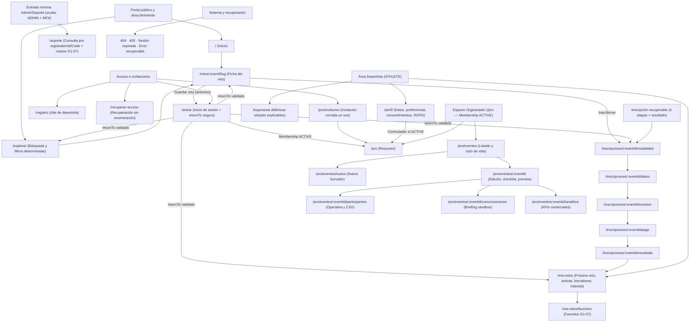

# Arquitectura de Información, Sitemap, Rutas Canónicas y Nomenclatura `es-ES` V1 — OAK

## 1. Control documental, jerarquía normativa y frontera `D0` vs `D1`

| Campo                                | Valor                                                                                                                                                                                                                                                                                         |
| ------------------------------------ | --------------------------------------------------------------------------------------------------------------------------------------------------------------------------------------------------------------------------------------------------------------------------------------------- |
| Paquete origen                       | `P1-004` (Fase 1 — Contrato de producto, marca y arquitectura)                                                                                                                                                                                                                                |
| Owner de arquitectura de información | `ux-brand` (`BRUX`)                                                                                                                                                                                                                                                                           |
| Versión                              | `1.0`                                                                                                                                                                                                                                                                                         |
| Decisión de alcance `D0`             | `APPROVED` (`2026-11-20`, `docs/agentic/DECISION_LOG.md`)                                                                                                                                                                                                                                     |
| Estado de Gate `D1`                  | **`PENDING USER VALIDATION`** (`PENDING_D1_APPROVAL`, ratificación en `P1-012`)                                                                                                                                                                                                               |
| Consumidores directos                | `P1-006` (inventario de componentes), `P1-007` (prototipo navegable), `P1-012` (validación `D1`), `P1-013` (congelación de contrato)                                                                                                                                                          |
| Fuentes normativas vinculantes       | `AGENTS.md`, `DECISION_LOG.md`, `V1_SCOPE_AND_EXCLUSIONS.md`, `REQUIREMENTS_BASELINE.md`, `BRAND_UX_CONTRACT.md` (§1.4, §3, §9–§15), `G0_BRAND_UX_BASELINE.md`, `SYSTEM_ARCHITECTURE.md`, `ADR-003`, `DATA_CLASSIFICATION_RETENTION.md`, `BROWSER_VIEWPORT_MATRIX.md`, `SYNTHETIC_DATASET.md` |

### 1.1 Precedencia de fuentes y regla de no auto-aprobación `D1`

En caso de conflicto entre documentos, prevalece el orden estricto definido en `AGENTS.md`:

1. `docs/agentic/DECISION_LOG.md` (`D0 = APPROVED`, `2026-11-20`).
2. `docs/agentic/MASTER_EXECUTION_PLAN.md` y `docs/product/V1_SCOPE_AND_EXCLUSIONS.md`.
3. `docs/agentic/QUALITY_GATES.md` y `docs/agentic/REQUIREMENTS_BASELINE.md`.
4. `docs/brand/BRAND_UX_CONTRACT.md` (ajustado aquí en los puntos impactados por `D0` y elevado a Gate `D1`).
5. Los decks estáticos bajo `sites/` únicamente como referencia visual histórica (prohibido copiar su CSS, JS, datos mock o anotaciones mixtas).

> **Regla de gobernanza sobre Gate `D1`:** Este documento aplica de forma vinculante todo lo ya aprobado en `D0` (`trail` y `running` en la Comunidad de Madrid, deportista + organizador por invitación cerrada + soporte mínimo `AC-J08`, web responsive `es-ES`, Stripe Hosted Checkout solo modo `test`, **Favoritos `AC-J02-04` incluido** y exclusión de mapa interactivo, dorsal digital, wearables, red social, IA y gamificación avanzada). Toda concreción nueva o refinamiento respecto a `BRAND_UX_CONTRACT.md` (`D1-06`, `D1-07`, `D1-08`, `D1-09`, `D1-10`, `D1-11`) queda marcada explícitamente como **`PENDING_D1_APPROVAL`** para decisión del usuario en **`P1-012`**.

---

## 2. Reconciliación explícita de conflictos frente a `BRAND_UX_CONTRACT.md` §9 y los decks (`AC-02`)

La auditoría `G0_BRAND_UX_BASELINE.md` y la aprobación posterior de `D0` en `V1_SCOPE_AND_EXCLUSIONS.md` detectaron contradicciones entre los dos decks (`sites/`), el borrador previo a `D0` de `BRAND_UX_CONTRACT.md` §9 y el alcance congelado de V1. Quedan resueltas de forma obligatoria en los seis puntos siguientes:

### 2.1 Retiro total del mapa interactivo en `/explorar` y en la ficha del reto

- **Conflicto heredado:** `BRAND_UX_CONTRACT.md` §9.3 describía `/explorar` como `"Search, filters, results and map/list choice"`. Además, los decks mostraban un conmutador de vista mapa en `/explorar` y un módulo interactivo de recorrido y perfil altimétrico en la ficha móvil.
- **Resolución V1 (`D0 = APPROVED` + `V1_SCOPE_AND_EXCLUSIONS.md` §5.1 #7 y §5.2):** Se **elimina por completo** el conmutador lista/mapa, cualquier mapa interactivo, visor GPX o selector cartográfico de `/explorar` y de `/retos/:eventSlug`. En V1, `/explorar` expone únicamente buscador, filtros combinables, lista/rejilla de resultados y ordenación determinista **sin IA**. La ficha `/retos/:eventSlug` muestra lugar, municipio madrileño, distancia, desnivel cuando aplique y descripción textual de recorrido sin mapas ni trazados interactivos simulados.

### 2.2 Retiro total de dorsal digital, wallet, check-in, wearables, red social, cronometraje y gamificación avanzada

- **Conflicto heredado:** Los decks de referencia mencionaban enseñar el dorsal en móvil, tarjetas de planes de preparación, tiempos oficiales de llegada, pasaporte con sellos, compartición social y niveles competitivos de gamificación.
- **Resolución V1 (`D0 = APPROVED` + `V1_SCOPE_AND_EXCLUSIONS.md` §5.1 #2, #3, #6, #8, #12, #13):** Quedan retirados de toda navegación, mapa de rutas, pestañas y acciones secundarias:
  - **Cero** rutas o tarjetas de dorsal digital, pases Apple/Google Wallet o check-in de día de prueba.
  - **Cero** enlaces de conexión con relojes/wearables o plataformas externas de actividad.
  - **Cero** muros sociales, seguidores, comentarios o botones de compartición social pública de logros.
  - **Cero** cronometraje oficial en directo, clasificaciones, planes de preparación, lista de espera o cesión/transferencia de dorsal.
  - **Cero** niveles, insignias, títulos o sellos de pasaporte en `/trayectoria` (`AC-J05-05`); únicamente se muestran el próximo reto con cuenta atrás, el estado real de las inscripciones (con código legible `registrationCode` como referencia de reserva, nunca un dorsal QR), los favoritos guardados y métricas simples explicables derivadas de inscripciones `CONFIRMED` y eventos `COMPLETED` (`AC-J05-03`).

### 2.3 Acotación de `/pro/eventos/:eventId/participantes` frente a `BRAND_UX_CONTRACT.md` §9.4 (`D1-09`)

- **Conflicto heredado:** `BRAND_UX_CONTRACT.md` §9.4 definía `/pro/eventos/:eventId/participantes` como `"Participant and document operations"`, y los decks mostraban revisión de documentos pendientes y campo de documento identificativo en inscripción.
- **Resolución V1 (`V1_SCOPE_AND_EXCLUSIONS.md` §5.1 #15 y §7.1 #7 + `DATA_CLASSIFICATION_RETENTION.md` §3.4):** En V1, `/pro/eventos/:eventId/participantes` queda estrictamente acotada a la **operativa de participantes**: consulta paginada (`<= 50` filas/página) filtrable por modalidad y estado de inscripción, control de cupos/plazas ocupadas, estado de inscripción/pago y exportación CSV segura contra _formula injection_ registrada en `AuditLog` (`AC-J07-01..03`). **Queda excluida y bloqueada cualquier recogida, carga, previsualización o revisión de DNI/NIE/pasaporte, reglas especiales de edad de menores o documentos clínicos/de salud**, que permanecen deshabilitados hasta una decisión explícita **`PENDING_D1_APPROVAL` (`D1-09`)**.

### 2.4 Integración de Favoritos (`AC-J02-04`) aprobada por `D0` sin desplazar `Trayectoria` (`D1-07`)

- **Conflicto heredado:** `BRAND_UX_CONTRACT.md` §9.3 no incluía ruta ni ubicación para Favoritos y §15.2 los listaba como diferibles; a su vez, los decks móviles sustituían `Trayectoria` por `Perfil` y dejaban el botón de guardado sin destino definido.
- **Resolución V1 (`D0 = APPROVED`):** **Favoritos (`AC-J02-04`) forma parte obligatoria de V1**, integrado sin añadir un 5.º ítem a la barra primaria móvil ni desplazar `Trayectoria`:
  1. **Captura contextual:** Botón explícito (`Guardar reto` / `Guardado en favoritos`, con estado `aria-pressed` y nombre accesible que identifica el evento) presente en las tarjetas de `/` y `/explorar` y en la zona de decisión de `/retos/:eventSlug`.
  2. **Continuidad desde estado anónimo (`returnTo` seguro):** Si un usuario `ANONYMOUS` pulsa `Guardar reto`, redirige a `/entrar?returnTo=<ruta_interna_validada>` preservando los filtros activos de `/explorar` o el evento `/retos/:eventSlug` junto con la intención segura de guardado (`intent=fav&eventId=<uuid>`). Tras autenticar, el sistema ejecuta el alta idempotente (`UNIQUE (user_id, event_id)`) y devuelve al deportista a su contexto exacto sin duplicar registros ni perder filtros.
  3. **Ubicación de consulta y gestión (`PENDING_D1_APPROVAL` `D1-07`):** La navegación primaria mantiene invariantes sus **4 ítems**: `Inicio`, `Explorar`, `Mis retos` y `Trayectoria`. Se propone ubicar la vista dedicada de Favoritos en la subruta **`/mis-retos/favoritos`** bajo el dominio `Mis retos`, accesible mediante subnavegación persistente dentro de `/mis-retos` (`Inscripciones` en `/mis-retos` y `Favoritos` en `/mis-retos/favoritos`) y mediante bloque resumen con enlace directo desde `/mis-retos`, manteniendo `Mis retos` marcado como activo en la barra primaria. La forma definitiva de esta subruta frente a pestaña integrada en `/mis-retos` queda registrada como **`PENDING_D1_APPROVAL` (`D1-07`)** para validación del usuario en `P1-012`.

### 2.5 Flujo de inscripción recuperable en 4 etapas + resultado vs 3 pasos del deck (`D1-08`)

- **Conflicto heredado:** El deck de escritorio anunciaba una inscripción en tres pasos (`Modalidad -> Datos -> Confirmación`), mientras que el deck móvil utilizaba `Continuar al pago` y `BRAND_UX_CONTRACT.md` §10.4 recomendaba cuatro etapas explícitas.
- **Resolución V1:** Se adopta el flujo secuencial obligatorio de **4 etapas + resultado durable** (`AC-J04-01..08`): `modalidad -> datos -> revision -> pago -> resultado`, con desglose en `EUR` visible desde la etapa 1, consentimientos versionados explícitos en la etapa 3 (`ConsentRecord`), reserva temporal atómica (`TTL 15 min` en `PENDING_PAYMENT`) hacia **Stripe Hosted Checkout en modo `test`** (o confirmación atómica gratuita `0 EUR`) en la etapa 4, y recuperación de borradores `DRAFT` durante `7 días`. Permanece explícito como **`PENDING_D1_APPROVAL` (`D1-08`)** el detalle de transición hacia Stripe Hosted Checkout externo frente a pasarela embebida y las políticas finas de cancelación/reembolso/reintento.

### 2.6 Acceso cerrado a `/pro`, unificación de rutas y retirada de etiquetas mixtas

- **Conflicto heredado:** El deck de escritorio incluía un enlace público `Organizadores` en la cabecera, usaba el singular `/reto/...` y `/mi-trayectoria`, y el deck móvil acortaba `Mis retos` a `Retos` y reemplazaba `Trayectoria` por `Perfil`, además de incluir encabezados mixtos en inglés y glifos Unicode de navegación.
- **Resolución V1:**
  - En la barra pública desaparece `Organizadores` como portal comercial abierto (en `D0` no existe marketplace de autoalta); el conmutador hacia `/pro` se muestra **únicamente** a usuarios autenticados con `OrganizationMembership.status = 'ACTIVE'`, y la entrada de invitados ocurre mediante la ruta cerrada `/pro/invitacion`.
  - Se unifican rutas y etiquetas: `/retos/:eventSlug` (plural), `/trayectoria` (`Trayectoria`), `/mis-retos` (`Mis retos`), `/perfil` (`Perfil y privacidad`, accesible desde el control de cuenta).
  - Se prohíben en producción todos los encabezados mixtos de presentación, las llamadas algorítmicas opacas y cualquier glifo Unicode como sistema de iconos (`§5`).

### 2.7 Tabla resumen de conflictos reconciliados

| Elemento origen (`BRAND_UX_CONTRACT.md` §9 o decks `sites/`) | Estado anterior en referencia                                       | Decisión V1 reconciliada en `P1-004`                                                                               | Autoridad / Estado Gate                                    |
| ------------------------------------------------------------ | ------------------------------------------------------------------- | ------------------------------------------------------------------------------------------------------------------ | ---------------------------------------------------------- |
| `/explorar` (`BRAND` §9.3 y slide 06)                        | `"Search, filters, results and map/list choice"` + botón vista mapa | Solo búsqueda, filtros combinables, resultados y orden determinista sin IA; **0** conmutador mapa/lista            | `D0 = APPROVED`                                            |
| Ficha móvil recorrido/perfil (slide 13)                      | Módulo de mapa/recorrido interactivo                                | Información textual/numérica estructurada de distancia, desnivel y punto de encuentro; sin mapa ni GPX             | `D0 = APPROVED`                                            |
| Dorsal digital / Wallet / Check-in (slide 11)                | Promesa de enseñar el dorsal en móvil                               | **Retirado por completo** de la IA, navegación y tarjetas de `/mis-retos`                                          | `D0 = APPROVED`                                            |
| Wearables, red social, cronometraje, planes, waitlist        | Presente en slides 09/14 o diferible §15.2                          | **Retirado por completo** de la IA y acciones de producto V1                                                       | `D0 = APPROVED`                                            |
| Pasaporte con sellos y niveles de gamificación (slide 14)    | Niveles ilustrativos y sellos compartibles                          | **Retirado por completo** (`AC-J05-05`); `/trayectoria` solo muestra métricas simples explicables                  | `D0 = APPROVED`                                            |
| Favoritos (`AC-J02-04`)                                      | Diferible en `BRAND` §15.2; corazón aislado en slide 12             | **Incluido en V1**: acción contextual + `returnTo` seguro + propuesta `/mis-retos/favoritos`                       | `D0 = APPROVED` / ruta **`PENDING_D1_APPROVAL` (`D1-07`)** |
| `/pro/eventos/:eventId/participantes` (`BRAND` §9.4)         | `"Participant and document operations"`                             | Operativa de participantes, modalidades, cupos, estado y export CSV seguro; **sin DNI/NIE ni documentos clínicos** | `D0` + **`PENDING_D1_APPROVAL` (`D1-09`)**                 |
| Pasos de inscripción (slide 08 vs `BRAND` §10.4)             | 3 pasos desktop vs 4 etapas en `BRAND` §10.4                        | 4 etapas obligatorias + resultado (`modalidad -> datos -> revision -> pago -> resultado`)                          | **`PENDING_D1_APPROVAL` (`D1-08`)**                        |
| Nav móvil inferior (slides 12, 14)                           | `Inicio`, `Explorar`, `Retos`, `Perfil` (desplaza `Trayectoria`)    | `Inicio`, `Explorar`, `Mis retos`, `Trayectoria` + `/perfil` en control de cuenta                                  | **`PENDING_D1_APPROVAL` (`D1-07`)**                        |
| Enlace público `Organizadores` (slide 05)                    | Visible a todo visitante                                            | Retirado de nav pública; conmutador `/pro` solo si `Membership = ACTIVE` + `/pro/invitacion` cerrada               | `D0 = APPROVED` / **`PENDING_D1_APPROVAL` (`D1-07`)**      |
| Rutas `/reto/...`, `/mi-trayectoria` y glifos Unicode        | Singular/doble etiqueta y símbolos Unicode                          | `/retos/:eventSlug`, `/trayectoria` y librería SVG aprobada (`P1-006`)                                             | **`PENDING_D1_APPROVAL` (`D1-07` / `D1-11`)**              |

---

## 3. Sitemap V1 y contrato completo de rutas (`AC-01`)

### 3.1 Sitemap unificado de OAK V1

### 3.2 Convenciones transversales de URL e identificadores

1. **Idioma y formato de slugs:** Todas las rutas visibles usan español `es-ES` en minúsculas `kebab-case`, sin tildes ni espacios en el segmento de ruta.
2. **Identificadores públicos vs transaccionales/privados:**
   - El catálogo público usa `:eventSlug` legible y estable (p. ej. `/retos/trail-puentes-viejas-lozoya` del dataset sintético `oak-seed.v1`).
   - Los flujos transaccionales de inscripción y gestión privada usan `:eventId` en formato `UUID` opaco para garantizar invariancia ante cambios de título antes de publicar y evitar enumeración secuencial (`NT-01`, `NT-09`).
3. **Cero PII en URLs ni query strings (`NFR-03`):** Queda terminantemente prohibido incluir en rutas o parámetros URL nombres personales, correos electrónicos, teléfonos, fechas de nacimiento, documentos identificativos o tokens de sesión.
4. **Representación de fechas y precios:** Toda ruta muestra fechas y horas convertidas de UTC a `Europe/Madrid` y precios en `EUR` recalculados en servidor.

### 3.3 Contrato detallado de todas las rutas V1

#### A. Portal público y descubrimiento (`ANONYMOUS` y cualquier usuario autenticado)

| Ruta                | Propósito                                                                                                                   | `<title>` patrón (`es-ES`)                                                              | `<h1>` único esperado                                                                        | Autorización y redirección/error                                                                                                                                                                                       | Parámetros URL permitidos (`0` PII)                                                                              | Breadcrumb / Retorno seguro                                                               |
| ------------------- | --------------------------------------------------------------------------------------------------------------------------- | --------------------------------------------------------------------------------------- | -------------------------------------------------------------------------------------------- | ---------------------------------------------------------------------------------------------------------------------------------------------------------------------------------------------------------------------- | ---------------------------------------------------------------------------------------------------------------- | ----------------------------------------------------------------------------------------- |
| `/`                 | Portada de descubrimiento en Comunidad de Madrid (`trail`/`running`), búsqueda rápida y selección determinista sin IA       | `Inicio — Retos de trail y running en Madrid \| OAK`                                    | Promesa principal de inicio (`PENDING_D1_APPROVAL` `D1-06` si permanece en inglés o español) | Pública (`200` para `ANONYMOUS`, `ATHLETE`, `ORG_*`, `ADMIN`). Solo lista eventos `PUBLISHED` futuros/abiertos                                                                                                         | Ninguno requerido; parámetros desconocidos se ignoran sin error                                                  | Raíz del portal (sin breadcrumb)                                                          |
| `/explorar`         | Catálogo público filtrable por reglas deterministas sin IA ni conmutador lista/mapa (`AC-J01-01..06`)                       | `Explorar retos en la Comunidad de Madrid \| OAK` (o dinámico por disciplina/municipio) | `Explorar retos en la Comunidad de Madrid`                                                   | Pública (`200`). Solo expone eventos `PUBLISHED` con `registrationClosesAtUtc > NOW()`. Errores de validación de query sanean el filtro sin `5xx`                                                                      | `q`, `disciplina`, `municipio`, `fechaDesde`, `fechaHasta`, `distancia`, `nivel`, `orden`, `pagina` (según §3.4) | `Inicio > Explorar`                                                                       |
| `/retos/:eventSlug` | Ficha completa del reto previa al CTA (`AC-J02-01..05`), comparativa de modalidades, estado de cupo y acción `Guardar reto` | `<Nombre del evento> (<Municipio>) \| OAK`                                              | `<Nombre del evento>`                                                                        | Pública (`200`) si `Event.status` es `PUBLISHED`, `CLOSED`, `CANCELLED` o `COMPLETED`; devuelve **`404`** si `DRAFT` (para anónimos y usuarios sin membresía `ACTIVE` en la org dueña, `NT-09`) o si el slug no existe | Opcional `intent=fav` tras retorno autenticado seguro (`returnTo`). Cero parámetros de precio o estado           | `Inicio > Explorar > <Nombre del evento>` (enlace a `/explorar` preserva contexto seguro) |

#### B. Acceso, registro, recuperación e invitación cerrada

| Ruta                | Propósito                                                                                         | `<title>` patrón (`es-ES`)                     | `<h1>` único esperado                | Autorización y redirección/error                                                                                                                                                                                                                                                                                    | Parámetros URL permitidos (`0` PII)                                                                                  | Breadcrumb / Retorno seguro                                                        |
| ------------------- | ------------------------------------------------------------------------------------------------- | ---------------------------------------------- | ------------------------------------ | ------------------------------------------------------------------------------------------------------------------------------------------------------------------------------------------------------------------------------------------------------------------------------------------------------------------- | -------------------------------------------------------------------------------------------------------------------- | ---------------------------------------------------------------------------------- |
| `/entrar`           | Inicio de sesión SSR `HttpOnly` (`AC-J03-01`) con preservación segura de `returnTo`               | `Entrar en tu cuenta \| OAK`                   | `Entrar en OAK`                      | `ANONYMOUS` (`200`). Si ya autenticado -> `302` a `returnTo` validado (o `/mis-retos` por defecto). Fallos de login nunca enumeran cuentas (`NT-09`)                                                                                                                                                                | `returnTo` (validado según §3.5), `motivo` (`sesion-expirada` \| `requiere-acceso` \| `reautenticacion`)             | Enlace `Volver a Explorar` (`/explorar`) o regreso al origen público de `returnTo` |
| `/registro`         | Creación de cuenta de deportista y aceptación inicial de política de privacidad (`ConsentRecord`) | `Crear cuenta de deportista \| OAK`            | `Crea tu cuenta en OAK`              | `ANONYMOUS` (`200`). Si ya autenticado -> `302` a `/mis-retos`. Respuesta neutra si el correo ya existe (`NT-09`)                                                                                                                                                                                                   | `returnTo` (validado según §3.5), `estado` (`verificacion-enviada`)                                                  | Enlace `Ya tengo cuenta: Entrar` (`/entrar`) y `Volver a Explorar`                 |
| `/recuperar-acceso` | Solicitud de restablecimiento y confirmación segura sin enumeración (`AC-J03-01`)                 | `Recuperar acceso a tu cuenta \| OAK`          | `Recuperar acceso`                   | Pública para usuarios sin sesión (`200`). Respuesta textual e HTTP idéntica exista o no la cuenta (`NT-09`)                                                                                                                                                                                                         | Ningún parámetro con email en URL; tokens efímeros consumidos server-side y limpiados de la barra de direcciones     | `Volver a Entrar` (`/entrar`)                                                      |
| `/pro/invitacion`   | Aceptación cerrada de invitación de organizador (`SHA-256`, un solo uso, `72 h`, `ADR-003`)       | `Activar invitación de organizador \| OAK Pro` | `Aceptar invitación de organización` | Requiere token válido no expirado y sesión autenticada correspondiente (si `ANONYMOUS` -> guía a `/entrar` o activación previa preservando verificación segura). Token consumido/expirado/revocado -> `410` / `403` sin filtrar miembros (`NT-03`). La activación exige confirmación `POST`, nunca `GET` automático | Parámetro técnico de invitación de un solo uso consumido y limpiado inmediatamente de la URL tras validación (`303`) | `Volver al inicio` (`/`) o acceso directo a `/pro` tras `ACTIVE`                   |

#### C. Flujo de inscripción recuperable en 4 etapas + resultado (`AC-J04-01..08`, `PENDING_D1_APPROVAL` `D1-08`)

> **Guardia transversal de acceso:** Todas las rutas `/inscripciones/:eventId/*` exigen sesión `ATHLETE` válida. Un `ANONYMOUS` recibe **`302` a `/entrar?returnTo=/inscripciones/:eventId/modalidad`**. Si `:eventId` no existe o está en `DRAFT` para ese usuario -> **`404`**. Si la inscripción no pertenece al `user_id` autenticado -> **`403`** (`NT-02`). Si el evento está `CLOSED`, `CANCELLED` o sin cupo al intentar crear/avanzar borrador -> bloqueo explícito en servidor con redirección/aviso comprensible hacia `/retos/:eventSlug` (`AC-J02-03`).

| Ruta                                | Propósito                                                                                                                                                             | `<title>` patrón (`es-ES`)                                             | `<h1>` único esperado                                                                                                                | Autorización y guardias secuenciales                                                                                                                | Parámetros URL permitidos (`0` PII)                                                                                                                | Breadcrumb / Retorno seguro                                                             |
| ----------------------------------- | --------------------------------------------------------------------------------------------------------------------------------------------------------------------- | ---------------------------------------------------------------------- | ------------------------------------------------------------------------------------------------------------------------------------ | --------------------------------------------------------------------------------------------------------------------------------------------------- | -------------------------------------------------------------------------------------------------------------------------------------------------- | --------------------------------------------------------------------------------------- |
| `/inscripciones/:eventId/modalidad` | **Etapa 1 de 4:** Selección de modalidad y consulta del desglose (`tarifa base + gestión = total EUR`)                                                                | `Paso 1 de 4: Elegir modalidad — <Nombre del evento> \| OAK`           | `Elige tu modalidad`                                                                                                                 | `ATHLETE` autenticado (`302` a `/entrar` si anónimo). Evento `PUBLISHED` con plazo abierto y `remainingSpots > 0`                                   | Opcional `modalidadId` (UUID preseleccionado desde ficha) o `draftId` (UUID)                                                                       | `Volver a la ficha del reto` (`/retos/:eventSlug`)                                      |
| `/inscripciones/:eventId/datos`     | **Etapa 2 de 4:** Datos del participante prellenados desde `AthleteProfile` para revisión/corrección, sin documento sensible ni salud (`D1-09`)                       | `Paso 2 de 4: Datos del participante — <Nombre del evento> \| OAK`     | `Revisa tus datos de inscripción`                                                                                                    | `ATHLETE` dueño del borrador. Si no existe modalidad válida seleccionada -> `302` a `/modalidad`                                                    | Opcional `draftId` (UUID)                                                                                                                          | `Volver a modalidad` + `Guardar borrador y salir` (`/mis-retos`)                        |
| `/inscripciones/:eventId/revision`  | **Etapa 3 de 4:** Resumen íntegro del compromiso, política de cancelación, reglamento y consentimientos explícitos (`ConsentRecord`)                                  | `Paso 3 de 4: Revisión y consentimientos — <Nombre del evento> \| OAK` | `Revisa tu inscripción y confirma las condiciones`                                                                                   | `ATHLETE` dueño del borrador. Si faltan etapas 1 o 2 completas -> `302` a la primera etapa incompleta                                               | Opcional `draftId` (UUID)                                                                                                                          | `Volver a datos` + `Guardar borrador y salir` (`/mis-retos`)                            |
| `/inscripciones/:eventId/pago`      | **Etapa 4 de 4:** Reserva atómica (`TTL 15 min`) y salto a **Stripe Hosted Checkout modo `test`** o confirmación gratuita `0 EUR` (**`PENDING_D1_APPROVAL` `D1-08`**) | `Paso 4 de 4: Pago seguro — <Nombre del evento> \| OAK`                | `Completar pago de inscripción` (o `Confirmar inscripción gratuita` si `0 EUR`)                                                      | `ATHLETE` dueño del borrador con etapas 1–3 completas y consentimiento registrado; `409 CONFLICT` recuperable si se agota la última plaza (`NT-04`) | Opcional `draftId` (UUID). Prohibido pasar importes o descuentos por query                                                                         | `Volver a revisión` + `Guardar borrador y salir` (`/mis-retos`)                         |
| `/inscripciones/:eventId/resultado` | Resultado durable consultado en servidor (`CONFIRMED`, `PENDING_PAYMENT`, `FAILED`, `CANCELLED`), nunca basado en query string (`NT-16`)                              | `Estado de tu inscripción — <Nombre del evento> \| OAK`                | Dinámico según estado real en BD (`Inscripción confirmada`, `Pago en confirmación`, `No se ha completado el pago`, `Pago cancelado`) | `ATHLETE` dueño de la inscripción (`403` si pertenece a otro usuario). El servidor consulta siempre el estado real en BD                            | `registrationId` (UUID) o `session_id` de Stripe solo como referencia de lectura; el servidor ignora parámetros falsificados tipo `status=success` | `Ir a Mis retos` (`/mis-retos`), `Reintentar pago` (si aplica) o `Explorar otros retos` |

#### D. Área Deportista autenticado (`ATHLETE`)

> **Guardia transversal:** `ANONYMOUS` -> **`302` a `/entrar?returnTo=<ruta_solicitada>`**. Cada usuario solo lee y modifica sus propios registros (`user_id = auth.uid()`, `NT-02`).

| Ruta                   | Propósito                                                                                                                                                                                                  | `<title>` patrón (`es-ES`)               | `<h1>` único esperado | Autorización y redirección/error                                                                                                                            | Parámetros URL permitidos (`0` PII)                   | Breadcrumb / Retorno seguro      |
| ---------------------- | ---------------------------------------------------------------------------------------------------------------------------------------------------------------------------------------------------------- | ---------------------------------------- | --------------------- | ----------------------------------------------------------------------------------------------------------------------------------------------------------- | ----------------------------------------------------- | -------------------------------- |
| `/mis-retos`           | Dashboard operativo del deportista: próximo reto con cuenta atrás, inscripciones activas (`CONFIRMED`), pendientes/borradores (`7 días`), acceso a Favoritos e historial (`AC-J05-01..04`)                 | `Mis retos \| OAK`                       | `Mis retos`           | `ATHLETE` (cualquier usuario autenticado). `ANONYMOUS` -> `302` a `/entrar?returnTo=/mis-retos`                                                             | `estado` (`proximos` \| `borradores` \| `pasados`)    | `Inicio > Mis retos`             |
| `/mis-retos/favoritos` | Gestión de retos guardados en Favoritos (`AC-J02-04`) sin desplazar `Trayectoria` (**`PENDING_D1_APPROVAL` `D1-07`**)                                                                                      | `Mis retos guardados — Favoritos \| OAK` | `Retos guardados`     | `ATHLETE` autenticado. `ANONYMOUS` -> `302` a `/entrar?returnTo=/mis-retos/favoritos`. Lectura y retirada idempotentes por `UNIQUE (user_id, event_id)`     | Opcional `pagina` (`>= 1`)                            | `Inicio > Mis retos > Favoritos` |
| `/trayectoria`         | Historial deportivo conectado y métricas simples explicables (`retos`, `km`, `localidades`) solo de `CONFIRMED` + `COMPLETED`, sin gamificación competitiva ni datos clínicos (`AC-J05-03`, `AC-J05-05`)   | `Trayectoria \| OAK`                     | `Trayectoria`         | `ATHLETE` autenticado. `ANONYMOUS` -> `302` a `/entrar?returnTo=/trayectoria`                                                                               | Opcional `anio` (`YYYY` numérico válido)              | `Inicio > Trayectoria`           |
| `/perfil`              | Datos reutilizables, preferencias no clínicas, historial `ConsentRecord`, cierre de sesión, conmutador a `/pro` (si `ACTIVE`), exportación JSON y borrado RGPD con `auth_time <= 15 min` (`AC-J03-02..05`) | `Perfil y privacidad \| OAK`             | `Perfil y privacidad` | `ATHLETE` autenticado. Exportación/borrado con `auth_time > 15 min` redirige a re-autenticación `/entrar?returnTo=/perfil&motivo=reautenticacion` (`NT-17`) | `seccion` (`datos` \| `preferencias` \| `privacidad`) | `Inicio > Perfil y privacidad`   |

#### E. Espacio Organizador `/pro` (invitación cerrada + `OrganizationMembership = ACTIVE`)

> **Guardia transversal multi-tenant (`AC-J06`, `AC-J07`, `NT-01`, `NT-03`):**
>
> - `ANONYMOUS` -> **`302` a `/entrar?returnTo=<ruta_pro_solicitada>`**.
> - `ATHLETE` sin membresía `ACTIVE`, o miembro en estado `INVITED` o `REVOKED` -> **`403`** (`Acceso restringido a organizadores activos`).
> - Miembro `ACTIVE` de `Org A` que solicita `:eventId` de `Org B` -> **`403`** (o **`404`** si el evento es `DRAFT` para evitar enumeración cross-tenant, `NT-01`).
> - Rol **`ORG_VIEWER`**: tiene acceso de lectura a `/pro`, `/pro/eventos`, `/pro/eventos/:eventId`, `/pro/eventos/:eventId/participantes` (consulta filtrada; mutaciones bloqueadas) y `/pro/eventos/:eventId/analitica`; cualquier petición a `/pro/eventos/nuevo` o acción de escritura/publicación/briefing recibe **`403`** en servidor.

| Ruta                                   | Propósito                                                                                                                                                                                         | `<title>` patrón (`es-ES`)                        | `<h1>` único esperado                   | Matriz de roles autorizados vs rechazo                                                                                                                                                         | Parámetros URL permitidos (`0` PII)                                                                                                         | Breadcrumb / Retorno seguro                                 |
| -------------------------------------- | ------------------------------------------------------------------------------------------------------------------------------------------------------------------------------------------------- | ------------------------------------------------- | --------------------------------------- | ---------------------------------------------------------------------------------------------------------------------------------------------------------------------------------------------- | ------------------------------------------------------------------------------------------------------------------------------------------- | ----------------------------------------------------------- |
| `/pro`                                 | Resumen operativo de la organización: KPIs reconciliados, eventos próximos y pendientes de publicación                                                                                            | `Resumen del organizador \| OAK Pro`              | `Resumen de organización`               | `ORG_OWNER`, `ORG_MANAGER`, `ORG_VIEWER` (`ACTIVE`). Otros -> `403` (`302` si anónimo)                                                                                                         | Ninguno requerido (selector de organización activa si pertenece a >1 org en sesión, sin exponer IDs ajenos)                                 | Raíz de `/pro` + enlace `Volver al portal deportista` (`/`) |
| `/pro/eventos`                         | Listado de eventos propios (`DRAFT`, `PUBLISHED`, `CLOSED`, `CANCELLED`, `COMPLETED`) y acceso al ciclo de vida                                                                                   | `Eventos de la organización \| OAK Pro`           | `Eventos`                               | `ORG_OWNER`, `ORG_MANAGER`, `ORG_VIEWER` (`ACTIVE`). Botón `Crear nuevo evento` visible solo para `ORG_OWNER`/`ORG_MANAGER`                                                                    | `estado` (`DRAFT` \| `PUBLISHED` \| `CLOSED` \| `CANCELLED` \| `COMPLETED`), `pagina`                                                       | `Resumen > Eventos`                                         |
| `/pro/eventos/nuevo`                   | Creación de borrador `DRAFT` con datos básicos, modalidades, cupos, tarifas y contacto institucional (`AC-J06-02`)                                                                                | `Crear nuevo evento \| OAK Pro`                   | `Nuevo evento`                          | **`ORG_OWNER`, `ORG_MANAGER` (`ACTIVE`) únicamente**. `ORG_VIEWER`, `INVITED`, `REVOKED`, `ATHLETE` -> **`403`**                                                                               | Ninguno                                                                                                                                     | `Resumen > Eventos > Nuevo evento`                          |
| `/pro/eventos/:eventId`                | Gestión del evento (**`PENDING_D1_APPROVAL` `D1-10`**): edición controlada (`AC-J06-05`), checklist server-side (`AC-J06-03`), vista previa equivalente (`AC-J06-04`) y transiciones auditadas    | `<Nombre del evento> — Gestión \| OAK Pro`        | `<Nombre del evento>`                   | Lectura: `ORG_OWNER`, `ORG_MANAGER`, `ORG_VIEWER` de la org dueña. Edición/publicación/cierre/cancelación: solo `ORG_OWNER`/`ORG_MANAGER` (`ORG_VIEWER` -> `403`). Cross-tenant -> `403`/`404` | Opcional `vista` (`edicion` \| `modalidades` \| `publicacion` \| `vista-previa`)                                                            | `Resumen > Eventos > <Nombre del evento>`                   |
| `/pro/eventos/:eventId/participantes`  | Operativa de participantes (`AC-J07-01..03`): listado paginado (`<= 50`), filtros por modalidad/estado, ocupación y export CSV seguro. **Sin DNI/NIE/pasaporte ni documentos clínicos (`D1-09`)** | `Participantes — <Nombre del evento> \| OAK Pro`  | `Participantes de <Nombre del evento>`  | `ORG_OWNER`, `ORG_MANAGER`, `ORG_VIEWER` de la org dueña (`ACTIVE`). Cross-tenant -> `403`/`404`. Exportación CSV auditada siempre en `AuditLog`                                               | `modalidadId` (UUID), `estado` (`CONFIRMED` \| `PENDING_PAYMENT` \| `CANCELLED` \| `REFUNDED`), `pagina`. **Prohibido nombre/email en URL** | `Resumen > Eventos > <Nombre del evento> > Participantes`   |
| `/pro/eventos/:eventId/comunicaciones` | Envío de briefing en sandbox (`AC-J07-04..05`): selección explícita de destinatarios, vista previa obligatoria, confirmación explícita e historial `CommunicationLog`                             | `Comunicaciones — <Nombre del evento> \| OAK Pro` | `Comunicaciones de <Nombre del evento>` | Envío: **`ORG_OWNER`, `ORG_MANAGER` (`ACTIVE`) únicamente**. `ORG_VIEWER` solo consulta historial (mutación -> **`403`**). Cross-tenant -> `403`/`404`                                         | Opcional `pagina` para historial                                                                                                            | `Resumen > Eventos > <Nombre del evento> > Comunicaciones`  |
| `/pro/eventos/:eventId/analitica`      | Analítica comercial reconciliada al céntimo (`AC-J07-02`): inscritos confirmados, ocupación e ingresos `EUR` modo `test`. Cero biometría ni cronometraje                                          | `Analítica — <Nombre del evento> \| OAK Pro`      | `Analítica de <Nombre del evento>`      | `ORG_OWNER`, `ORG_MANAGER`, `ORG_VIEWER` de la org dueña (`ACTIVE`). Cross-tenant -> `403`/`404`                                                                                               | Opcional `modalidadId` (UUID)                                                                                                               | `Resumen > Eventos > <Nombre del evento> > Analítica`       |

#### F. Entrada mínima acotada Admin / Soporte (`AC-J08-01..04`) y rutas de sistema

| Ruta                                     | Propósito                                                                                                                                        | `<title>` patrón (`es-ES`)      | `<h1>` único esperado                           | Autorización y restricciones críticas                                                                                                                                                                                                                                                                                                                                                                                    | Parámetros URL permitidos (`0` PII)                                                                                                | Breadcrumb / Retorno seguro                                    |
| ---------------------------------------- | ------------------------------------------------------------------------------------------------------------------------------------------------ | ------------------------------- | ----------------------------------------------- | ------------------------------------------------------------------------------------------------------------------------------------------------------------------------------------------------------------------------------------------------------------------------------------------------------------------------------------------------------------------------------------------------------------------------ | ---------------------------------------------------------------------------------------------------------------------------------- | -------------------------------------------------------------- |
| `/soporte`                               | Consola mínima de soporte auditado (**`PENDING_D1_APPROVAL` `D1-07`** frente a `/admin`, oculta de toda navegación pública, deportista y `/pro`) | `Soporte administrativo \| OAK` | `Consulta puntual de soporte`                   | Exclusivo **`ADMIN` con MFA verificado**. `ANONYMOUS` -> `302` a `/entrar?returnTo=/soporte`. Cualquier `ATHLETE`, `ORG_*` o `ADMIN` sin MFA -> **`403`** (`NT-15`). Consulta únicamente por `registrationId` o `registrationCode` vía formulario `POST` con `reason` obligatorio en `AuditLog`; cero búsquedas abiertas de PII, cero impersonación silenciosa y cero edición directa de pagos o cupos (`AC-J08-01..04`) | Ninguno con PII ni códigos de inscripción en query string persistente; la búsqueda puntual se envía por formulario `POST` auditado | Enlace `Volver al portal público` (`/`)                        |
| Ruta inexistente / `DRAFT` ajeno (`404`) | Página de recurso no encontrado o `DRAFT` oculto anti-enumeración (`NT-09`)                                                                      | `Página no encontrada \| OAK`   | `No hemos encontrado esa página`                | Devuelta con HTTP `404` sin detalles internos ni trazas de servidor                                                                                                                                                                                                                                                                                                                                                      | Ninguno                                                                                                                            | Botones `Ir al inicio` (`/`) y `Explorar retos` (`/explorar`)  |
| Acceso denegado (`403`)                  | Rechazo explícito por falta de rol, membresía `INVITED`/`REVOKED`, `ORG_VIEWER` en mutación o acceso cross-tenant (`NT-01..03`)                  | `Acceso no autorizado \| OAK`   | `No tienes permiso para acceder a esta sección` | Devuelta con HTTP `403` sin revelar datos del recurso ni existencia de organizaciones ajenas                                                                                                                                                                                                                                                                                                                             | Ninguno                                                                                                                            | `Ir a Mis retos` (`/mis-retos`) o `Ir al inicio` (`/`)         |
| Sesión expirada / Re-autenticación       | Recuperación controlada tras expiración de sesión o exigencia `auth_time <= 15 min` en acciones RGPD (`AC-J03-05`)                               | Redirige a `/entrar`            | `Entrar en OAK` (con aviso contextual)          | HTTP `302` hacia `/entrar?returnTo=<ruta_interna_validada>&motivo=sesion-expirada` o `motivo=reautenticacion`                                                                                                                                                                                                                                                                                                            | Solo `returnTo` validado y `motivo` de lista blanca                                                                                | Regreso automático tras autenticar a la ruta original validada |

### 3.4 Contrato determinista de parámetros de `/explorar` (`AC-J01-01..03`)

Los parámetros URL de `/explorar` reflejan en todo momento los filtros activos y permiten compartir el enlace o usar `Atrás`/`Adelante` del navegador sin perder contexto ni introducir lógica de IA:

| Parámetro                   | Tipo / Lista blanca permitida                                                                 | Valor por defecto                     | Regla de validación y seguridad                                                                           |
| --------------------------- | --------------------------------------------------------------------------------------------- | ------------------------------------- | --------------------------------------------------------------------------------------------------------- |
| `q`                         | Cadena UTF-8 normalizada, máx. `80` caracteres                                                | Vacío (sin filtro)                    | Recorte y escape; nunca se acepta ni registra como PII; si supera longitud se trunca                      |
| `disciplina`                | `trail` \| `running` (`DISCIPLINES`)                                                          | Todas (`trail` y `running`)           | Valores ajenos (p. ej. ciclismo) se descartan con aviso claro o reset seguro                              |
| `municipio`                 | Allowlist exacta de los `55` municipios de la Comunidad de Madrid (`data/fixtures/schema.ts`) | Todos los municipios de Madrid        | Comparación normalizada sin acentos; municipios fuera de la Comunidad de Madrid no son seleccionables     |
| `fechaDesde` / `fechaHasta` | Fecha ISO `YYYY-MM-DD` dentro de rango válido (`fechaDesde <= fechaHasta`)                    | Desde fecha actual en `Europe/Madrid` | Eventos con `registrationClosesAtUtc <= NOW()` nunca aparecen aunque se fuerce fecha pasada (`AC-J01-04`) |
| `distancia`                 | Rango discreto (`hasta-10k`, `10k-25k`, `mas-25k`) o `distMinKm`/`distMaxKm` enteros `>= 1`   | Todas las distancias                  | Valores negativos o no numéricos se descartan de forma segura                                             |
| `nivel`                     | `INICIACION` \| `MEDIO` \| `AVANZADO` (`EVENT_LEVELS`)                                        | Todos los niveles                     | Allowlist estricta                                                                                        |
| `orden`                     | `fecha_asc` \| `precio_asc` \| `distancia_asc`                                                | `fecha_asc`                           | Ordenación 100 % determinista; prohibido parámetro de personalización por IA                              |
| `pagina`                    | Entero `>= 1` (máx. `24` tarjetas/página)                                                     | `1`                                   | Valores `< 1` o no numéricos vuelven a `1`                                                                |

### 3.5 Reglas estrictas anti-_open redirect_ de `returnTo`

Toda redirección posterior a `/entrar` o `/registro` se valida **en servidor** con política _fail-closed_. Ante cualquier desviación, el parámetro `returnTo` se descarta y el sistema redirige a `/mis-retos` (o a `/pro` únicamente si la ruta solicitada era `/pro` con sesión válida):

1. **Normalización y formato obligatorio:** El valor recibido se decodifica una única vez (si falla la decodificación o contiene doble codificación sospechosa como `%2f%2f`, `%5c`, `%0d`, `%0a`, se rechaza). Debe cumplir estrictamente que es una ruta relativa de mismo origen iniciada por una única barra `/` seguida de carácter alfanumérico (`^\/[a-z0-9]`).
2. **Lista blanca exacta de prefijos internos permitidos tras `/entrar`:**
   - `/` (raíz exacta)
   - `/explorar` (solo conservando query params de la lista blanca de §3.4 y, cuando proceda por `AC-J02-04`, `intent=fav&eventId=<uuid>`)
   - `/retos/<slug>` (`slug` en formato `^[a-z0-9]+(?:-[a-z0-9]+)*$`, con query opcional `intent=fav`)
   - `/inscripciones/<uuid>/modalidad`, `/inscripciones/<uuid>/datos`, `/inscripciones/<uuid>/revision`, `/inscripciones/<uuid>/pago`, `/inscripciones/<uuid>/resultado`
   - `/mis-retos` y `/mis-retos/favoritos`
   - `/trayectoria`
   - `/perfil`
   - `/pro`, `/pro/eventos`, `/pro/eventos/nuevo`, `/pro/eventos/<uuid>`, `/pro/eventos/<uuid>/participantes`, `/pro/eventos/<uuid>/comunicaciones`, `/pro/eventos/<uuid>/analitica` (si tras autenticar el usuario no posee membresía `ACTIVE`, la ruta destino devolverá `403` sin filtrar datos)
   - `/soporte` (si tras autenticar el usuario no es `ADMIN` con MFA, la ruta destino devolverá `403`)
3. **Patrones rechazados de forma absoluta:**
   - Cualquier URL absoluta con esquema (`http://`, `https://`, `ftp://`, `mailto:`, `javascript:`, `data:`, `vbscript:`).
   - Rutas _protocol-relative_ (`//ejemplo.invalid`), barras invertidas (`\`, `/\`), secuencias de ascenso (`..`) o carácter `@` en segmento inicial de autoridad.
   - Rutas de bucle o endpoints técnicos (`/entrar`, `/registro`, `/recuperar-acceso`, `/api/**`).
   - Parámetros query que contengan PII o credenciales (`email`, `dni`, `phone`, `token`).
4. **Ejemplo conforme de preservación de filtros + Favoritos (`AC-J02-04`):**
   - Ruta origen: `/explorar?disciplina=trail&municipio=buitrago-del-lozoya&nivel=MEDIO` tras pulsar `Guardar reto` sobre el evento `40000000-0000-4000-8000-000000000001` (`trail-puentes-viejas-lozoya`).
   - Redirección a login: `/entrar?returnTo=%2Fexplorar%3Fdisciplina%3Dtrail%26municipio%3Dbuitrago-del-lozoya%26nivel%3DMEDIO%26intent%3Dfav%26eventId%3D40000000-0000-4000-8000-000000000001`.
   - Tras iniciar sesión, se aplica de forma idempotente el guardado en `Favourite` y el usuario aterriza en `/explorar?disciplina=trail&municipio=buitrago-del-lozoya&nivel=MEDIO` con confirmación accesible visible (`Reto guardado en Favoritos`) y los tres filtros intactos.

---

## 4. Navegación por dominio, diseño responsive (`320 px`..`1440+ px`) y accesibilidad (`WCAG 2.2 AA`)

### 4.1 Dominio Deportista y Portal Público

La navegación primaria consta de **exactamente 4 ítems**, complementados por un control de cuenta y un conmutador condicional hacia `/pro`:

| Posición          | Etiqueta canónica (`es-ES`)                  | Ruta destino                            | Visibilidad por estado de sesión                                                                                                         | Regla de estado activo (`aria-current`)                                               |
| ----------------- | -------------------------------------------- | --------------------------------------- | ---------------------------------------------------------------------------------------------------------------------------------------- | ------------------------------------------------------------------------------------- |
| 1                 | `Inicio`                                     | `/`                                     | Siempre visible (`ANONYMOUS` y autenticados)                                                                                             | `aria-current="page"` en `/`                                                          |
| 2                 | `Explorar`                                   | `/explorar`                             | Siempre visible (`ANONYMOUS` y autenticados)                                                                                             | `aria-current="page"` en `/explorar` y activo contextual en `/retos/:eventSlug`       |
| 3                 | `Mis retos`                                  | `/mis-retos`                            | Siempre visible (anónimo redirige vía `/entrar?returnTo=/mis-retos`; autenticado accede directo)                                         | `aria-current="page"` en `/mis-retos` y `/mis-retos/favoritos`                        |
| 4                 | `Trayectoria`                                | `/trayectoria`                          | Siempre visible (anónimo redirige vía `/entrar?returnTo=/trayectoria`; nunca desplazado por `Perfil`)                                    | `aria-current="page"` en `/trayectoria`                                               |
| Control de cuenta | `Entrar` (anónimo) / `Mi cuenta` (`ATHLETE`) | `/entrar` o menú de cuenta -> `/perfil` | `Entrar` + secundario `Crear cuenta` si `ANONYMOUS`; avatar/etiqueta a `/perfil` y cierre de sesión si autenticado                       | `aria-current="page"` en `/perfil`                                                    |
| Conmutador `/pro` | `Espacio organizador`                        | `/pro`                                  | **Visible únicamente si `OrganizationMembership.status = 'ACTIVE'`** (oculto para `ANONYMOUS`, `ATHLETE` sin org, `INVITED` y `REVOKED`) | Fuera de los 4 ítems primarios (en cabecera desktop/tablet y en menú de cuenta móvil) |

### 4.2 Dominio Organizador (`/pro`)

El espacio `/pro` utiliza una navegación propia de **exactamente 5 ítems**, más controles contextuales de organización y retorno al portal público:

| Posición             | Etiqueta canónica (`es-ES`)                         | Ruta destino                           | Comportamiento cuando no hay `:eventId` en URL (p. ej. desde `/pro` o `/pro/eventos`)                                                                         | Protección `ORG_VIEWER` (`NT-03`)                         |
| -------------------- | --------------------------------------------------- | -------------------------------------- | ------------------------------------------------------------------------------------------------------------------------------------------------------------- | --------------------------------------------------------- |
| 1                    | `Resumen`                                           | `/pro`                                 | Directa al resumen de organización                                                                                                                            | Lectura completa                                          |
| 2                    | `Eventos`                                           | `/pro/eventos`                         | Directa al listado de eventos propios                                                                                                                         | Lectura completa; oculta botón `Crear nuevo evento`       |
| 3                    | `Participantes`                                     | `/pro/eventos/:eventId/participantes`  | Resuelve al evento activo seleccionado en contexto o abre selector explícito de evento propio en `/pro/eventos?siguiente=participantes` (nunca enlace muerto) | Lectura filtrada; mutaciones bloqueadas (`403`)           |
| 4                    | `Comunicaciones`                                    | `/pro/eventos/:eventId/comunicaciones` | Resuelve al evento activo seleccionado o selector de evento en `/pro/eventos?siguiente=comunicaciones`                                                        | Lectura de historial; envío de briefing bloqueado (`403`) |
| 5                    | `Analítica`                                         | `/pro/eventos/:eventId/analitica`      | Resuelve al evento activo seleccionado o selector de evento en `/pro/eventos?siguiente=analitica`                                                             | Lectura completa                                          |
| Controles auxiliares | `Volver al portal deportista` + selector org/cuenta | `/` y `/perfil`                        | Permanecen visibles junto a la cabecera del workspace para salir del área de gestión con seguridad                                                            | Igual para todos los roles `ACTIVE`                       |

### 4.3 Matriz responsive por modo (`Mobile 320–767 px`, `Tablet 768–1199 px`, `Desktop >= 1200 px`)

Los viewports obligatorios de verificación siguen `BRAND_UX_CONTRACT.md` §12 y `BROWSER_VIEWPORT_MATRIX.md` §3: **`320x568`**, **`390x844`**, **`768x1024`**, **`1200x800`** y **`1440x900`**:

| Aspecto estructural                                    | Desktop (`>= 1200 px`, `12` cols; `1200x800` y `1440x900`)                                                                                                                                          | Tablet (`768–1199 px`, `8` cols; `768x1024`)                                                                                  | Mobile (`320–767 px`, `4` cols; `390x844` y `320x568`)                                                                                                                                                                                                                                                                               |
| ------------------------------------------------------ | --------------------------------------------------------------------------------------------------------------------------------------------------------------------------------------------------- | ----------------------------------------------------------------------------------------------------------------------------- | ------------------------------------------------------------------------------------------------------------------------------------------------------------------------------------------------------------------------------------------------------------------------------------------------------------------------------------ |
| **Navegación Deportista**                              | Barra superior horizontal única: marca OAK a la izquierda, 4 ítems (`Inicio`, `Explorar`, `Mis retos`, `Trayectoria`), conmutador condicional `/pro` (si `ACTIVE`) y control de cuenta a la derecha | Barra superior compacta conservando los 4 ítems primarios visibles sin colisión y control de cuenta accesible (`>= 48x48 px`) | Cabecera superior mínima (marca + acción contextual + control de cuenta a `/perfil` y acceso `/pro` si `ACTIVE`) + **barra inferior persistente de 4 ítems** (`Inicio`, `Explorar`, `Mis retos`, `Trayectoria`), `0` desplazamiento de `Trayectoria`, `0` 5.º ítem, altura y targets `>= 48x48 px`, `0` scroll horizontal a `320 px` |
| **Subnavegación `Mis retos` + Favoritos**              | Pestañas enlazadas horizontales (`Inscripciones` \| `Favoritos`) bajo el encabezado de `/mis-retos`                                                                                                 | Pestañas enlazadas horizontales con targets `>= 48x48 px`                                                                     | Pestañas enlazadas de ancho completo o scroll seguro sin recortar etiquetas a `320 px` + enlace directo desde resumen                                                                                                                                                                                                                |
| **Filtros en `/explorar`**                             | Panel/barra de filtros visible permanentemente junto o sobre los resultados + chips activos eliminables                                                                                             | Barra compacta o cajón desplegable accesible (`aria-expanded`) + chips eliminables                                            | Botón `Abrir filtros` (`>= 48x48 px`) que abre **`bottom sheet` / `dialog` modal** con trampa de foco, `Escape`, botón `Aplicar filtros` y retorno de foco                                                                                                                                                                           |
| **Flujo de inscripción (`/inscripciones/:eventId/*`)** | Cabecera simplificada (`Volver` + `Guardar borrador y salir`), indicador `Etapa X de 4` y columna lateral fija de resumen `EUR`                                                                     | Cabecera simplificada, indicador `Etapa X de 4` y resumen legible sobre o bajo el formulario                                  | **Se oculta la barra inferior del portal** para evitar solapamientos con el CTA primario (`Continuar al pago`); resumen colapsable o inline antes del botón final; targets `>= 48x48 px`                                                                                                                                             |
| **Navegación `/pro`**                                  | Barra lateral fija izquierda con los 5 ítems (`Resumen`, `Eventos`, `Participantes`, `Comunicaciones`, `Analítica`), org activa y `Volver al portal deportista`                                     | Cabecera de workspace con cajón lateral desplegable (`aria-expanded`, `Escape`) o barra compacta + selector de evento         | Cabecera compacta `OAK Pro` + botón `Menú organizador` (`>= 48x48 px`) que abre cajón accesible por teclado con los 5 ítems y `Volver al portal deportista`                                                                                                                                                                          |
| **Tablas (`/pro` y comparativa de modalidades)**       | Tabla semántica completa (`<table>`, `<thead>`, `<th scope="col">`) con paginación `<= 50` filas                                                                                                    | Tabla adaptada o columnas priorizadas sin pérdida de datos primarios                                                          | Conversión obligatoria a **tarjetas/listas verticales apiladas** (`0` scroll horizontal de página ni scroll 2D obligatorio a `320 px`)                                                                                                                                                                                               |

### 4.4 Requisitos obligatorios de accesibilidad estructural (`WCAG 2.2 AA`)

Toda pantalla y componente de navegación derivado en `P1-006` y `P1-007` debe cumplir desde el origen:

1. **Enlace `Saltar al contenido`:** Primer elemento enfocable del DOM en todas las rutas (`<a href="#contenido-principal">Saltar al contenido</a>`), visible al recibir foco (`>= 48x48 px` o área equivalente) y apuntando a `<main id="contenido-principal" tabindex="-1">`.
2. **Landmarks únicos y diferenciados:**
   - Un único `<header>` principal de página, un único `<main id="contenido-principal">` y un único `<footer>`.
   - Cada bloque `<nav>` declara `aria-label` único en español (`Navegación principal`, `Subnavegación de Mis retos`, `Navegación de organizador`, `Ruta de migas de pan`, `Paginación`).
3. **Jerarquía de encabezados, título y estado actual:** Un único `<h1>` visible por ruta, sin saltar niveles (`h1 -> h2 -> h3`), `<title>` único actualizado en cada navegación, `aria-current="page"` en la ruta activa de navegación y `aria-current="step"` en el indicador de etapa del flujo de inscripción.
4. **Teclado y gestión de foco:**
   - Operabilidad completa mediante `Tab`, `Shift+Tab`, `Enter`, `Space` y `Escape`, con anillo de foco visible `>= 3 px` (`focus.on-light` o `focus.on-dark`, contraste `>= 3:1`) nunca tapado por cabeceras ni barras sticky.
   - En cajones móviles (`/pro`), menús de cuenta y `bottom sheet` de filtros (`/explorar`): atributo `role="dialog"`, `aria-modal="true"`, nombre accesible, trampa de foco interna mientras está abierto, cierre con `Escape` o botón `Cerrar` (`>= 48x48 px`) y **retorno inmediato del foco al disparador original**.
   - Al navegar entre rutas o actualizar resultados filtrados, el foco o el anuncio en región `aria-live="polite"` informa al lector de pantalla del nuevo estado sin robar foco de forma inesperada.
5. **Reflow `320 px` y zoom `200 %`:** Sin scroll horizontal de página a `320 CSS px` ni recorte/superposición al `200 %` de zoom sobre `1200x800` y `1440x900`; botones e ítems de navegación nunca bajan de `48 x 48 CSS px`.

---

## 5. Glosario único `es-ES`, copy transaccional, prohibiciones y registro `D1` (`AC-02`, `AC-03`)

### 5.1 Glosario canónico `es-ES` y sinónimos de decks retirados

| Concepto oficial V1 (`es-ES`)                                            | Ruta / Uso canónico                                                 | Anotaciones o sinónimos de decks retirados (prohibidos en producción)                  | Motivo de unificación                                                        |
| ------------------------------------------------------------------------ | ------------------------------------------------------------------- | -------------------------------------------------------------------------------------- | ---------------------------------------------------------------------------- |
| `Inicio`                                                                 | `/` (ítem 1 nav primaria)                                           | `Portada`, `Home`                                                                      | Término único en desktop y móvil                                             |
| `Explorar`                                                               | `/explorar` (ítem 2 nav primaria)                                   | `Explorar eventos`, `Discovery` (anotación de presentación)                            | Evita duplicar etiquetas y elimina inglés                                    |
| `Ficha del reto`                                                         | `/retos/:eventSlug`                                                 | `Decision page` (sobretítulo mixto deck), `/reto/:slug` (singular)                     | Elimina encabezado mixto inglés y unifica plural `/retos/`                   |
| `Mis retos`                                                              | `/mis-retos` (ítem 3 nav primaria)                                  | `Retos` (nav móvil deck), `Mis inscripciones` (slide 02)                               | Consistencia exacta entre desktop, tablet y móvil                            |
| `Favoritos` (`Retos guardados`)                                          | `/mis-retos/favoritos` (**`PENDING_D1_APPROVAL` `D1-07`**)          | Corazón suelto sin vista destino                                                       | Materializa `AC-J02-04` aprobado en `D0` sin desplazar `Trayectoria`         |
| `Trayectoria`                                                            | `/trayectoria` (ítem 4 nav primaria)                                | `Mi trayectoria`, `/mi-trayectoria`, `Perfil` (en posición 4 móvil), `Personal growth` | Mantiene el valor diferencial OAK visible en la barra móvil                  |
| `Perfil y privacidad`                                                    | `/perfil` (desde control de cuenta)                                 | `Ajustes` con icono engranaje Unicode, `Athlete home` (sobretítulo mixto)              | Separa configuración/RGPD de la navegación primaria                          |
| `Flujo de inscripción`                                                   | `/inscripciones/:eventId/{modalidad,datos,revision,pago,resultado}` | `Conversion flow` (sobretítulo mixto), `Inscripción en tres pasos`                     | Adopta las 4 etapas + resultado durable con paso explícito de pago           |
| `Selección en Madrid` / `Próximas pruebas`                               | Bloque determinista en `/` y `/explorar`                            | `Para ti`, `Elegidos para ti`                                                          | Evita falsa promesa de personalización por IA (`D0`)                         |
| `Espacio organizador` (`OAK Pro`)                                        | `/pro` y `/pro/eventos/**`                                          | `B2B workspace` (sobretítulo mixto), `Organizadores` en barra pública                  | Refleja el acceso por invitación cerrada (`D0`)                              |
| `Resumen` / `Eventos` / `Participantes` / `Comunicaciones` / `Analítica` | Los 5 ítems de `/pro`                                               | `Panel de control`, `Publicar evento` como raíz, `document operations`                 | Unifica los 5 dominios operativos sin recoger documentos sensibles (`D1-09`) |
| `Soporte administrativo`                                                 | `/soporte` (**`PENDING_D1_APPROVAL` `D1-07`**)                      | Consola de soporte amplia o `/admin` visible en nav                                    | Cumple `AC-J08-01..04` oculto de la navegación pública                       |

### 5.2 Etiquetas de acción transaccionales específicas y prohibiciones (`BRAND_UX_CONTRACT.md` §3.5)

Toda acción crítica indica qué ocurre al pulsarla, el importe o compromiso cuando aplique, si el progreso queda guardado y cómo volver atrás de forma segura:

| Contexto de pantalla                                | Etiqueta oficial recomendada (`es-ES`)                                                                                                                                                                                                    | Regla de claridad transaccional asociada                                                               | Etiquetas prohibidas                                                                      |
| --------------------------------------------------- | ----------------------------------------------------------------------------------------------------------------------------------------------------------------------------------------------------------------------------------------- | ------------------------------------------------------------------------------------------------------ | ----------------------------------------------------------------------------------------- |
| Buscador en `/` y `/explorar`                       | `Buscar retos`                                                                                                                                                                                                                            | Ejecuta búsqueda determinista sobre eventos `PUBLISHED` de Madrid                                      | `Enviar`, `OK`, icono lupa Unicode solo                                                   |
| Filtros móviles (`/explorar`)                       | `Abrir filtros`, `Aplicar filtros`, `Limpiar filtros`, `Cerrar filtros`                                                                                                                                                                   | Indica cuántos filtros están activos y permite restaurar listado sin error                             | `Aceptar`, `Enviar`, `×` sin nombre accesible                                             |
| Favoritos (`/` / `/explorar` / `/retos/:eventSlug`) | `Guardar reto` / `Quitar de guardados`                                                                                                                                                                                                    | `aria-pressed` booleano + `aria-label` con título del reto; si anónimo informa que volverá tras entrar | Corazón Unicode solo sin `aria-label`                                                     |
| CTA en ficha `/retos/:eventSlug`                    | `Inscribirme en este reto` (si disponible); badge informativo no clicable `Plazas agotadas`, `Inscripciones cerradas` o `Evento cancelado`                                                                                                | Precio total desde (`EUR`), modalidades, cupo y cancelación visibles antes del CTA (`AC-J02-01..03`)   | `Quiero este reto` con flecha genérica cuando oculte estado, CTA habilitado si cupo `= 0` |
| Etapas 1–3 de inscripción                           | `Continuar a datos`, `Continuar a revisión`, `Guardar borrador y salir`                                                                                                                                                                   | Explica que el borrador `DRAFT` se guarda `7 días` antes de confirmar pago                             | `Siguiente`, `Continuar` genérico, flecha sola                                            |
| Etapa 4 de inscripción (`/pago`)                    | `Continuar al pago` (muestra total `EUR` antes de redirigir a Stripe test) o `Confirmar inscripción gratuita (0 EUR)`                                                                                                                     | Reserva temporal `15 min`; advierte redirección a Stripe Checkout modo `test`                          | `Aceptar`, `Enviar`, `Pagar` sin importe ni contexto                                      |
| Resultado (`/resultado`) y `/mis-retos`             | `Ver en Mis retos`, `Reintentar pago`, `Explorar otros retos`                                                                                                                                                                             | Refleja siempre el estado persistido en servidor (`NT-16`)                                             | Mensajes optimistas sin confirmación servidor                                             |
| Cuenta y RGPD (`/perfil`)                           | `Guardar cambios de perfil`, `Cerrar sesión`, `Exportar mis datos (JSON)`, `Solicitar borrado de cuenta`                                                                                                                                  | Exige sesión reciente `auth_time <= 15 min` para exportación/borrado y explica anonimización (`BR-01`) | `Eliminar` sin advertencia ni confirmación explícita                                      |
| Gestión en `/pro`                                   | `Crear nuevo evento`, `Guardar borrador`, `Comprobar requisitos y publicar`, `Publicar evento`, `Cerrar inscripciones`, `Marcar como completado`, `Exportar participantes (CSV)`, `Previsualizar briefing`, `Confirmar envío de briefing` | Indica consecuencias irreversibles o auditadas en `AuditLog` y bloquea mutación para `ORG_VIEWER`      | `Aceptar`, `Enviar`, `Guardar` ambiguo                                                    |
| Soporte `AC-J08` (`/soporte`)                       | `Localizar inscripción por identificador`, `Registrar acción con motivo`                                                                                                                                                                  | Exige `registrationId`/`registrationCode` exacto + `reason` obligatorio                                | `Buscar usuarios`, `Entrar como usuario` (impersonación prohibida)                        |

**Prohibiciones absolutas de etiquetas e iconos (`BRAND_UX_CONTRACT.md` §3.5 y §11.1):**

- **Prohibidas etiquetas genéricas:** `Aceptar`, `Enviar`, `OK` o controles compuestos únicamente por flechas cuando la acción no resulte inequívoca.
- **Prohibidos iconos Unicode:** Queda prohibido usar glifos Unicode de casa, lupa, diana, engranaje, corazón o flechas sueltas como sistema de iconos de navegación o botones en producción. Todo icono será SVG consistente aprobado en `P1-006` / `D1-11`, siempre acompañado de etiqueta visible en barra primaria y con nombre accesible (`aria-label`) en controles compactos.

### 5.3 Política lingüística `es-ES`, voz OAK y prohibición de datos ilustrativos de los decks

1. **Idioma único `es-ES` (`D0 = APPROVED`):** Todo el documento HTML declara `lang="es"` y redacta en español de España (`es-ES`) en _sentence case_ para formularios, errores, mensajes de estado y correos sandbox. Se permiten en inglés únicamente los nombres deportivos de uso común en España (_trail_, _running_) y, de forma provisional sujeta a `D1-06`, la promesa y firma de marca definidas en `BRAND_UX_CONTRACT.md` §2.2.
2. **Tono prohibido (`BRAND_UX_CONTRACT.md` §3.3):** Cero mensajes de culpa por inactividad, cero eslóganes elitistas o de superación extrema, cero urgencia artificial sin respaldo de cupo real (`remainingSpots`) y cero equiparación del valor personal con velocidad o clasificación.
3. **Prohibición estricta de datos ilustrativos de decks (`V1_SCOPE_AND_EXCLUSIONS.md` §5.3 y `BRAND_UX_CONTRACT.md` §1.4):** Los **8 términos ilustrativos** catalogados en `V1_SCOPE_AND_EXCLUSIONS.md` §5.3 (persona ilustrativa, cuatro nombres ilustrativos de eventos de los decks, dominio ilustrativo de los decks y dos niveles ilustrativos de gamificación) quedan **totalmente prohibidos (`0` ocurrencias)** en rutas, ejemplos activos, constantes, precios, cuentas o seeds. Toda documentación y ejemplo utiliza únicamente entidades sintéticas de `data/fixtures/oak-seed.v1.json` (como `trail-puentes-viejas-lozoya`, `media-parque-alhondiga-getafe`, `nocturna-polvoranca-leganes`) y correos reservados RFC 2606 bajo `@oak-demo.invalid`.

### 5.4 Frontera cerrada `D0` vs candidatos **`PENDING_D1_APPROVAL`** para `P1-012`

Ninguno de los ítems siguientes queda auto-aprobado en `P1-004`; todos se elevan con recomendación explícita al usuario para su validación binaria en **`P1-012` (Gate `D1`)**:

| ID Gate `D1` | Estado actual             | Qué propone `P1-004` para decisión en `P1-012`                                                                                                                                                                                                                                                                                                                                               | Impacto si el usuario modifica la propuesta en `D1`                                                                                                            |
| ------------ | ------------------------- | -------------------------------------------------------------------------------------------------------------------------------------------------------------------------------------------------------------------------------------------------------------------------------------------------------------------------------------------------------------------------------------------- | -------------------------------------------------------------------------------------------------------------------------------------------------------------- |
| **`D1-06`**  | **`PENDING_D1_APPROVAL`** | Confirmar si la promesa maestra y la firma de `BRAND_UX_CONTRACT.md` §2.2 permanecen en inglés en la portada `/` o se adoptan equivalentes oficiales en español `es-ES`, congelando este glosario como diccionario único                                                                                                                                                                     | Ajustar el `<h1>` de `/` y las cadenas de cabecera en `P1-007` y `P3-005` sin cambiar `es-ES` en el resto de la UI                                             |
| **`D1-07`**  | **`PENDING_D1_APPROVAL`** | Ratificar: (a) barra primaria de 4 ítems (`Inicio`, `Explorar`, `Mis retos`, `Trayectoria`) + `/perfil` en cuenta + conmutador `/pro` solo si `ACTIVE`; (b) ubicación exacta de **Favoritos** en subruta `/mis-retos/favoritos` (frente a pestaña integrada sin subruta en `/mis-retos`); (c) ruta cerrada `/pro/invitacion`; y (d) ruta oculta `/soporte` (frente a `/admin`) para `AC-J08` | Ajustar mapeo de rutas en `P1-007`, `P1-009` y App Router antes de congelar en `P1-013`                                                                        |
| **`D1-08`**  | **`PENDING_D1_APPROVAL`** | Ratificar flujo visual en 4 etapas + resultado durable (`modalidad -> datos -> revision -> pago -> resultado`) con **Stripe Hosted Checkout externo (modo `test`)** frente a pasarela embebida, y políticas finas de cancelación/reembolso/reintento                                                                                                                                         | Ajustar interfaz de etapa 4 (`/pago`) y copys legales previos al pago en `P1-007` y Fase 4                                                                     |
| **`D1-09`**  | **`PENDING_D1_APPROVAL`** | Confirmar exclusión de recogida/revisión de DNI/NIE/pasaporte, reglas especiales de edad de menores y datos clínicos en `/perfil`, `/inscripciones/:eventId/datos` y `/pro/eventos/:eventId/participantes`                                                                                                                                                                                   | Mantener bloqueado por defecto (`documentNumber: null`); si se autorizase documento en el futuro requeriría diseño mínimo cifrado/enmascarado y revisión legal |
| **`D1-10`**  | **`PENDING_D1_APPROVAL`** | Validar en el prototipo `P1-007` los campos operativos exactos mostrados en `/retos/:eventSlug` y en las vistas de `/pro/eventos/:eventId/**` manteniendo el beachhead `D0` (Madrid, `trail`/`running`, invitación cerrada)                                                                                                                                                                  | Ajustar bloques informativos y columnas visibles en `P1-006`/`P1-007` antes de implementación                                                                  |
| **`D1-11`**  | **`PENDING_D1_APPROVAL`** | Aprobar en `P1-006` / `P1-012` el inventario de componentes y la librería de iconos SVG sustitutiva de los glifos Unicode                                                                                                                                                                                                                                                                    | Sustituir cualquier icono en prototipo `P1-007` antes de producción                                                                                            |

---

## 6. Checklist de verificación para `P1-006`, `P1-007` y `P1-012`

- [ ] **Cobertura completa de dominios (`AC-01`):** Portal público (`/`, `/explorar`, `/retos/:eventSlug`), acceso/invitación (`/entrar`, `/registro`, `/recuperar-acceso`, `/pro/invitacion`), inscripción 4 etapas + resultado, área deportista (`/mis-retos`, `/mis-retos/favoritos`, `/trayectoria`, `/perfil`), espacio `/pro` (7 rutas) y consola mínima `/soporte`.
- [ ] **Honestidad `D0` (`AC-02`):** `0` menciones activas a mapa interactivo/conmutador lista-mapa, dorsal digital, wallet, wearables, red social, cronometraje o niveles competitivos; `Favoritos` integrado sin desplazar `Trayectoria`.
- [ ] **Seguridad de navegación (`AC-01`, `NFR-03`):** `returnTo` validado por lista blanca relativa de mismo origen; `0` PII en URLs; `DRAFT` ajenos devuelven `404`; `ADMIN` exige MFA y `reason`.
- [ ] **Accesibilidad y responsive (`AC-01`, `NFR-04`):** `Saltar al contenido`, landmarks únicos con `aria-label` diferenciado, `h1` único por página, `aria-current`, teclado + `Escape` con retorno de foco, `>= 48x48 px`, `320 px` sin scroll horizontal y zoom `200 %`.
- [ ] **Gobernanza `D1` (`AC-03`):** Todo ajuste en `D1-06..D1-11` permanece marcado como `PENDING_D1_APPROVAL` para decisión explícita del usuario en `P1-012`.
