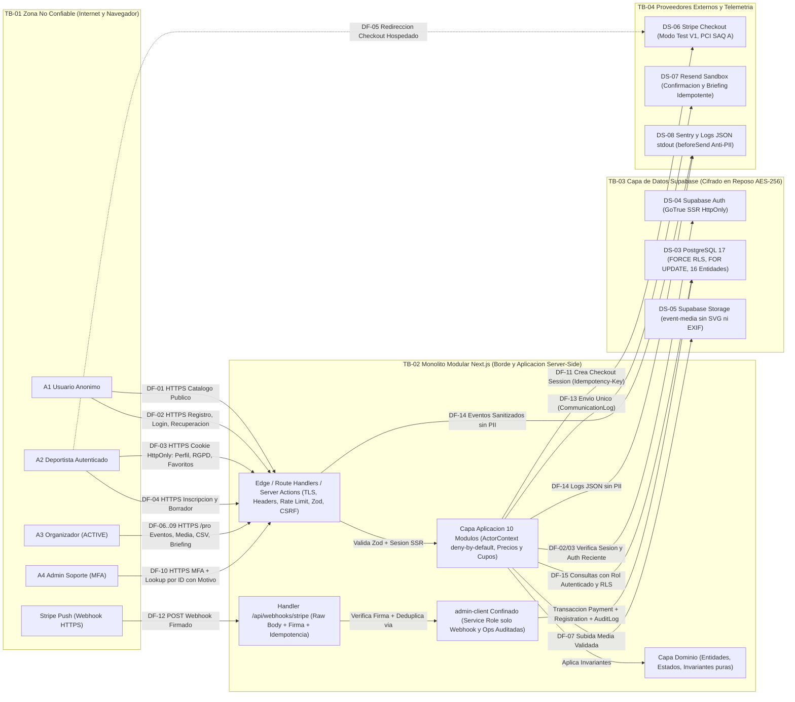

# Mapa de Flujos de Datos, Actores y Fronteras de Confianza

- **Versión:** `1.0` (`P0-006`)
- **Estado:** Entregado para revisión independiente (`auditor-no-funcional`) y verificación `G0` (`release-guardian`)
- **Owner:** `arquitecto-seguridad` (`SEC` / `ARCH`)
- **Fecha UTC:** `2026-11-18T21:48:00Z`
- **Fuentes normativas:** `AGENTS.md`, `MASTER_EXECUTION_PLAN.md` (§7.1–§7.6, §12–§13), `QUALITY_GATES.md` (§6 G0/G3/G5), `.agents/rules/oak-security-data.md`, `docs/brand/BRAND_UX_CONTRACT.md` (§9, §10.4)
- **Coherencia arquitectónica:** Alineado con las propuestas `ADR-001`..`ADR-004` (`P0-003`, pendientes de revisión independiente y cierre de su paquete)

---

## 1. Propósito

Este documento inventaría todos los **actores**, **almacenes de datos**, **integraciones externas** y **fronteras de confianza** de OAK V1, describiendo cada flujo que cruza una frontera de confianza junto con los controles preventivos y de validación exigibles desde diseño (`G0`) hasta despliegue (`G6`/`G7`).

---

## 2. Inventario de Actores (`A1–A6`)

| ID | Actor | Nivel de confianza inicial | Superficies permitidas | Mecanismo de identidad / autenticación |
|---|---|---|---|---|
| **A1** | **Usuario Anónimo (`ANONYMOUS`)** | No confiable (Internet público) | `/`, `/explorar`, `/retos/:eventSlug`, `/entrar`, `/registro`, `/recuperar-acceso` | Ninguno (solo lectura pública de eventos `PUBLISHED` sin PII). |
| **A2** | **Deportista Autenticado (`ATHLETE`)** | No confiable hasta verificar cookie SSR en servidor | A1 + `/inscripciones/**`, `/mis-retos`, `/trayectoria`, `/perfil`, favoritos | Cookie de sesión `HttpOnly`, `Secure`, `SameSite=Lax` (`@supabase/ssr`), verificada en cada petición; re-autenticación `<= 15 min` para exportación/borrado RGPD. |
| **A3** | **Organizador (`ORG_OWNER`, `ORG_MANAGER`, `ORG_VIEWER`)** | No confiable fuera de su organización (`organization_id`) | Workspace `/pro/**` aislado estrictamente a su `OrganizationMembership` con `status = 'ACTIVE'` | Alta únicamente por invitación cerrada (`token SHA-256`, un uso, `72h`); cookie SSR + comprobación de membresía `ACTIVE` y rol por caso de uso. (`INVITED` y `REVOKED` tienen acceso denegado). |
| **A4** | **Administrador / Soporte Mínimo (`ADMIN`)** | Privilegiado sujeto a mínimo privilegio y auditoría | Consola mínima de soporte (`AC-J08-01..04`) | Cookie SSR + **MFA obligatorio** (`§7.6`) + motivo obligatorio en `AuditLog`. Prohibida impersonación silenciosa y prohibida edición manual de pagos/cupos en BD. |
| **A5** | **Proveedores Externos** (`Stripe`, `Supabase`, `Resend`, `Sentry`) | Frontera externa (tráfico de entrada no confiable salvo firma criptográfica) | Webhook `/api/webhooks/stripe` (entrada); APIs salientes HTTPS TLS 1.2+/1.3 | Stripe Webhook autenticado por firma HMAC (`stripe-signature` + raw body); APIs salientes mediante secretos por entorno fuera de Git. |
| **A6** | **Operador DevOps / CI-CD (`SRE`)** | Privilegiado en infraestructura fuera de runtime web | GitHub Actions, Vercel, gestores de secretos, backups/restore | Permisos RBAC en GitHub/Vercel, entornos protegidos y separación estricta `local` / `preview` / `staging` / `producción`. |

---

## 3. Inventario de Almacenes e Integraciones Externas (`DS-01–DS-08`)

| ID | Almacén / Canal | Tecnología / Proveedor | Datos alojados o transmitidos | Clasificación máxima | Regla crítica de aislamiento |
|---|---|---|---|---|---|
| **DS-01** | **Navegador Cliente** | Next.js Client UI | Vistas públicas, formularios validados en curso, cookie opaca `HttpOnly` (no legible por JS) | `PII` en tránsito / rendering autorizado | **Prohibido** almacenar JWTs en `localStorage`/`sessionStorage`; **prohibido** consultar tablas Supabase desde el navegador (`UI -> tablas`). |
| **DS-02** | **Servidor Monolito Modular** | Next.js App Router (Vercel) | `ActorContext`, lógica de negocio en 10 módulos (`§7.2`), recálculo de precios, CSRF/rate-limit, validación Zod | `Secreto` (en RAM/env servidor) + `PII` + `Financiera/Pago` | Validación fail-closed de variables de entorno al arranque; nunca retorna secretos ni PII ajena al cliente. |
| **DS-03** | **PostgreSQL 17** | Supabase Managed DB | Las 16 entidades mínimas (`§7.3`), estados (`§7.4`), `AuditLog` append-only | `PII` + `Financiera/Pago` + `Confidencial` + `Secreto` (hashes) | `FORCE ROW LEVEL SECURITY` en todas las tablas; `SUPABASE_SERVICE_ROLE_KEY` confinada a `admin-client` en servidor. |
| **DS-04** | **Servicio de Identidad** | Supabase Auth (`GoTrue`) | Credenciales, `password_hash`, verificación email, MFA admin, sesiones | `Secreto` + `PII` (`email`) | Integración exclusiva vía servidor (`@supabase/ssr`); respuestas neutras no enumeradoras hacia el cliente. |
| **DS-05** | **Almacenamiento Media** | Supabase Storage (`event-media`) | Imágenes de eventos (`webp`, `avif`, `jpeg`, `png`, `<= 5 MB`) | `Confidencial` (`DRAFT`) / `Pública` (`PUBLISHED`) | **Prohibido SVG subido por usuario**; validación de MIME/tamaño en servidor y eliminación de EXIF. |
| **DS-06** | **Pasarela de Pagos** | Stripe Checkout (**modo `test` en V1**) | Sesión de pago hospedada, importes en céntimos `EUR`, webhooks firmados | `Financiera/Pago` + `Secreto` (`STRIPE_WEBHOOK_SECRET`) | **Cero PAN/CVV en OAK** (PCI SAQ A); claves `sk_live_`/`pk_live_` bloqueadas en arranque mientras `OAK_ENABLE_LIVE_PAYMENTS !== "true"`. |
| **DS-07** | **Correo Transaccional** | Resend (**sandbox en V1**) | Confirmación única de inscripción y briefing de organizador | `PII` transitoria en envío saliente | `CommunicationLog.idempotency_key UNIQUE`; en V1 usa sink/sandbox sin correos reales externos. |
| **DS-08** | **Observabilidad y Logs** | `stdout` JSON + Sentry | Logs estructurados con `correlation_id`, errores y trazas API | `Interna` (**Cero PII / Cero Secreto**) | Hooks `beforeSend` / `beforeSendTransaction` eliminan cabeceras, cookies, firmas, cuerpos y PII. |

---

## 4. Diagrama de Flujos de Datos y Fronteras de Confianza

---

## 5. Fronteras de Confianza (`TB-01–TB-06`) y Controles por Cruce (`DF-01–DF-15`)

### 5.1 Resumen de Fronteras de Confianza

| Frontera | Separación física/lógica | Principio de cruce |
|---|---|---|
| **TB-01** | Navegador / Internet público <-> Borde HTTP de Next.js (`src/app/**`) | Todo dato entrante es hostil; TLS obligatorio; validación de origen CSRF/SameSite; rate limiting; validación estricta Zod. |
| **TB-02** | Capa Presentación (`RSC`/Client) <-> Casos de Uso de Aplicación (`src/modules/*/application`) | Autenticación SSR verificada en servidor; autorización `deny-by-default` sobre `ActorContext`; prohibido cálculo de precios o cupos en cliente. |
| **TB-03** | Aplicación/Infraestructura <-> PostgreSQL 17 (Supabase) | Consultas SQL parametrizadas; `FORCE ROW LEVEL SECURITY` como segunda barrera; `SELECT ... FOR UPDATE` en reservas; `admin-client` confinado. |
| **TB-04** | Servidor <-> Supabase Auth y Storage | Cookies `HttpOnly`/`Secure`/`SameSite=Lax`; invitación con hash SHA-256; subida de media sin SVG, límite `5 MB` y limpieza EXIF. |
| **TB-05** | Servidor <-> Stripe Checkout & Webhook (`/api/webhooks/stripe`) | Modo `test` forzado salvo `D3`; firma HMAC verificada sobre raw body; `Idempotency-Key` saliente y `provider_event_id UNIQUE` entrante. |
| **TB-06** | Servidor -> Resend Sandbox, Sentry y Logs JSON | Idempotencia de envíos en `CommunicationLog`; fallo de correo no revierte pago confirmado; scrubbing total anti-PII y anti-secretos en telemetría. |

### 5.2 Matriz Detallada de Flujos por Cruce de Frontera

| ID Flujo | Frontera | Origen -> Destino | Datos transferidos y clasificación | Controles obligatorios en el cruce |
|---|---|---|---|---|
| **DF-01** | TB-01 / TB-02 | `A1` Anónimo -> `Catalog` -> `PG` | Consultas de búsqueda/filtros (`Interna`), respuesta eventos `PUBLISHED` (`Pública`) | Solo devuelve `Event.status = 'PUBLISHED'`; excluye `DRAFT`, PII de inscritos, correos privados y métricas de organizador; rate limit contra scraping abusivo; cabeceras CSP/`X-Content-Type-Options`/`Referrer-Policy`. |
| **DF-02** | TB-01 / TB-04 | `A1` Anónimo -> `Identity` -> `Supabase Auth` | Credenciales en alta/login/recuperación (`Secreto`, `PII`) | HTTPS TLS; rate limit estricto por IP e identificador (`429`); respuestas **neutras no enumeradoras** en `/entrar`, `/registro`, `/recuperar-acceso`; emisión exclusiva de cookies `HttpOnly`, `Secure`, `SameSite=Lax`. |
| **DF-03** | TB-01 / TB-02 / TB-03 | `A2` Atleta -> `Athlete` / `Catalog` -> `PG` | Perfil (`PII`), `ConsentRecord` (`Interna`), `Favourite` (`Interna`), Export/Borrado RGPD | Cookie SSR verificada; aislamiento estricto `user_id = auth.uid()` en app + RLS; **sesión reciente `auth_time <= 15 min`** para exportación JSON y solicitud de borrado/anonimización (`AC-J03-05`); favoritos idempotentes (`UNIQUE`). |
| **DF-04** | TB-01 / TB-02 / TB-03 | `A2` Atleta -> `Registration` -> `PG` | Selección de modalidad, datos participante (`PII`), cálculo de importe (`Financiera/Pago`) | Recálculo 100% server-side desde `PriceTier` en céntimos `EUR`; campos de precio enviados por el cliente ignorados; reserva atómica de cupo con `SELECT ... FOR UPDATE` en `EventModality`; TTL de borrador/reserva y límite de borradores activos. |
| **DF-05** | TB-01 / TB-05 | `A2` Atleta -> `Stripe Checkout` (hospedado) | Sesión de checkout `cs_test_*` + redirección de retorno | OAK nunca recibe PAN/CVV (`PCI SAQ A`). La URL de retorno (`/inscripciones/:eventId/resultado`) **nunca confirma por sí sola** la inscripción: consulta el estado real en servidor (`Registration`/`Payment`). |
| **DF-06** | TB-01 / TB-02 / TB-03 | `A3` Organizador -> `Organization` / `Organizer Ops` -> `PG` | Aceptación de invitación (`Secreto` SHA-256), CRUD eventos (`Confidencial`), publicación | Token de invitación de un solo uso válido `<= 72h` validado por digest SHA-256; autorización por `organization_id` + `status = 'ACTIVE'` + rol (`ORG_OWNER`/`ORG_MANAGER`, `ORG_VIEWER` solo lectura); checklist server-side obligatorio antes de `PUBLISHED`. |
| **DF-07** | TB-01 / TB-04 | `A3` Organizador -> `Organizer Ops` -> `DS-05 Storage` | Imágenes de evento (`EventMedia`) | Autorización de miembro `ACTIVE` de la organización propietaria; validación server-side de magic bytes + MIME (`webp`/`avif`/`jpeg`/`png`), tamaño `<= 5 MB`, **rechazo explícito de SVG** y eliminación de EXIF. |
| **DF-08** | TB-01 / TB-02 / TB-03 | `A3` Organizador -> `Organizer Ops` -> `PG` | Consulta de participantes (`PII`) y descarga CSV | Aislamiento estricto por `organization_id` (app + RLS); paginación acotada; **neutralización CSV Formula Injection** (prefijo `'` ante `=`, `+`, `-`, `@`, `\t`, `\r`); registro obligatorio en `AuditLog` de cada exportación (`AC-J07-03`). |
| **DF-09** | TB-01 / TB-06 | `A3` Organizador -> `Communications` -> `DS-07 Resend` | Envío de briefing a participantes confirmados (`PII` restringida a destinatarios del evento) | Prohibido para `ORG_VIEWER`; exige preview y confirmación explícita; selección restringida a inscritos confirmados del evento propio; `idempotency_key` por lote/destinatario en `CommunicationLog`; modo sandbox en V1. |
| **DF-10** | TB-01 / TB-02 / TB-03 | `A4` Admin -> Soporte -> `PG` | Lookup puntual por `registration_id` / acción auditada (`Interna`) | **MFA obligatorio** (`§7.6`); `reason` no vacío obligatorio; registro inmutable en `AuditLog`; prohibida búsqueda masiva de PII, prohibida impersonación silenciosa y prohibida alteración directa de `Payment` o cupos (`AC-J08-01..04`). |
| **DF-11** | TB-02 / TB-05 | `Payments` -> `Stripe API` (saliente) | `amount_cents`, `currency = 'EUR'`, `registration_id` en metadata mínima | Bloqueo fail-closed si clave `sk_live_` detectada con `OAK_ENABLE_LIVE_PAYMENTS !== "true"`; `Idempotency-Key` determinista (`reg:<id>:attempt:<n>`); timeout `<= 5s`; sin PII excesiva en metadata enviada a Stripe. |
| **DF-12** | TB-01 / TB-05 / TB-03 | `A5` Stripe -> `/api/webhooks/stripe` -> `admin-client` -> `PG` | Evento webhook (`checkout.session.completed`, `expired`, `charge.refunded`) | Verificación obligatoria de firma HMAC `stripe-signature` con `rawBody` antes de parsear negocio (`400`/`401` ante firma inválida + alerta); `INSERT PaymentWebhookEvent(provider_event_id) ON CONFLICT DO NOTHING`; transiciones monótonas que ignoran eventos *out-of-order* con `200 OK`; payload sanitizado sin PII ni cabeceras. |
| **DF-13** | TB-02 / TB-06 | `Communications` -> `DS-07 Resend` (saliente) | Confirmación única de inscripción / briefing | Deduplicación previa mediante `CommunicationLog.idempotency_key UNIQUE`; timeout `<= 5s`; si Resend falla tras `Payment SUCCEEDED`, la inscripción permanece `CONFIRMED` y el envío queda `FAILED` reintentable sin duplicar envíos previos. |
| **DF-14** | TB-02 / TB-06 | `Audit & Observability` -> `DS-08 Sentry / Logs JSON` | Errores de runtime, trazas API, `correlation_id`, métricas | Scrubbing obligatorio `beforeSend` y `beforeSendTransaction` (elimina `authorization`, `cookie`, `stripe-signature`, cuerpos, emails, nombres, documentos y tokens); degradación no bloqueante si Sentry falla; logs `stdout` validados por allowlist sin PII. |
| **DF-15** | TB-02 / TB-03 | `Infrastructure Repos` <-> `DS-03 PostgreSQL 17` | Consultas de negocio, transacciones `FOR UPDATE`, `AuditLog` | Prohibición de llamadas `UI -> tablas`; consultas parametrizadas anti-SQLi; `FORCE ROW LEVEL SECURITY`; `admin-client` (`SUPABASE_SERVICE_ROLE_KEY`) confinado únicamente a webhook verificado, jobs internos autorizados y operaciones `ADMIN` auditadas. |

